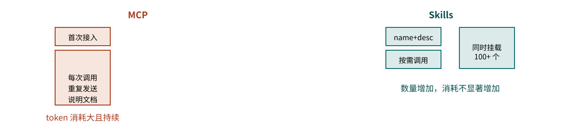

# AI 编程核心能力体系与工程实践

> **1037Solo ▸ AI-Native** · 从“能跑起来的 demo”到“能长期上线维护的系统”，中间隔着耦合设计、任务执行方法论、组件复用、部署常识与格式素养——这是一份补齐这些缺口的实操地图。

<aside-note id="archive-note" kind="callout" title="整理说明">
这篇内容整理自当时在一些社群中的分享（与上一篇《AI 编程发展方向与工程化思维简论》同属一个系列）。现在回看，里面谈到的内容虽然比较浅，但我觉得对刚接触 AI 编程的读者依然有一定参考价值。重新梳理后更新在我的博客中，也代表着自己某一阶段探索与思考的成长留档。
</aside-note>

上篇聊的是方向与思维框架，本篇回到更具体的工程实践层面：探讨为什么复杂项目让人不敢轻易接手、为什么改一个 bug 会冒出三个新 bug，以及那些真正决定项目能不能“长期稳定跑下去”的细节常识。

## 写在前面

上一篇主要聊了 AI 编程的整体方向与工程化思维，这一篇想往回收一收，回到更落地的工程实践层面。从个人阶段性的探索视角出发，难免还有考虑不周的地方，但我想集中探讨一个很具体的问题：<text-mark tone="thesis">如果目标是“从只能做简单 demo，进阶到能独立交付真实项目、对接企业需求并维持长期维护”，到底需要了解哪些工程常识？</text-mark>

这个判断的依据，来自我作为一名基础医学专业的学生，在跨专业的情况下用大半年时间摸索 AI 编程、并在网安与计算机相关企业项目里实际交付成果的经历——同时也是在与不少计算机专业的博硕士学长及一线从业者交流后形成的共识。

对真正做工程交付的人来说，AI 编程本质上是在用你的软件工程认知去指导 AI 做事情——你未必需要亲手敲出每一行代码，但必须知道相关基础设施的存在，也要清楚 AI 每一步具体在做什么。

## 长期维护的底气从哪里来

<aside-note id="chapter-01-practice-map" kind="addon" title="章节导读：认知边界与维护信心">
很多时候不敢接手复杂项目，不是因为缺少某个语法知识，而是不清楚 AI 产物的边界在哪里、上线后会造成什么影响。
- 案例：三端同步应用项目的复杂度失控
- “改一个 bug，冒出三个 bug”是怎么发生的
- 本地没问题、线上出问题，是真实工程的常态
</aside-note>

很多刚接触 AI 编程的开发者，不太敢接手周期长、复杂度高的正式项目。表面原因是“觉得自己技术储备还不够”，更深层的原因其实是：<text-mark tone="thesis" effect="fluorescent">不清楚结合 AI 能做出的系统边界在哪里，不知道代码上线之后会产生什么连锁影响，也不了解背后大体的运行机制</text-mark>。心里没底的时候，人或许可以应付一个周期很短的展示型小项目，却很难对一个需要长期迭代的系统负责——因为正式上线意味着后续大量精力都要投入在稳定性与维护上。

### 一个真实案例：三端同步的应用平台

设想一个规模稍大的项目：一套同时覆盖网页端、移动端与桌面端，且要求三端数据实时同步的应用平台。用 AI 做出一个能演示的早期 demo 并不难，但随着功能越加越多，你会发现即便调用再强的模型，到后期也很难稳定地修复问题。不是模型突然变笨了，而是会真切撞上那句经典的工程老话：<text-mark tone="thesis">修一个 bug，冒出三个新 bug</text-mark>，有时候甚至根本定位不到问题出在哪。本地开发服务器跑起来一切正常，一部署到云端生产环境就报错，这在真实工程实践里是非常普遍的现象。

<aside-note id="source-note-1" kind="callout" title="为什么会“改一个 bug，冒出三个 bug”">
很大概率是因为代码边界不够清晰，许多本该拆分开的职责模块被揉在了同一个文件里，而不是各自独立封装。这正是下一章要讲的核心概念：<text-mark tone="thesis">耦合</text-mark>。
</aside-note>

## 高耦合与低耦合：架构决策的第一课

<aside-note id="chapter-02-practice-map" kind="addon" title="章节导读：牵一发动全身的根源">
牵一发而动全身的代码，本质上都是同一个问题：该分开的职责被混在了一起。
- 高耦合：一个功能出错，全项目受牵连
- 低耦合：模块拆分清晰，改动范围可控
- 架构决策能力 = 专业知识 + 大量实战经验
</aside-note>

假设一个软件有 A、B、C 三个功能，理想情况下应该分别放在职责清晰的独立模块里，让开发者和 AI 都能明确知道“哪部分代码对应哪个功能”。但如果不加约束地让 AI 直接生成代码，它很容易把三者的状态和逻辑堆在同一个地方；于是当你改动其中一个功能时，另外两个功能可能就跟着报错了。这种代码状态就是<text-mark tone="thesis">高耦合</text-mark>——可维护性极低，任何小改动都会“牵一发而动全身”。

<svg-embed id="source-diagram-02" src="./media/svg/source-diagram-02.svg" title="高耦合与低耦合结构对比" />

想象一个成熟软件往往包含成百上千个细分功能。如果功能之间随意交织混杂，想要定位“某个功能对应哪些代码、修改它会波及什么范围”就会极其费劲，甚至会出现“明知这里有个小缺陷，但只要一动它整个系统就会崩溃”的窘境。这不是危言耸听，而是无数真实项目缺乏架构约束后的共同归宿。

<compare-block id="coupling-comparison" title="高耦合 vs 低耦合的工程表现">
<compare-side role="bad" title="高耦合（改一处全线受牵连）">
- 模块边界混杂，状态与逻辑相互交织
- 修改功能 A 时，功能 B 和 C 意外报错
- 排查与定位问题极其艰难，代码越改越乱
</compare-side>
<compare-side role="good" title="低耦合（模块独立改动受控）">
- 单一职责，各模块独立拆分与封装
- 接口定义清晰，局部改动不波及外部系统
- 结构清晰，非常利于人机协同与针对性单点调试
</compare-side>
</compare-block>

<inset-card id="source-card-1" title="低耦合的几条基本要求" eyebrow="核心指标" kicker="COUPLING CRITERIA">
<html-embed id="coupling-switchboard" src="./embeds/coupling-switchboard/index.html" title="点选功能：观察耦合的影响范围" height="580">
点选 A、B、C 并切换高低耦合，观察这个简化例子中的潜在改动范围；不是对真实项目的自动诊断。
</html-embed>

- 代码高复用，不写重复逻辑
- 避免无效冗余代码
- 结构清晰，利于后期维护
- 模块拆分明确、职责单一
- 单文件体量适度，不宜过长
</inset-card>

<inset-card id="source-card-2" title="为什么要用专业术语和文档跟 AI 沟通" eyebrow="规范沉淀" kicker="SPEC DRIVEN">
上面这几条工程要求，如果每次都在对话框里用零散的口语去临时叮嘱，很容易在多轮对话后被模型遗忘。更稳妥的做法是把整个项目的架构规范沉淀成文档（如 `AGENTS.md`），让 AI 每次会话都能同步读取——这就是“文档驱动开发”的起点。
</inset-card>

### 架构决策：一种需要专业知识与实战经验共同支撑的能力

真正能做好架构决策，意味着能把一个完整的系统方案——无论是业务流程方案还是软件工程方案——在动手写代码之前就想清楚核心细节：模块怎么划分边界、数据怎么流转、不同阶段怎么分步推进，最终落成一份可执行的设计文档。这项能力既需要理论知识，更离不开真实项目的反复锤炼；入门阶段往往靠踩坑积累直觉，往深处走则一定是专业知识与实战经验的结合。

<svg-embed id="source-diagram-03" src="./media/svg/source-diagram-03.svg" title="架构决策能力金字塔" />

## 目标模式与渐进模式

<aside-note id="chapter-03-practice-map" kind="addon" title="章节导读：两种人机协作心态">
把一个模糊需求直接丢给 AI 长时间自主推进，看似省事，往往是失控的开始。
- 芝诺乌龟式的任务无限拆分陷阱
- 重型 Harness 过度执行的真实案例
- 渐进模式：小步快跑、每步验收
</aside-note>

在实际开发中有一套效率很高的协作方式：先花几个小时和最强的模型深入讨论，把最初模糊的想法一步步收敛清楚，拆解成几十上百条边界明确的具体任务；然后再开启工具的“目标模式”（或 Plan / Auto 模式），交由性价比更高的模型按计划推进。但这套工作流能跑通有一个绝对前提：<text-mark tone="thesis">前期必须先把模糊的自然语言需求，转译成清晰、无歧义的工程计划</text-mark>——在规范的团队里，这一步对应的产出就是 PRD（产品需求文档）与技术设计文档。

<aside-note id="source-note-2" kind="warn" title="目标模式最容易踩的坑：无限拆分">
如果没有清晰的分阶段验收标准，AI 在自主推进复杂任务时很容易表现得像“芝诺的乌龟”——总觉得自己离最终目标还差一点，于是不断把子任务继续往细里拆。一个本该分十步走完的功能，由于前期步子迈得太大、缺乏中间校验，边做边改、边改边拆，不断累积技术债，越到后期越容易全盘混乱。连续跑了一两天却拿不出一个能稳定运行的切面，往往就是目标模式失去边界控制的典型信号。
</aside-note>

<svg-embed id="source-diagram-05" src="./media/svg/source-diagram-05.svg" title="目标模式失控路径与渐进模式推进对比" />

### 案例：重型 harness 把“改一个字”变成大工程

使用具备重型 harness（如 Codex 等智能体工具）时，经常会遇到一个很有代表性的现象：哪怕你的需求简单到只是修改页面上的一个错别字，它也不会直接改完结束——它会先检查 Git 工作区状态，接着分析需求、列出执行步骤、编写或更新测试、运行测试套件，甚至启动浏览器截图做视觉验证……一整套标准流程走下来，原本几十秒就能改完的小事，被拉长到了十几分钟。

```text
# 一个“改一个字”任务，在重型 harness 下的典型执行链路
1. 检查 Git 状态与分支信息
2. 分析需求上下文、列出执行计划
3. 查找或编写相关测试文件（如 test.ts）
4. 运行测试套件，确认通过
5. 启动开发服务器并打开浏览器截图验证
# 而在简单场景下，实际只需要：Ctrl+F 定位文字 → 直接修改 → 保存
```

<aside-note id="source-note-3" kind="addon" title="延伸补充：这不是工具的缺陷，而是任务分级的问题">
当还不熟悉智能体工具的运行机制时，很容易走向两个极端：要么无论大小事都放任重型 Agent 走完整套长流程，白白消耗时间与 Token；要么因为嫌流程繁琐，干脆在提示词里把 Git 版本控制、自动化测试这些关键护栏全部关掉——后者的代价往往大得多。面对“改一个文案字眼”这类极小任务，在 IDE 里用全局搜索顺手改掉，往往比启动一轮完整的 Agent 循环高效得多。
</aside-note>

## 新手最容易掉进的坑

<aside-note id="chapter-04-practice-map" kind="addon" title="章节导读：避开三类隐蔽陷阱">
把暂时不懂的工程护栏直接关掉，看似省心，实际上切断了自己继续进阶的通道。
- 陷阱一：把不理解的机制直接关掉
- 陷阱二：对 AI 输出缺乏求证习惯
- 陷阱三：把“能跑通”误当成“已精通”
</aside-note>

### 陷阱一：把不懂的东西直接关掉，等于切断学习通道

回顾自己刚接触 AI 编程时的一个真实误区：最早做网页时，我曾以为所有网站都应该写成“一个 HTML 文件内嵌全部样式与脚本”，不仅把本该拆分的模块强行揉在一起，还在提示词里要求 AI 必须按这种单文件方式输出。结果 AI 只能顺着这个错误的约束不断堆砌代码，项目很快陷入改不动的状态，自己的认知也因此停留在原地。

<aside-note id="source-note-4" kind="warn" title="更隐蔽的一种表现：绕开工程规范">
初次接触 Git、Skills、MCP 或工程化目录结构时，如果因为“看着陌生、暂时嫌麻烦”就直接要求 AI 绕开或禁用它们，表面上看项目好像“变简单了”，实际上却把通往真实软件工程的学习入口全部堵死了。遇到不熟悉的工程规范时，先顺着问一句“它为什么存在、解决什么问题”，远比退回单文件 HTML 的舒适区更有价值。
</aside-note>

### 陷阱二：对 AI 输出缺乏求证的习惯

另一个需要时刻自我提醒的习惯是：永远不要默认 AI 输出的每一句话、每一段代码都是绝对正确的。大模型本质上是基于概率的生成系统，即便是看起来条理清晰、甚至附带了检索来源的回答，在涉及关键技术选型、安全边界或学术事实时，依然需要保留一份求证与交叉核实的习惯。

### 陷阱三：把“能用 AI 做出来”当成“自己已经懂了”

当借助 AI 顺利交付了几个项目之后，人很容易在不知不觉中产生一种过度自信，觉得大多数需求都不在话下，进而对没接触过的技术栈产生本能的轻视或排斥。但实际上，即便已经做过不少应用，知识版图里依然会存在大片“自以为知道、实则一知半解”的盲区，需要时常保持警觉与谦逊。

<aside-note id="source-note-5" kind="callout" title="一次小型移动端需求带来的反思">
有一次接触到一个功能非常简单的原生移动端小工具需求（只是一个基础的指标计算与硬件指令交互）。真正动手去查资料时才意识到，自己此前对原生 Android 开发从 Java 到 Kotlin 的演进、SDK 封装方式以及物联网控制指令的打包流程其实非常陌生——这些都是过去因为“待在 Web 技术栈舒适区”而未曾认真了解的领域。那次经历最大的收获，就是重新提醒自己：“保持技术广度与开放心态”不能只停留在口头上。
</aside-note>

<aside-note id="source-note-6" kind="callout" title="四个阶段的真实跨度">
“听说过 AI 编程”、“能用 AI 做个自用的小玩具”、“能用 AI 做出可交付给他人使用的作品”、“能用 AI 做出可上生产环境并长期稳定维护的系统”——这四个阶段之间的跨度，远比表面听起来大得多。
</aside-note>

## 组件库与 SDK：复用是工程的本质

<aside-note id="chapter-05-map" kind="addon" title="这一章先看四个切面">
- **从零手写 vs 引入库**：5~7 万行与几百行的差别
- **SDK 封装**：把复杂通信变成简单接口
- **从零手写是最大的浪费**：不要重造已被验证的轮子
- **Skills 相比 MCP 的消耗优势**：按需调用、轻量挂载
</aside-note>

一个非常有代表性的反面案例：从零开始做一个博客网站，初学者很常见的推进方式是——先让 AI 写一套 Markdown 渲染，再让 AI 手写图片预览，接着手写思维导图、手写评论区、手写登录逻辑……每新增一篇文章或一个板块，都让 AI 重新生成一整套页面代码。最后往往会得到一个令人哭笑不得的结果：十篇内容不同的文章页面，背后竟然躺着十份各自独立的渲染代码，不同页面里的弹窗样式和交互细节还各不相同——一个本该很精简的个人博客，硬生生堆出了五六万行重复代码。

<svg-embed id="source-diagram-09" src="./media/svg/source-diagram-09.svg" title="手写堆砌 vs 引入组件库的代码量对比" />

问题的根源在于不知道“这些通用能力早就有成熟的开源方案”。格式化文本渲染、评论系统、登录鉴权、富文本与协同编辑，在开源社区里几乎都有经过充分验证的组件库或 SDK：<text-mark tone="thesis">把成熟的组件库引入项目、按规范组合调用</text-mark>，往往几百行胶水代码就能实现原本手写上万行还漏洞百出的功能。一旦建立起“通用能力优先复用成熟库、核心业务逻辑再自研”的习惯，复用带来的收益就不只是代码量减少，更在于架构的演进——当内容引擎搭好之后，后续新增一篇文章，只需要新建一个存放 Markdown 与素材的目录，无需再改动任何一行框架代码。

<aside-note id="source-note-7" kind="callout" title="站在成熟开源项目与组件库的肩膀上">
在实际工程中，许多业务需求完全可以建立在成熟开源项目或组件库的基础上做定制与集成。虽然深度定制时需要遵守上游框架的约束，但用更少的代码量、更高的确定性去完成通用底座，能把宝贵的精力留给真正体现产品差异化的核心业务。
</aside-note>

### MCP 与 Skills：同样是“能力扩展”，上下文成本差异明显

如果进一步观察 Agent 工具链的演进会发现，<text-mark tone="thesis">并不是所有场景都适合直接堆砌大量 MCP</text-mark>，越来越多工程实践开始采用“按需加载的 Skills + CLI 工具”组合。原因在于部分 MCP 的加载机制：每次建立会话时，往往需要先把所有已挂载工具的完整 Schema 与说明文档一并注入上下文，当挂载的服务较多时，还没开始干活就已经消耗了相当可观的 Token。



相比之下，Skills 采用的是“渐进式披露”的设计：平时只向模型暴露轻量的 `name` 和 `description` 字段，模型通过简短描述判断当前任务是否需要某个 Skill，只有在真正命中时才去读取完整的指导文档。理解这一层机制后就会明白，为什么合理组织的 Skills 体系即使扩展到几十上百个，也不会让基础上下文膨胀失控。

<aside-note id="source-note-8" kind="addon" title="延伸补充：看懂这一层，就摸到了设计轻量 Agent 工具的入口">
一旦理解 Agent 的核心运行循环其实就是“系统提示词约束 + 按需工具调用”（工具可以是检索、读写文件、执行终端命令或加载特定 Skill），开发一款垂直场景的轻量 Agent 小工具，门槛其实比想象中清晰得多。
</aside-note>

## 版本管理与协作

<aside-note id="chapter-06-practice-map" kind="addon" title="章节导读：工程化协作的生命线">
没有 Git，AI 就没有可以对比、可以回退的“历史坐标”。
- Commit / Branch / Merge 的基本规范
- Git 与 GitHub 的协作关系
- 为什么“没保存”与“缓存未刷新”是最常遇到的排查盲区
</aside-note>

在进入稍复杂的项目前，一定要把版本管理的基础概念补齐：Git 与 GitHub 各自是什么关系，什么是一次提交（commit）以及为什么要写清楚提交说明，为什么要切出独立分支（branch）开发新功能，以及合并分支（merge / Pull Request）的基本流程。

<aside-note id="source-note-9" kind="callout" title="为什么“不用 Git”会让 AI 协作越用越乱">
AI 编程工具在判断“刚刚改了哪些代码、哪一步引入了报错”时，高度依赖 Git 的提交历史与差异对比（diff）。如果不使用 Git，所有改动直接覆盖在工作区里，一旦某轮修改跑偏，不仅人很难找回半小时前还能正常运行的快照，AI 也失去了回溯对比的锚点。大模型的上下文窗口并不是无限的永久记忆，Git 的每一次干净提交，本质上都是在为人机协作留下可靠的存档点。
</aside-note>

### 两个看似简单、实则高频踩中的“排查冷笑话”

现代前端框架的热更新（HMR）非常方便，往往改完代码页面就自动刷新了，这反而容易让人在排查问题时忽略两个最基础的动作：第一，文件其实还没有保存；第二，文件虽然保存了，但浏览器或构建缓存里还残留着旧产物，导致页面看起来毫无变化。遇到“改了代码却完全没生效”时，不妨先试试<text-mark tone="thesis">强制刷新与清理缓存</text-mark>：

- <text-mark tone="note" effect="kbd">Ctrl + F5</text-mark>：常规强制刷新。
- <text-mark tone="note" effect="kbd">Ctrl + Shift + R</text-mark>：清空缓存并强制刷新（或打开浏览器无痕窗口对照终端构建日志排查）。

同样地，如果是需要预构建或静态导出的项目，修改源码后还需要重新执行构建命令，生成最新的产物文件：

```bash
# 打包构建产物（实际执行时请以项目 package.json 与锁文件约定的包管理器为准）
npm run build  # 或 pnpm build / bun run build
```

## 部署与生产环境常识

<aside-note id="chapter-07-practice-map" kind="addon" title="章节导读：生产环境与稳定性底线">
本地开发环境能跑通，不等于生产环境万无一失；数据隔离与稳定性，是正式上线绕不开的功课。
- 域名 / DNS / SSL 证书 / 端口 / 进程守护
- 绝对路径与相对路径的陷阱
- 数据隔离、并发与线上稳定性
</aside-note>

在自己电脑上写完代码跑起来，只是运行在<text-mark tone="thesis">本地开发环境</text-mark>；而真正部署到服务器或托管平台上供外部用户访问，则是<text-mark tone="thesis">生产环境</text-mark>。两者的网络条件、环境变量、权限边界往往存在显著差异，很多隐藏问题（例如未捕获的异常边界、跨域与证书配置）只有在生产环境下才会暴露。一个非常典型的初学者错误，是在代码里硬编码了只在本机电脑上存在的<text-mark tone="thesis">本地绝对路径</text-mark>（如 `C:\Users\...`）——一旦代码部署到云端 Linux 容器或边缘节点上，这些路径就会立刻失效；因此在工程中应当始终使用相对于项目根目录的<text-mark tone="thesis">相对路径</text-mark>或环境变量配置。

<inset-card id="source-card-3" title="部署前要搞懂的几个词" eyebrow="核心概念" kicker="DEPLOYMENT CONCEPTS">
- **域名**与 **IP** 如何绑定
- **SSL 证书**：为什么网站需要它
- **端口**：本地与线上分别怎么用
- **pm2**：守护进程，保证服务不掉线
</inset-card>

<inset-card id="source-card-4" title="README.md 为什么重要" eyebrow="工程规范" kicker="DOCUMENTATION">
打开任何一个规范的开源项目，根目录下的 `README.md` 都会写明该项目所需的运行环境（如 Node.js 版本）、包管理器安装指令以及启动步骤——这是接手和复现任何陌生工程的第一站。
</inset-card>

<aside-note id="source-note-10" kind="warn" title="正式上线最容易被低估的维度：数据隔离与安全性">
当项目从个人玩具走向多用户使用的线上系统时，除了功能跑通之外，<text-mark tone="thesis">用户间的数据隔离（如权限校验与行级安全策略）、并发请求处理、服务异常恢复</text-mark>是必须严肃对待的工程底线。其中数据隔离与权限控制尤其容易被初学者忽略，却直接关系到线上系统的安全红线。
</aside-note>

## 格式与工具素养

<aside-note id="chapter-08-practice-map" kind="addon" title="章节导读：人机协作的通用语言">
JSON、XML、Markdown、SVG——这四种基础格式，是与大模型及现代开发工具打交道时的通用语言。
- 四种基础文本格式的各自定位
- LaTeX：学术与科技排版为什么离不开它
- 看懂结构化格式，才能高效验收 AI 产出
</aside-note>

在日常与 AI 协作中，有四种基础文本格式非常值得花一点时间摸清各自的定位：<text-mark tone="thesis">JSON</text-mark>、<text-mark tone="thesis">XML</text-mark>、<text-mark tone="thesis">Markdown</text-mark> 与 <text-mark tone="thesis">SVG</text-mark>。它们本质上都是纯文本，却分别承担着结构化数据交换、层级标记、富文本排版与矢量图形描述的角色。理解它们的基本结构后，我们对“AI 到底在输入输出什么”会有清晰得多的掌控力：

- **JSON**：结构化数据交换与配置，前后端接口与模型结构化输出的通用载体。
- **XML**：语义标签与层级数据描述，工具调用协议与组件约定的常见形态。
- **Markdown**：轻量级结构化排版语法，人机协作、文档沉淀与内容引擎的标准底座。
- **SVG**：可编程的矢量图形描述，直接用代码绘制高保真架构图与图表。

### LaTeX：为什么理工与学术排版离不开它

在撰写学术论文、技术报告或包含大量数学公式的文档时，LaTeX（以及网页端的 KaTeX / MathJax）几乎是绕不开的标准工具。如果只用传统富文本字处理软件配合插件去逐个手动调整公式字号与间距，不仅繁琐易乱，也很难让 AI 直接批量生成和修改；而采用 LaTeX 语法描述公式与排版结构，因为本身就是纯文本代码，天然适合大模型直接生成、审校与网页端高性能渲染。<text-mark tone="thesis" effect="fluorescent">对经常接触理工科或医学文献的学生与创作者来说，花半天时间了解 LaTeX 的基础语法，回报率极高</text-mark>。

## Agent 的本质：提示词与工具调用

<aside-note id="chapter-09-practice-map" kind="addon" title="章节导读：智能体的底层骨架">
看懂“提示词约束 + 工具调用循环”这一层，智能体应用就不再是一个神秘的黑盒。
- Agent = 系统提示词 + 可调用的工具集合
- 苏格拉底式追问：最高效的自学姿势
- 遇到陌生概念顺手追问，就是拓宽技术地图的过程
</aside-note>

顺着前面 Skills 与格式素养的脉络往下看，我们会发现大模型调用外部能力的方式其实高度统一——无论是联网搜索、读写代码文件、执行终端命令，还是按需加载一份 Skill 文档，在底层都可以归结为“工具调用（Tool Use）”。一旦理解了模型如何输出结构化的工具请求、外部程序如何执行并把结果回填进上下文，就会看清 <text-mark tone="thesis">Agent 的核心骨架其实就是“提示词工程 + 工具调用循环”</text-mark>。剥开神秘的包装之后，我们自己动手设计或调试一套轻量智能体工作流也就有了清晰的抓手。

<aside-note id="source-note-11" kind="callout" title="苏格拉底式追问：一种通用的工程自学法">
遇到陌生的技术概念或报错信息时，不要急着绕过去，而是顺着向 AI 追问：“它是什么？解决什么问题？如果不用它会怎样？在我当前的项目里对应哪一部分？”把这种层层拆解的追问变成习惯，很多原本显得晦涩的工程术语都会迅速变得具体可感。
</aside-note>

<aside-note id="source-note-12" kind="callout" title="关于完整开发流程的一点小结">
先梳理需求与交互原型，明确架构边界与技术栈，再进入渐进式开发；在开发过程中遇到任何新概念，第一反应是把它当作扩展技术地图的契机顺手弄懂，而不是直接关掉护栏。知识广度不需要一天之内全部背熟，但每一次“顺手问明白一个概念”，都是在为下一个更复杂的项目积累底气。
</aside-note>

## 尾声：十二条最值得带走的结论

从“能跑起来的 demo”到“能长期维护的系统”，中间最关键的工程台阶基本都浓缩在这十二条里：

- **01 边界感**：敢不敢接手复杂长期项目，取决于是否清楚 AI 的能力边界与代码上线后的影响面。
- **02 耦合**：改一个 bug 冒出三个新 bug，根源往往是本该独立的模块被混写在了同一个地方。
- **03 架构决策**：架构能力由专业知识与实战经验共同支撑，真实项目的踩坑复盘占极大权重。
- **04 渐进优于冒进**：目标模式必须建立在清晰的任务拆解与分块验收之上，否则极易陷入无限拆分。
- **05 执行分级**：改一个错别字这样的小事，不必动用重型 Agent 跑完一整套长流程。
- **06 别切断学习通道**：把不熟悉的 Git、测试或工程规范直接关掉看似省事，代价是失去了进阶的入口。
- **07 求证习惯**：大模型的输出并非字字正确，对关键技术方案与事实始终保留交叉核实的习惯。
- **08 复用是本质**：善用成熟组件库与 SDK，能把几万行脆弱的手写代码收敛为几百行可靠的集成。
- **09 MCP vs Skills**：Skills 借助简短描述按需加载上下文，在扩展大量能力时比全量常驻更省 Token。
- **10 没有 Git 就没有历史坐标**：AI 依赖版本差异对比来追踪改动，规范的提交是人机协作不迷路的前提。
- **11 生产环境不是本地环境**：路径规范、数据隔离、并发与异常恢复，是项目正式上线前必须补齐的功课。
- **12 Agent 不神秘**：核心骨架是提示词约束加工具调用循环，看穿这一层就能从容地使用和构建它。

## 附录：给 AI 的说明书

这段提示词的作用：让 AI 结合《AI 编程发展方向与工程化思维简论》（上篇）与《AI 编程核心能力体系与工程实践》（下篇）的核心脉络，用 <text-mark tone="thesis">ELI5</text-mark>（Explain Like I'm 5，像给零基础读者做启蒙一样）的方式重新梳理一遍关键工程概念，并在讲解过程中主动联想适合练手的小项目；如果你手头正在推进自己的项目，也可以把这段提示词连同项目结构一起发给 AI，让它给出分步骤的优化建议。

```text
# 角色设定
你是一位经验丰富、极其擅长把复杂软件工程概念讲给初学者听的技术导师。
接下来我会向你提供《AI 编程发展方向与工程化思维简论》（上篇）与
《AI 编程核心能力体系与工程实践》（下篇）的核心内容或我的项目代码。

# 你的任务
1. 完整读取并理解这两篇内容的核心逻辑：广度优先于单点深度、可迁移的软件
工程方法论、耦合与架构决策、目标模式与渐进模式、组件库复用、
版本管理、部署与生产环境常识、格式素养、Agent 的本质。
2. 用 ELI5 的方式，面向"零基础、刚开始用 AI 写代码"的读者，
把文中每一个核心概念重新讲一遍：
- 先给一个生活化的类比，再落回软件工程本身；
- 每讲完一个概念，追加一句"这在实际项目里意味着什么"；
- 避免堆砌术语，术语第一次出现时用一句话解释清楚。
3. 在讲解每一章内容后，联想并简要给出 1~2 个"可以直接上手练习"
的小项目建议（例如：一个带 Markdown 渲染的个人博客、一个调用
现成组件库的简易待办或笔记工具等），说明这个练习具体锻炼了文中
哪一项工程能力。
4. 如果用户在这段提示词之外，额外上传了自己的项目文件或代码库：
请结合文中的方法论（尤其是低耦合、组件复用、Git 版本管理、渐进式任务
拆分四点），分析该项目当前的结构问题，并给出具体的、分步骤的
改进建议，而不是泛泛而谈。

# 输出要求
- 全程使用清晰、平实、循序渐进的中文表达；
- 遇到文中提到但未展开的术语，可以补充你自己的解释，但需要明确
标注"（这是补充说明，原文未展开）"；
- 结构上按照原文章节顺序讲解，不要打乱逻辑顺序；
- 如果用户追问某一章节的细节，允许脱离 ELI5 风格，转为更专业、
更深入的工程讲解。
-- 使用方式：将本段提示词与文章内容（或你的项目目录结构）一并提供给支持长上下文的 AI 模型 --
```

<aside-note id="source-note-13" kind="callout" title="关于这份附录的说明">
这段提示词不是为了替代阅读本身，而是给读完之后觉得某些工程概念还有些抽象的读者，提供一条边问边练的互动路径——尤其适合刚开始接触全栈开发的初学者，或者想把文中思路套用到自己手头具体项目上的读者。
</aside-note>
