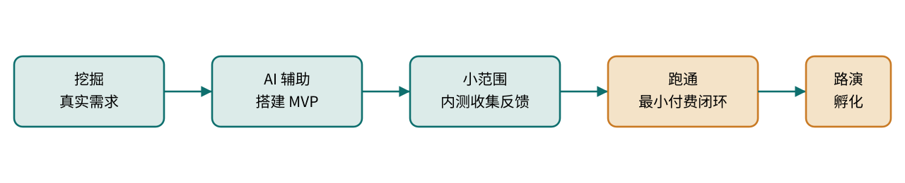

# AI 编程发展方向与工程化思维简论

<aside-note id="archive-note" kind="callout" title="整理说明">
这篇内容整理自当时在一些社群中的分享。现在回看，里面谈到的内容虽然比较浅，但我觉得对刚接触 AI 编程的读者依然有一定参考价值。重新梳理后更新在我的博客中，也代表着自己某一阶段探索与思考的成长留档。
</aside-note>

卷一 · 上篇

AI 编程发展方向与工程化思维简论

一份来自一线实践的思考整理：为什么"只做前端页面"走不远，
为什么知识广度比单点深度更早决定天花板，以及一个非科班学生如何用一年时间，
把 AI 编程沉淀为可以对接真实项目的工程能力。

整理自 1037Solo（羽升）早期语音分享
《AI 编程发展方向与工程化思维简论》

1037Solo ▸ AI-Native

CONTENTS · 上篇目录

本篇面向刚接触 AI 编程、或正在摸索独立开发与项目交付方向的读者，核心聊一件事：

在"把代码跑起来"之上，还有"广度""方法论""产品化"三层台阶，它们才是决定我们能走多远的关键。

序 写在前面 实践背景与问题意识的起点 05

01 深度不是终点 初学者普遍存在的"广度缺口"，以及为什么它比单点技法更重要 07

02 同质化的方法论 语言学不完，但底层的软件工程思维可以迁移到任何板块 11

03 从中转站到产品 OPC 式独立开发者路径：需求挖掘、MVP、内测、商业闭环 15

04 UI 与 UX 不是一回事 前端好看只是及格线，交互顺不顺手才是产品的命门 21

05 绕不开的基础设施常识 域名、DNS、证书、部署——独立开发绕不开的最小词汇表 25

06 模型不是越贵越好 用经验换成本：定位准确时，高性价比模型同样能打 29

07 从编码到软件工程 先学会统筹架构，再学会深潜细节；操作系统与算法导论的位置 33

终 尾声与精华提炼 本篇十条最值得带走的结论 37

## 写在前面 PREFACE

这是一份由早期语音记录整理而成的手记，核心想探讨一个在 AI 辅助开发浪潮中越来越普遍的现象：当许多人尝试用 <text-mark tone="thesis">AI 编程</text-mark> 去做个人项目或承接外部开发需求时，为什么往往很快就会撞上天花板？这些观察来自我这一年多从零摸索全栈开发的切身体会，希望能把踩过的坑和沉淀下来的思考客观地记录下来。

在展开具体讨论之前，先简单交代一下自己的实践背景。把这段经历摆在前面，是为了给后面的判断提供一个清晰的"视角坐标"——让读者知道这些体会是在什么样的项目强度和实践场景下得出的，从而结合自己的实际情况去取舍。

投入强度

接触 AI 编程约一年时间；在近半年的密集开发期里，几乎每天都保持着高强度的人机协同开发与项目迭代。

企业合作

与两家企业保持深度合作，完整参与并交付过多个 AI 智能体与全栈方向的应用项目。

赛事历练

国内大型黑客松极限赛道三等奖（连续多日高强度推进完整产品原型）；

全国大学生计算机应用能力大赛 AIGC 创新赛省级二等奖；

华中科技大学校级智能体大赛：作为基础医学专业的非科班学生，带队获得决赛三等奖。

<aside-note id="source-note-1" kind="callout">

为什么要交代这些背景

这里并不是想把个人履历当作标准答案，而是想说明：下文提到的许多瓶颈与误区，并非纸面推演，而是从非科班视角一路踩坑、交付真实项目之后回头看到的共性问题。每位读者的技术背景和目标不同，带着这份上下文去审视和对照，比单纯看结论更有意义。
</aside-note>

<aside-note id="source-note-2" kind="addon">
延伸补充

关于"交代视角坐标"的习惯

在工程与技术复盘里，先说明"观察者处在什么位置、经历过什么规模的项目"，能帮助读者更准确地判断哪些经验可以直接复用，哪些结论需要结合自身场景做调整。
</aside-note>

01

Chapter 01 · Breadth Over Depth

深度不是终点
广度才是护城河

初学者常见的问题往往不是"某个知识点钻得不够深"，而是对整个技术版图的宽度缺乏认知——容易把自己局限在单页前端上。

为什么"做一套系统"比"做一张图"复杂得多

计算机是当代最庞大的学科集群之一

前端页面只是技术版图里很小的一角

## 深度不是终点，广度才是护城河

先说一个核心观察：<text-mark tone="thesis" effect="fluorescent">在 AI 辅助开发阶段，很多初学者卡住的地方不是某个单点钻研得不够深，而是对整个技术版图的广度缺乏基本认知</text-mark>。这句话需要拆开来看：做 AI 应用开发，未必需要在某一个底层技术点上立刻钻研到极致，但必须对整个软件工程的版图宽度有基本的概念。

身边不少朋友在接触 AI 时，往往是从文案创作、AI 生图、AI 视频或者制作精致的前端展示页切入的。这些方向在各自领域都能做出非常惊艳的作品，视觉反馈也很直接。但当我们真正跨入 <text-mark tone="thesis">AI 软件开发与工程交付</text-mark> 这一步时，面临的挑战会发生本质变化——这里考验的不再只是"能不能生成一段代码或一个好看的页面"，而是对"所有数字基础设施本质上都是软件与代码"这件事有没有全局认知。

### 为什么生图/生视频的"变化维度"不同于软件工程

AI 生图或生视频，核心产出物是一张图或一段视频——构图、光影、镜头语言当然有很多门道，但它的交付形态始终是相对聚焦的。而软件系统与代码则不同：手机里的应用是代码，硬件控制底层离不开代码，各类云服务平台、SaaS 工具、第三方 API 接口，乃至校园网系统、飞书这类协同办公软件，追根溯源全都是"软件工程"的不同切面。对应到高校学科体系上，这背后支撑着计算机科学、软件工程、网络安全等一整个庞大的学科集群，技术链条的长度与复杂度要高出一个数量级。

<svg-embed id="source-diagram-02" src="./media/svg/source-diagram-02.svg" title="原稿图示 02" />

图 1-1　"聚焦型产出"与"计算机学科集群"的规模对比示意

### 真正有技术含量的，是同质化的方法论

世界上的编程语言和框架太多了，没有人能全部学完。真正重要的不是死磕某一门语言的语法细节，而是通过学习一门语言（比如 Python 或 TypeScript），提炼出一套<text-mark tone="thesis">偏软件工程的通用思维</text-mark>：错误处理怎么做、高并发压力怎么应对、模块边界怎么划分——这些是所有软件系统都会遇到的经典问题。换一门语言或换一个框架时，我们未必能手写每一行语法，但要知道该怎么去引导和指挥 AI 完成设计——这本身就是一套可复用的方法论。包括大模型应用本身，底层同样遵循代码与计算的工程规律，很多认知是可以"归一化"迁移的。

<aside-note id="source-note-3" kind="callout">

一句话结论

不要把自己局限在"前端单页 HTML"上。前端界面只是软件系统的一个切面；如果想真正独立做出完整可用的产品，"能把同一套工程方法论迁移到不同技术板块"的能力，才是最核心、最不能绕过去的基础。
</aside-note>

02

Chapter 02 · Transferable Methodology

同质化的方法论
比任何一门语言都重要

工期估算、模型选择、判断 AI 能力边界——这些能力一旦形成，就能跨语言、跨项目复用。

知其然：先看清全流程长什么样

交付有底气，来自对边界的清晰认知

软件工程思维先于具体编码技巧

## 同质化的方法论比语言更重要

放到真实的项目开发或需求交付场景中，一个很现实的衡量标准是：面对不同类型的需求，我们对相关技术领域是否<text-mark tone="thesis">有所涉猎</text-mark>——至少听说过核心概念的名字，知道它在系统里大概承担什么角色，哪怕暂时还不理解最底层的实现原理。了解的版图越宽，就越清楚 AI 能干什么、能力边界在哪里，也就越有底气去验收 AI 产出的代码，越能准确评估一个项目的开发周期、时间投入以及该搭配什么档位的模型。

AI 是一个杠杆——哪怕你暂时还没有完全吃透某个底层实现，只要你能准确叫出那个技术概念的名字、清楚它解决什么问题，把这些概念合理地组合在一起交给 AI，AI 就能沿着专业的工程方向把它实现出来。
实践体会

### 不要只停留在做一个前端页面

纯静态的前端页面如果没有任何后端逻辑与数据流支撑，充其量只能算一个展示型页面。真正有生命力的产品，核心价值往往在于界面背后跑起来的那套系统——一套能落地、能持久化数据、能持续运行的工程体系。这也是为什么"全栈工程能力"不能等同于"画前端页面"：前端只是用户交互的第一层入口，而不是整个软件系统的全部。

<aside-note id="source-note-4" kind="addon">
延伸补充

"同质化方法论"具体包含什么

结合实际项目里反复遇到的场景，这套可迁移的方法论大致可以落到几个具体维度：错误处理与容错设计、高并发下的稳定性意识、模块拆分与低耦合的直觉、对"生产环境 vs 开发环境"差异的敏感度，以及最关键的——判断一个需求环节该交给 AI 自主执行，还是必须由人来拍板把关。这些认知一旦建立，换一门语言、换一个项目类型，依然可以直接复用。
</aside-note>

03

Chapter 03 · From Relay to Product

从中转站到产品
独立开发者的商业闭环

OPC 式路径：把一次性的技术开发，变成可以持续运营、甚至孵化演进的产品。

案例一：教材可视化复习平台

案例二：分子式可视化 AI 对话工具，50 人内测

黑客松与路演：离产品验证最近的舞台

## 从中转站到产品：一条 OPC 式路径

近年来常被提到的 OPC（One Person Company，一人公司），指向的是在 AI 编程时代，独立开发者也有机会跑通一整套产品闭环——比如一个垂直领域的工作流平台，或者一个专业向的 AI 辅助工具。相比于单纯做零散的技术代工，更完整的成长路径是把模型能力封装进自己的应用系统里，解决一个真实场景下的具体问题；等核心流程验证跑通之后，再按规范逐步补齐主体资质、支付接入、实名认证等基础设施，让一个点子真正变成可持续运转的产品。

图 3-1　独立开发者产品化路径：从需求到闭环

### 案例一：把教科书变成一套可交互复习系统

期末复习时，理工科与医学教材里大段的公式和抽象概念往往非常枯燥。当时尝试的一个做法是：让 AI 按照教材目录，把每一章内容整理成结构化的 Markdown；再进一步，结合代码为关键知识点渲染配套的讲解动画——一本书拆解下来，可以为上百个核心知识点生成直观的动态演示。除此之外，还可以在重点概念处嵌入<text-mark tone="thesis">可交互网页组件</text-mark>：比如学习正弦函数在 x 轴、y 轴上的叠加变换时，拖动滑块就能实时观察合成后的波形变化。

这个思路后来被进一步打磨成一套复习工具：用户上传教材或检索章节后，系统自动完成结构化解析与可视化转换，帮助学生更快进入理解与复习状态。

### 案例二：让 AI 真的"画"出化学分子式

同一时期尝试的另一个项目是面向理工科学习的 AI 对话工具，起因是通用纯文本 AI 助手的一个明显痛点：讲解函数图像时，往往只能生成静态文本或代码片段，无法直接在对话流里提供可交互的函数图像；讲解化学分子结构时，只能输出 `CH4` 这类纯文本字符，既不直观也缺乏空间立体感。我们在项目里针对性补齐了这一环：当讨论函数时直接渲染出可视化的函数曲线，当讨论分子结构时直接渲染出可旋转观察的球棍模型与立体构型。

<aside-note id="source-note-5" kind="callout">

内测反馈

在校园论坛发布内测招募后，很快就有约 <text-mark tone="thesis">50 名</text-mark>同学报名试用——即便当时的早期版本还比较粗糙，这也印证了一件事："精准踩中一个具体场景的痛点"，往往比"追求功能大而全"更容易获得早期用户的真实反馈。
</aside-note>

### 黑客松与路演：距离产品验证最近的舞台

像 Devpost 上的国际黑客松或国内的大型创客赛事，从来不只是一场单纯的写代码比赛——现场往往聚集着许多关注早期项目的投资人、产品前辈与潜在合作伙伴。很多高校也设有完善的科创孵化机制：先通过校内路演与答辩验证想法，获得认可后即可申请进入孵化器获得场地与资源支持。对学生开发者而言，这是一条从"做出玩具 demo"走向"打磨真实产品"的很务实的路径。

<aside-note id="source-note-6" kind="callout">

反过来看，更重要的是什么

写代码只是产品链条上的一环。挖掘真实痛点、讲清楚产品价值、做好用户沟通与运营反馈，同样甚至更加关键，而且完全可以与擅长不同方向的伙伴分工协作——技术人员不需要、也很难独自把所有环节都做到满分。但这一切有一个共同前提：<text-mark tone="thesis" effect="fluorescent">心里要有一套"怎样把一个想法变成可用产品"的工程方法论，具体的编码实现则可以让 AI 成为放大器</text-mark>。
</aside-note>

04

Chapter 04 · UI vs UX

UI 与 UX
从来不是一回事

前端做得再花哨，如果要点三四步才能开始核心操作，也比不过"打开就能直接用"的顺手设计。

UI：界面怎么设计、怎么布局

UX：用户交互路径顺不顺手

产品原型批注：设计与开发的协作接口

## UI 与 UX：产品思维而非展示思维

从"做展示页"转向"做产品"，首先要分清楚两个经常被混用的词：<text-mark tone="thesis">UI</text-mark> 侧重界面视觉怎样布局、怎样呈现；<text-mark tone="thesis">UX</text-mark> 则关乎用户完成任务的交互体验顺不顺畅。把三种常见的前端形态放在一起对比会非常直观：

<inset-card id="source-card-1" title="原文卡片 01">
#### 案例 A · 视觉花哨但路径繁琐

视觉动效做得很炫目，但用户需要连续点击三四步才能真正开始和 AI 对话。

- UI 视觉分高
- UX 交互分低
- 实际使用体验大打折扣
</inset-card>

<inset-card id="source-card-2" title="原文卡片 02">
#### 案例 B · 朴素但直达核心

界面视觉只是干净克制的水平，但打开页面一句话就能直接开始核心任务。

- UI 视觉分中等
- UX 交互分高
- 长期留存往往更好
</inset-card>

<inset-card id="source-card-3" title="原文卡片 03">
#### 案例 C · 成熟通用的交互范式

沿用微信、飞书或主流对话工具等用户早已熟悉的交互布局——视觉上未必第一眼惊艳，但足够清晰、克制、符合直觉，用户几乎不需要额外的学习成本。
</inset-card>

<inset-card id="source-card-4" title="原文卡片 04">
#### 怎么选

<html-embed id="ui-ux-route-test" src="./embeds/ui-ux-route-test/index.html" title="亲手试试：展示先行与任务先行" height="650">
两条模拟路径都以开始对话为目标，让读者体验寻找入口和直接完成任务的区别；不模拟任何真实产品，不记录用户数据。
</html-embed>

面向真实使用场景、追求高频顺手的产品，往往是"符合直觉、路径最短"的设计，比"形式独特但增加操作门槛"的设计更容易被用户长期留存。
</inset-card>

<aside-note id="source-note-7" kind="callout">

前端需要打磨的，远不只是视觉特效

无论是独立开发还是团队协作，都可以借助 AI 先快速构建可点击的交互原型。在写复杂的业务后端之前，先把每个界面的跳转关系和状态反馈做成可交互的原型，亲自点一遍来检验流程是否顺畅，甚至直接在页面组件上留下结构化批注，再交给后续开发闭环——这条"先验交互、再写实现"的链路非常值得养成习惯。
</aside-note>

05

Chapter 05 · Infrastructure Literacy

绕不开的
基础设施常识

域名、DNS、证书、部署——不需要样样精通到能手写底层，但必须清楚它们在系统里各自负责什么。

为什么大型网站不会只用一个 HTML 文件

服务器自建部署 vs 平台托管部署的区别

IDE 的价值：调试、定位、文件结构认知

## 绕不开的基础设施常识

刚开始用 AI 写代码时，很容易忽略一些"看似不属于写代码、却决定项目能不能真正上线"的基础设施常识。我们不需要一上来就成为运维专家，但至少要弄明白：<text-mark tone="thesis">域名、DNS 解析、SSL 证书</text-mark>各自解决什么问题；<text-mark tone="thesis">构建与部署</text-mark>的本质是什么；用云服务器自己部署服务，与使用 Serverless 或静态托管平台部署，各自的适用边界在哪里。再比如一个最基础的问题：既然浏览器渲染的是 HTML，为什么现代中大型网站不能只靠一个单文件 HTML 搞定？把这类基础问题用直白的语言给自己讲明白，才算真正跨过了工程化的第一道门槛。

<aside-note id="source-note-8" kind="warn">

走出"单页 HTML"的舒适区

如果一直停留在只用网页端对话生成单文件 HTML，就很难触及 AI 编程在真实工程中的能力边界。想要构建更完整的应用，建议尽早熟悉 <text-mark tone="thesis">IDE（集成开发环境）</text-mark> 与浏览器开发者工具：学会看控制台报错、定位问题组件、理解项目目录里哪些文件负责界面渲染、哪些文件负责业务逻辑与数据接口。不需要死记硬背每一行语法，但要对项目的文件结构建立清晰的地图——只有这样，当项目规模变大之后，依然能准确地为 AI 指明方向。
</aside-note>

### 为什么"知道它在哪"比"手写每一行"更值得优先投入

在实际项目里有一个很普遍的现象：当代码量增长到几千上万行之后，如果开发者自己能清楚地告诉 AI"哪几个目录负责前端视图、哪几个文件处理数据校验与接口转发"，AI 定位和修复问题的准确率会高得多，消耗的上下文成本也会大幅降低。换句话说，前期哪怕还没有精通每一项底层技术，只要先建立起对项目结构和基础设施的全局地图，就不会在系统变复杂时迷失方向。

06

Chapter 06 · Model Economics

模型不是
越贵越好

任务边界划准了，高性价比模型也能把活干得很漂亮；边界模糊，再昂贵的旗舰模型也只是徒增消耗。

模型能力每年都在快速迭代

按任务难度合理分层调度模型

核心差距往往来自工程经验而非算力预算

## 模型不是越贵越好：一笔经济账

大模型的能力每年都在快速跃迁。一年前需要最顶尖旗舰模型才能勉强跑通的任务，今天许多轻量级模型或高性价比的国产模型已经能很好地胜任；而反过来，即便在早期模型能力有限的阶段，架构清晰的开发者依然做出了不少扎实的复杂项目。这背后指向一个很朴素的事实：<text-mark tone="thesis" effect="fluorescent">如果使用了更昂贵的模型、消耗了数倍的算力，却依然做不出结构稳定的产品，瓶颈往往不在模型本身，而在于开发者是否清楚模型的能力边界与任务拆解方式</text-mark>。

<svg-embed id="source-diagram-09" src="./media/svg/source-diagram-09.svg" title="原稿图示 09" />

图 6-1　相同投入下，模糊使用强模型与精准调度模型的产出对比

从工程成本的角度算一笔账：如果把架构设计、跨模块复杂决策交给旗舰模型，而把边界已经划清楚、规则明确的常规编码与验证任务交给成本低得多的模型去执行，不仅整体响应速度更快，还能省下可观的 Token 预算，把资源留给真正需要深度推理的难题。<text-mark tone="thesis">模型档位只是基础条件的一部分，真正拉开差距的，始终是我们如何带着工程经验去拆解问题、调度 AI。</text-mark>

07

Chapter 07 · Beyond Coding

从编码
到软件工程

在纠结具体语法之前，先理解一个完整的软件项目到底是如何被组织、拆分和推进的。

操作系统与算法思想的长期价值

识别并清理 AI 生成的冗余代码

建立基础工程框架只需几周到一个月

## 从编码到软件工程

想要驾驭复杂项目，真正需要补齐的是<text-mark tone="thesis">软件工程思维</text-mark>，而不仅仅是编码语法——或者说，在深入研究具体代码写法之前，不妨先弄清楚一个成熟的软件项目是如何被组织和推进的，不同模块之间的职责边界如何划分。当这套骨架在脑海里清晰起来之后，再结合兴趣与实际需求，逐步往深处补齐计算机系统原理、数据结构与算法等更底层的内功。

<aside-note id="source-note-9" kind="callout">

算法与底层原理的价值：从"能跑就行"到"心中有数"

了解常见算法与系统原理的意义，不在于每次都要自己手写红黑树或排序算法，而在于当遇到性能瓶颈或复杂业务场景时，我们不再只能让 AI"随便试一个能跑的办法"，而是能够判断这里应该采用什么思路、空间与时间复杂度是否合理。随着阅读和理解代码的能力逐步提升，我们对整个项目的掌控感也会随之发生质变。
</aside-note>

在日常与 AI 协作中，一项非常实用的工程直觉是：<text-mark tone="thesis" effect="fluorescent">能够及时识别出 AI 生成的冗余代码与重复造轮子</text-mark>——比如同一个通用组件在不同文件里被复制改写了五六遍，或者已经废弃的旧逻辑依然大量残留在仓库中。这些冗余代码不仅会增加维护负担，还会持续污染上下文窗口、干扰 AI 的后续判断。即便暂时还没有逐行精读全部源码，学会从文件结构和模块职责上巡检冗余、引导 AI 定期重构清理，也是工程化能力里极其重要的一环。

<aside-note id="source-note-10" kind="callout">
⏱ 建立这套认知地图的门槛并没有想象中高

把上述基础设施与软件工程的基础概念梳理到"心中有数、够用上路"的程度，集中投入通常只需要几周到一个月的时间。真正需要长期积累的，是在一次次真实项目的迭代与复盘中，把这些原则内化成自然的工程直觉。
</aside-note>

终

EPILOGUE · 尾声

十条最值得
带走的结论

这不是一份要求"一步到位样样精通"的考卷，而是一份"至少要知道它在哪、解决什么问题"的工程地图。

- 01 广度前端界面只是技术版图的一角，不要把自己局限在单文件 HTML 里。

- 02 方法论错误处理、并发意识、模块解耦……这些通用软件工程思维能跨语言、跨项目迁移。

- 03 产品化痛点挖掘 → 最小可行产品（MVP）→ 小范围验证 → 持续迭代，是从玩具走向产品的务实路径。

- 04 UI ≠ UX视觉好看是加分项，交互路径顺手才是留存的及格线。

- 05 基础设施域名、DNS、证书、构建与部署，不必一上来样样精通，但不能完全处于黑盒状态。

- 06 模型经济学任务边界清晰时，高性价比模型同样可靠；核心差距往往来自工程拆解经验而非预算。

- 07 软件工程先于语法先理解"怎么组织和拆分一个项目"，再逐步深潜到具体的底层实现细节。

- 08 冗余识别能够及时发现并清理 AI 生成的重复代码与无效逻辑，是一项被低估的核心能力。

- 09 学习门槛建立这套基础工程认知框架并不漫长，关键是在真实项目里持续验证与复盘。

- 10 协作与定位开发、产品与运营可以分工配合，但拥有一张全局工程地图会让每一步协作都更从容。

AI 编程与工程实践手记 · 上篇
1037Solo ▸ AI-Native
