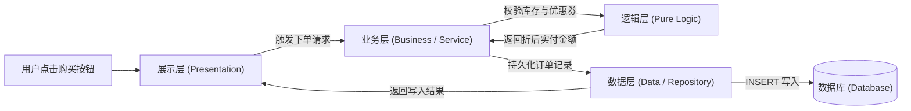
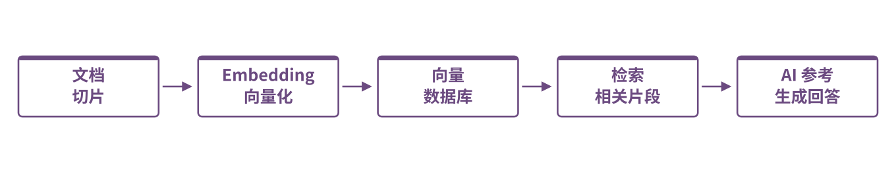
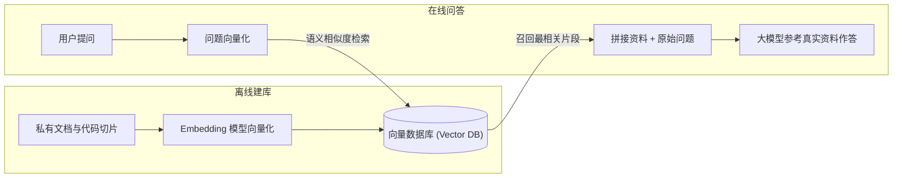
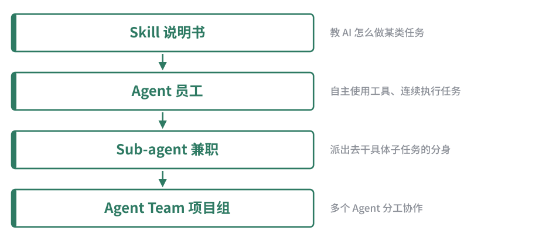
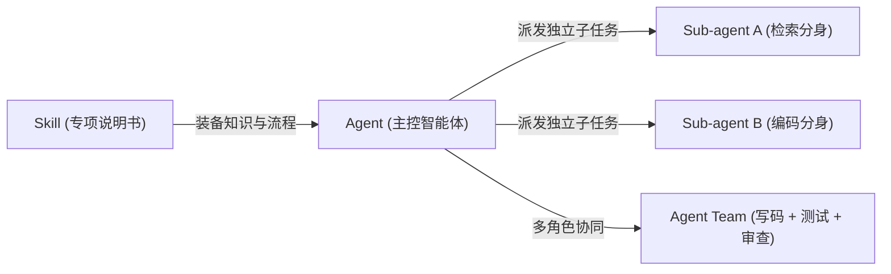
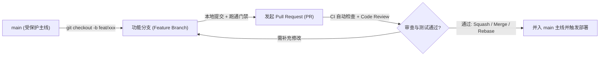
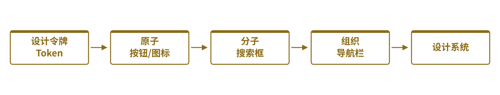

# 开发词汇手册

遇到一个听不懂的技术词，先来这里查——<text-mark tone="thesis" effect="fluorescent">先搞懂「它叫什么、干什么用的」</text-mark>，再去跟 AI 或工程师聊天，沟通效率会高出一个量级。全书共分**九个专题**，从底层的**架构分层**与工程规范、AI 时代的提示词与 Agent 工具链，一直覆盖到部署基础设施、测试工程流程、前端 UI 组件、编程语言与数据格式、动效图形渲染以及数据库后端服务；每一条术语都配「速查表」与「核心概念深潜」两种读法。

<html-embed id="topic-map" src="./embeds/topic-map/index.html" title="开发词汇手册 · 九大专题互动全景地图" height="520">
如果交互预览未加载，可点击右上角打开完整视图，或直接阅读下方九个专题的完整正文。
</html-embed>

<aside-note id="handbook-reading-guide" kind="addon" title="怎么用这本手册？" tone="note">
每篇专题都提供两种阅读颗粒度：**「速查表」**用来十秒内定位术语定义、常见工具与触发场景；**「核心概念深潜」**用打比方与对比拆解的方式讲清楚「为什么需要它、不用会踩什么坑」。不必从头读到尾，按下方目录找到你当下困惑的话题，直接跳转即可。
</aside-note>

## 九大专题导览

<svg-embed id="source-diagram-01" src="./media/svg/source-diagram-01.svg" title="开发词汇手册 · 九大专题知识网络图" />

| 专题编号 | 专题名称 | 英文领域 | 核心解决的问题 |
| --- | --- | --- | --- |
| **01** | 架构分层与工程规范 | Architecture & Engineering Discipline | 为什么代码不能随便堆在一起写——分层、Monorepo、SOLID、依赖注入、Harness Engineering |
| **02** | AI 时代特有词汇（一）：提示词与模型基础 | Prompts & Model Fundamentals | Prompt、Token、RAG、Embedding、幻觉、思维链——跟 AI 对话调参时冒出来的黑话 |
| **02b** | AI 时代特有词汇（二）：Agent、工具链与协作流程 | Agents & Tooling | MCP、Skill、Agent、Sub-agent、护栏——AI「自己动手做事」背后的一整套黑话 |
| **03** | 生产环境 / 部署（一）：环境与部署基础设施 | Environments & Infrastructure | 本地、Staging、生产环境有什么不同，Docker、CDN、SSR/SSG、灰度发布是什么 |
| **03b** | 生产环境 / 部署（二）：测试与工程流程 | Testing & Workflow | 单元测试到 E2E、Git 分支策略、监控日志——上线前后怎么知道系统靠不靠谱 |
| **04** | 前端 UI 组件与布局术语 | UI Components & Layout | 导航栏、弹窗、设计系统、原子设计——把「界面长什么样」说清楚的词汇表 |
| **05** | 语言与数据格式技术栈 | Languages & Data Formats | 该学哪个编程语言、`.json`/`.yaml` 是什么、编译与解释、静态与动态类型 |
| **06** | 动效与图形 / 渲染库 | Animation & Graphics | Canvas、WebGL、Three.js、Phaser、GSAP——渲染地基和动效工具怎么选 |
| **07** | 数据库与后端服务 | Database & Backend Services | Supabase、SQL vs NoSQL、认证/授权、RLS——数据到底存在哪、怎么保证安全 |

## 01 · 架构分层与工程规范

这篇讲的是：为什么代码不能随便堆在一起写，要拆成「层」？每一层到底负责什么？当项目交给 AI 长期演进时，怎样用工程规范把架构骨架钉死？


### 速查表

| 术语 | 通俗解释 | 常见叫法/工具 | 什么场景会用到 |
| --- | --- | --- | --- |
| 架构（Architecture） | 整个项目「房子怎么盖」的设计图 | Monorepo、分层架构、六边形架构 | 项目刚起步、决定代码怎么分文件夹时 |
| 路由（Router / Routing） | 网址决定显示哪个页面的规则 | React Router、Next.js App Router | 做多页面网站/App 时 |
| 数据层（Data Layer） | 只管「数据存哪、怎么读写」，不管页面好不好看 | Repository、DAO、ORM（Prisma/Drizzle） | 存取数据库、调用第三方 API |
| 业务层（Business Layer / Service Layer） | 管「这件事该怎么处理」的规则和判断 | Service、UseCase | 下单、扣库存、判断优惠券能不能用 |
| 逻辑层（Logic Layer） | 纯计算，不碰数据库、不碰界面 | Pure Function、工具函数 | 算价格、算碰撞、算分数 |
| 展示层（Presentation Layer / UI Layer） | 只管「画出来给人看」 | React 组件、Vue 组件 | 按钮、页面、动画 |
| 单一职责原则（Single Responsibility） | 一个模块只干一件事 | — | 判断「这段代码是不是该拆出去」 |
| 依赖方向（Dependency Direction） | 谁可以调用谁，不能反过来 | 依赖倒置、「核心不依赖壳」 | 大项目防止代码越写越乱 |
| Harness Engineering | 给项目定「骨架规范」，让人和 AI 长期按规矩协作 | `AGENTS.md`、ESLint 规则、CI 检查 | 项目要长期维护、多人（或多次 AI 会话）协作时 |
| MVC / MVVM | 一种「页面-数据-逻辑」三方分工的经典分层套路 | Model-View-Controller / Model-View-ViewModel | 传统 Web 框架、桌面/移动应用 |
| 单体架构（Monolith） | 所有功能写在一个项目里，一起开发、一起部署 | — | 小型项目、团队规模小、起步阶段 |
| 微服务（Microservices） | 把一个大系统拆成多个各自独立部署、独立扩容的小服务 | — | 大型系统、多团队并行开发 |
| Monorepo | 多个子项目（包）放在**同一个**代码仓库里统一管理 | pnpm workspace、Turborepo、Nx | 本项目就是 Monorepo（`packages/` + `apps/` 结构） |
| Polyrepo | 每个项目/服务各自一个**独立**仓库 | — | 团队/服务边界清晰、想各自独立发版时 |
| SOLID 原则 | 五条让代码「好改、不易崩」的设计准则 | 单一职责 / 开闭原则 / 里氏替换 / 接口隔离 / 依赖倒置 | 评审代码「设计得好不好」时的参考标尺 |
| 耦合与内聚（Coupling & Cohesion） | 耦合＝模块之间「粘得有多紧」；内聚＝模块内部「是不是该放在一起的东西」 | 低耦合高内聚 | 判断代码要不要拆分/合并 |
| 依赖注入（Dependency Injection） | 模块不自己创建它需要的东西，而是「从外面传进来」 | DI Container、构造函数注入 | 让代码更容易替换实现、更容易测试 |
| 设计模式（Design Pattern） | 前人总结出来的、某类重复出现问题的「标准解法」 | 单例模式、工厂模式、观察者模式、仓库模式 | 遇到「这个设计难题好像见过」时去查对应模式 |
| 领域驱动设计（DDD） | 先把业务概念（比如「订单」「库存」）理清楚，再照着业务概念设计代码结构 | Entity、Aggregate、Bounded Context | 业务规则复杂、容易越改越乱的系统 |
| 中间件（Middleware） | 请求处理流程里，插在中间统一处理一类事情的「关卡」 | 鉴权中间件、日志中间件、限流中间件 | 统一处理登录校验、请求日志、跨域等 |
| 事件驱动架构（Event-Driven Architecture） | 模块之间靠「发消息/广播事件」来通信，而不是互相直接调用 | EventEmitter、消息总线 | 想让模块互相不知道对方存在（解耦）、异步处理 |
| 消息队列（Message Queue） | 一个「任务先排队，慢慢被处理」的中转站 | RabbitMQ、Redis Queue、Kafka | 削峰限流、异步任务（发邮件、生成报表） |
| 状态管理（State Management） | 集中管理「整个应用里多个组件要共享的数据」的方案 | Redux、Zustand、Pinia | 多个页面/组件要读写同一份数据时 |
| 插件架构（Plugin Architecture） | 核心系统保持精简，具体功能通过「插件」往外挂 | VS Code 插件、Vite 插件 | 想让核心稳定，又要保留灵活扩展空间时 |

### 核心概念深潜

#### 为什么「点击购买」按钮背后要拆这么多层？

想象你在餐厅点餐：

1. **你（顾客）看到的菜单和按钮** —— 这是**展示层**。菜单好不好看、按钮在哪，跟「厨房怎么做菜」完全无关。
2. **服务员把你的需求记下来，判断「这道菜今天卖不卖、你的优惠券能不能用」** —— 这是**业务层**。这里全是「规则判断」，比如「会员打 8 折」「库存不足不能下单」。
3. **后厨真正去仓库拿菜、下锅炒** —— 这是**数据层**。它只管「东西存在哪、怎么取出来」，不关心你为什么点这道菜。
4. **厨师炒菜的手法、火候计算** —— 这是**逻辑层**。纯粹的「计算过程」，给定食材和火候，算出结果，不用知道是谁点的。

如果这四件事全部写在一起（比如按钮的点击事件里直接写数据库查询语句），会出现什么问题？

- 你想换一个好看的按钮样式，却怕改坏了扣库存的逻辑。
- 你想把「打折规则」复用到另一个页面，却发现代码和这个按钮死死绑在一起，拆不出来。
- 出 bug 了，你不知道问题出在「页面显示错了」还是「规则算错了」还是「数据库读错了」——因为它们全挤在一个文件里。

<text-mark tone="thesis" effect="fluorescent">拆层的本质好处：出问题时，你能快速定位「是哪一层出的错」，改一层不会震动另一层。</text-mark>

#### 路由（Router）是什么？

路由就是「网址 → 该显示哪个页面」的对照表：

```text
/home        → 首页组件
/shop        → 商店页面组件
/user/123    → 用户 123 的个人主页
```

浏览器地址栏输入不同网址，路由系统查这张表，决定渲染哪个页面。没有统一路由规范的项目，经常会出现「这个页面到底该用什么网址」「改了一个页面名字，结果到处链接都失效了」的混乱。

#### Harness Engineering 到底是什么？和「架构」是什么关系？

`Harness` 原意是「挽具」（拴住牲口拉车用的皮带套）。在软件工程里，`Harness Engineering` 指的是：

<aside-note id="source-note-1" kind="callout" title="Harness Engineering：先把骨架钉死" tone="thesis">
**在写具体功能之前，先把「骨架规范」钉死**——文件夹怎么分、哪层能调用哪层、命名怎么定、多长的文件要拆分、AI 或新人接手时该先看哪份文档。
</aside-note>

它跟「架构」的关系是：<text-mark tone="thesis" effect="wash">架构是设计图，Harness 是「把设计图刻进工具里，让人（或 AI）想违反都难」的那套机制</text-mark>。比如：

- 架构说「数据层不该被展示层直接调用」——这是设计图上的一句话。
- Harness 会用 ESLint 规则把这条禁令写成代码检查，你要是写错了，代码直接报错、提交不了。

<aside-note id="source-note-2" kind="warn" title="为什么不能只让 AI 自己定规范？" tone="warn">
因为 AI 每次对话可能是「失忆」的，如果规范只停留在口头约定或者靠 AI「自觉」，下一次换一个 AI 会话或换一个人接手，规矩可能就被悄悄破坏。把规矩写进文档（如 `AGENTS.md`）和工具配置里，才能让规矩真正「长期生效」，而不是「说过就忘」。
</aside-note>

#### 一个完整例子：点击「购买」按钮，数据是怎么流动的？



```text
用户点击"购买"按钮
↓  （展示层：捕获点击事件）
调用 "下单" 业务逻辑
↓  （业务层：检查库存够不够、优惠券能不能用、算最终价格）
调用逻辑层的纯函数计算最终金额
↓  （逻辑层：只做数学计算，不碰数据库）
把订单数据写入数据库
↓  （数据层：INSERT 一条订单记录）
返回结果给展示层，弹出"购买成功"提示
```

每一步只关心自己那一层的事，出错了也只需要去对应那一层排查，这就是分层的价值。

#### 单体架构、微服务、Monorepo、Polyrepo——这四个词怎么区分？

这四个词其实回答的是**两个互相独立的问题**，很多人会把它们混为一谈：

<compare-block id="monolith-vs-microservices" title="运行时部署形态 vs 代码仓库组织方式">
<compare-side role="a" title="单体 (Monolith) vs 微服务 (Microservices)">
回答**「代码在运行时是几个独立服务？」**——单体是所有模块打包成一个程序运行；微服务是拆成好几个各自独立运行、独立部署的小程序，彼此通过网络通信调用。
</compare-side>
<compare-side role="b" title="Monorepo vs Polyrepo">
回答**「源码在仓库层面放在几个 Git 仓库里？」**——Monorepo 是把好几个子项目或包的源码放在同一个 Git 仓库里统一管理；Polyrepo 是每个项目各自一个独立仓库。
</compare-side>
</compare-block>

<aside-note id="source-note-3" kind="callout" title="两个维度可任意正交组合" tone="note">
运行时架构与代码仓库结构互相独立，工程团队可以根据规模组合出四种常见形态：
</aside-note>

<timeline-block id="repo-arch-matrix" title="仓库形态 × 运行时架构的四种组合" tone="note">
- **Monorepo + 单体** — `packages/` 与 `apps/` 都在同一个仓库，每个应用作为独立单体壳运行，兼顾代码复用与简单部署
- **Monorepo + 微服务** — 大厂常见做法：所有微服务源码放一个大仓库，方便统一修改公共协议，但运行时仍是多个独立服务
- **Polyrepo + 单体** — 小团队最轻量的起步做法：一个 Git 仓库对应一个单体项目，零额外工具链负担
- **Polyrepo + 微服务** — 每个微服务各自一个独立仓库，团队自治边界最清晰，但跨服务复用公共代码需要发包同步
</timeline-block>

选 Monorepo 的核心好处是<text-mark tone="good" effect="wash">改一处公共逻辑，所有引用它的项目立刻同步</text-mark>；代价是仓库变大后需要专门的工具（如 pnpm workspace、Turborepo）来管理「只构建改动过的那部分」。这也是为什么项目里会有 `pnpm-workspace.yaml`——它就是 Monorepo 管理工具的配置文件。

#### SOLID 原则到底是哪五条？用最简单的话说

SOLID 是五个英文单词首字母拼出来的缩写，是面向对象与模块化设计里最常被引用的五条准则：

| 字母 | 全称 | 一句话解释 |
| --- | --- | --- |
| **S** | 单一职责原则（Single Responsibility） | 一个类/模块只干一件事 |
| **O** | 开闭原则（Open-Closed） | 加新功能时尽量「新增代码」，别老是「改已有代码」 |
| **L** | 里氏替换原则（Liskov Substitution） | 子类可以无痛替换父类使用，不会导致意外行为 |
| **I** | 接口隔离原则（Interface Segregation） | 不要强迫一个模块依赖它根本用不到的接口 |
| **D** | 依赖倒置原则（Dependency Inversion） | 高层逻辑不该依赖具体实现细节，而是依赖「抽象接口」 |

<inset-card id="solid-practical-compass" title="SOLID 不必死记硬背：看痛点识坏味道" eyebrow="DESIGN COMPASS" kicker="改一处牵全身 = 边界失守" tone="thesis">
从实用角度只需要记住一条信号：**当你发现「改一个小功能却牵连了一大片不相关的代码」或「一个类的方法多到一屏看不完」，就是在违反 SOLID 里的某一条**——这时候就该停下来拆分职责或抽离接口了。
</inset-card>

#### 依赖注入（DI）到底解决了什么问题？

<compare-block id="di-hardcoded-vs-injected" title="硬编码内部创建 vs 外部依赖注入 (DI)">
<compare-side role="bad" title="无依赖注入：内部死死绑定">
模块直接在内部 `new LocalSaveService()`。如果以后想换成「云端存档服务」，或者写单元测试时想换成「内存假存档服务」，都必须钻进 `Game` 类内部改代码。
</compare-side>
<compare-side role="good" title="依赖注入：只认接口，从外部传入">
模块构造函数只声明需要 `SaveService` 抽象接口，具体用本地存档还是云端存档由外部组装时传入。换壳、换平台、跑测试时核心代码一行都不用动。
</compare-side>
</compare-block>

没有依赖注入时，一个模块想用「存档服务」，会直接在内部写：

```ts
class Game {
  private saveService = new LocalSaveService() // 内部自己创建，死死绑定
}
```

依赖注入的做法是**从外部把「存档服务」传进来**：

```ts
class Game {
  constructor(private saveService: SaveService) {} // 从外面注入，随时能换实现
}
```

这正是 `packages/game-core/src/services/index.ts` 里定义各种 Service 接口、由 `apps/*` 各个壳去实现并注入的原理——核心逻辑只认「存档服务应该有什么功能」（接口），不关心「具体是本地存档还是云端存档」（实现），换壳、换平台时核心代码完全不用动。

## 02 · AI 时代特有词汇（一）：提示词与模型基础

这篇讲的是：跟 AI 对话、调模型参数、接入私有知识库时经常冒出来的黑话。**Agent、Skill、MCP 等「工具链/协作流程」相关的词，见下一篇 `02b` 专题。**



### 速查表

| 术语 | 通俗解释 | 常见工具/例子 | 什么场景会用到 |
| --- | --- | --- | --- |
| Vibe Coding | 靠「感觉」和 AI 对话式地写代码，而不是先设计再写 | 直接跟 Cascade/Cursor/Copilot 聊需求 | 快速试错、做原型 |
| 敏捷开发（Agile） | 小步快跑、频繁反馈的开发方式，不是一次性憋大招 | Scrum、Kanban | 需求会变化的项目 |
| Loop Engineering | 设计「AI 反复自我检查/修正」的循环流程 | AI 写代码→跑测试→看报错→自己修 | 让 AI 长任务里少犯错 |
| Harness Engineering | 给项目定死骨架规范，让协作长期稳定（详见 `01` 专题） | `AGENTS.md`、四把锁 | 项目要长期演进 |
| Prompt（提示词） | 你给 AI 的那段话/指令 | 「帮我写一个登录页面」 | 每次跟 AI 对话 |
| System Prompt vs User Prompt | System Prompt 是「预先设定好、贯穿全程的人设/规则」；User Prompt 是「你当下这句话」 | 系统提示词设定「你是个游戏开发助手」 | 区分「谁在什么层级影响 AI 的行为」 |
| Prompt Engineering | 研究「怎么把话说清楚，让 AI 输出更准」 | 结构化提问、给例子 | 让 AI 输出更符合预期 |
| 上下文（Context） | AI 这次对话「记得」的所有信息总量 | 对话历史、打开的文件 | AI 突然「忘事」或答非所问时 |
| 上下文窗口（Context Window） | AI 一次最多能「看」多少 token 的硬性上限 | 128K / 200K / 1M token 窗口 | 判断「这个项目/对话是不是塞太多东西了」 |
| 上下文管理（Context Management） | 主动整理/精简喂给 AI 的信息，别让它信息过载 | 摘要、清空历史、分文件说明 | 长对话、大项目 |
| Token | AI 处理文字的最小单位（不完全等于一个字） | 1 token ≈ 0.75 个英文单词 / 不到 1 个中文字 | 计算 AI 用量/费用 |
| 模型选择（Model Selection） | 选用哪个 AI 大脑来干活 | GPT、Claude、Gemini、DeepSeek | 追求速度/质量/成本的取舍 |
| 输入/输出（Input/Output） | 你发给 AI 的内容 / AI 返回给你的内容 | — | 计算 token 消耗时区分方向 |
| 采样参数：Temperature / Top-p | 控制 AI 回答「有多随机/有多保守」的旋钮 | Temperature 0（死板严谨）～1+（天马行空） | 想要 AI 更稳定 or 更有创意时调整 |
| 缓存命中（Cache Hit） | AI 服务商发现「这段内容之前处理过」，直接复用结果、省钱省时间 | Prompt Caching | 长期反复用同一份系统说明/文档时 |
| RAG（检索增强生成） | 先去「资料库」里查相关内容，再让 AI 参考着回答，而不是凭「记忆」瞎答 | 向量检索 + LLM 生成 | 让 AI 回答基于你的私有文档/最新资料 |
| Embedding（向量嵌入） | 把文字「翻译」成一串数字（向量），方便计算机比较「意思像不像」 | text-embedding-3、BGE | 做语义搜索、RAG 的底层技术 |
| 向量数据库（Vector Database） | 专门存 Embedding 向量、能快速找出「意思最相近」的数据的数据库 | Pinecone、pgvector、Milvus | RAG 系统、语义搜索 |
| 微调（Fine-tuning） vs 提示词工程 | 微调＝重新训练模型让它「学会」新技能；提示词工程＝不改模型，只改「怎么问」 | LoRA 微调 | 决定「用更好的提问方式」还是「投入资源训练专属模型」 |
| 幻觉（Hallucination） | AI 一本正经地编造不存在的事实 | AI 编造不存在的函数名/API | 判断「这个回答需不需要人工核实」 |
| Few-shot / Zero-shot | Few-shot＝先给几个例子再提问；Zero-shot＝不给例子直接问 | Prompt 里附带「示例输入输出」 | 想让 AI 更准确模仿某种格式时用 Few-shot |
| 思维链（Chain of Thought, CoT） | 让 AI「把思考步骤写出来」，而不是直接跳到答案 | 「请一步步推理后再回答」 | 复杂逻辑/数学题，提升准确率 |
| 多模态（Multimodal） | AI 不只能读文字，还能「看」图片、「听」语音 | 上传截图问 AI 这是什么 bug | 需要 AI 理解图片/音频/视频时 |
| 流式响应（Streaming Response） | AI 的回答像打字机一样一个字一个字冒出来，而不是等全部写完再显示 | ChatGPT 网页的逐字输出效果 | 提升用户等待体验、支持长回答提前查看 |
| 知识截止日期（Knowledge Cutoff） | 模型训练数据「截止到哪一天」，之后发生的事它不知道 | 「我的知识截止到 2024 年」 | 问 AI 最新新闻/版本号时要留意 |
| 开源权重 vs 闭源模型（Open-weight vs Closed） | 开源权重＝模型文件公开可下载自己跑；闭源＝只能通过官方 API 调用 | DeepSeek/Llama（开源权重）vs GPT/Claude（闭源） | 决定能不能自己私有化部署模型 |
| 模型量化（Quantization） | 把模型「压缩」得更小、跑得更快，牺牲一点精度 | 4-bit/8-bit 量化 | 想在普通电脑/手机上跑本地模型时 |
| 本地大模型（Local LLM） | 把模型直接下载到自己电脑上跑，不用联网调 API | Ollama、LM Studio | 想离线用、不想数据传到云端时 |

### 核心概念深潜

#### Vibe Coding 是什么？跟「正经写代码」有什么不同？

传统写代码像「先画好图纸再盖房子」：先想清楚需求、画流程图，再动手写。

Vibe Coding 更像「跟一个很懂技术的朋友聊天，边聊边改」：你说一句「我想要个能左右移动的小车」，AI 直接写出来，你看效果不满意再说一句「车速太快了，调慢点」，AI 再改。<text-mark tone="warn" effect="wash">优点是快、试错成本低；缺点是项目大了容易越改越乱，这也是为什么还是需要「架构规范」来兜底。</text-mark>

#### Loop Engineering 和 Harness Engineering 有什么区别？

<compare-block id="harness-vs-loop" title="Harness Engineering vs Loop Engineering">
<compare-side role="a" title="Harness Engineering（静态骨架规范）">
定「骨架」和「规矩」——项目该长什么样，文件夹怎么分，谁不能调用谁。是**静态的、一次性搭好的工程护栏**（打比方：给车装好护栏和车道线）。
</compare-side>
<compare-side role="b" title="Loop Engineering（动态自检循环）">
设计 AI 干活时的「自我检查循环」——写一段代码 → 跑一下测试 → 看报错 → 自己改 → 再跑测试，直到通过。是**动态的、执行过程中反复走的闭环**（打比方：教司机养成边开边看后视镜纠偏的习惯）。
</compare-side>
</compare-block>

#### Token 是什么？为什么要「省 Token」？

AI 不是按「字」读文字的，它把文字切成更小的碎片，叫 **Token**。粗略估算：

- 英文：1 个 token ≈ 0.75 个单词（例如 `"hello world"` 大概是 2~3 个 token）
- 中文：1 个 token 经常还不到 1 个汉字（中文相对「更贵」）

<aside-note id="source-note-5" kind="callout" title="为什么要省 Token？" tone="thesis">
1. **收费按 token 数算** —— 输入越长、AI 回复越长，花的钱越多。
2. **AI 一次能「记住」的 token 数是有上限的**（叫「上下文窗口」），塞太多没用的信息，AI 反而会注意力分散、漏看关键约束，导致答非所问。
</aside-note>

所以「上下文管理」的核心工作，就是**只喂给 AI 当前任务真正需要的信息，别把整个项目的历史废话都堆进去**。

#### 缓存命中（Cache Hit）为什么能省钱？

如果你每次对话都要先把一份很长的「系统说明书」发给 AI（比如项目的架构文档），AI 服务商发现「这段前缀内容我上次处理过，完全没变」，就可以直接复用之前算好的 KV 状态，**不用重新算一遍，这部分的费用会大幅打折**。这也是为什么把「不常变化的规则」（如 `AGENTS.md`）固定在提示词前部、别频繁改动，能显著省钱提速。

#### RAG、Embedding、向量数据库——这三个词是怎么串起来工作的？

假设你想让 AI 回答「我们项目的存档服务是怎么设计的」，但这个信息只存在你自己的代码仓库里，AI 训练时根本没见过。**RAG（检索增强生成）** 的工作流如下：



<timeline-block id="rag-pipeline-steps" title="RAG 检索增强生成的五步闭环" tone="thesis">
- **文档切片 (Chunking)** — 把你的私有文档或代码库切成语义完整的一小段一小段
- **向量嵌入 (Embedding)** — 用 Embedding 模型把每一段文字「翻译」成一串数字（高维向量）；意思相近的段落，向量距离也相近
- **向量入库 (Indexing)** — 把这些向量连同原文片段一起存进「向量数据库」里
- **语义检索 (Retrieval)** — 用户提问时，先把问题也变成向量，去向量数据库里找出「向量距离最近」的那几段真实资料
- **有据生成 (Augmented Generation)** — 把召回的相关段落与用户问题一起塞进 Prompt 交给 AI，让它严格参考真实资料作答
</timeline-block>

<aside-note id="source-note-6" kind="callout" title="一句话理解三者关系" tone="good">
**Embedding** 是「把文字变成可比较的数字」的翻译技术；**向量数据库**是「存这些数字、能快速找相似」的仓库；**RAG** 是「先查资料再回答」这一整套流程的名字。它解决的核心问题是：**让 AI 的回答有真实依据，而不是只靠训练时记住的旧知识瞎猜。**
</aside-note>

#### 微调（Fine-tuning）和提示词工程，什么时候该选哪个？

两者都是「让 AI 表现得更符合你的需求」，但成本和适用场景完全不同：

<compare-block id="prompting-vs-finetuning" title="提示词工程 vs 模型微调 (Fine-tuning)">
<compare-side role="good" title="提示词工程 + RAG（日常 99% 首选）">
只改「怎么问」和「给什么参考资料」，模型本身参数不变。**几乎零训练成本、随时可改、立竿见影**，能解决绝大多数日常开发与知识问答需求。
</compare-side>
<compare-side role="a" title="模型微调 Fine-tuning（特定领域深水区）">
准备大量高质量标注数据重新训练，真正改变模型权重参数。**需要算力、数据清洗与训练周期**，适合要求模型极其稳定地输出特定格式、特定领域腔调，且 Prompt 已穷尽仍无法达标的场景。
</compare-side>
</compare-block>

| 对比维度 | 提示词工程（Prompt Engineering） | 微调（Fine-tuning） |
| --- | --- | --- |
| 改的是什么 | 只改「怎么问」，模型本身不变 | 用你的数据重新训练，模型参数真的变了 |
| 成本与周期 | 几乎零成本，随时能改 | 需要准备训练数据、花算力和时间 |
| 适合场景 | 绝大多数日常任务 | 需要模型稳定输出「特定风格/特定领域知识」，且提示词工程已经解决不了 |

<aside-note id="source-note-7" kind="callout" title="选型铁律" tone="thesis">
**99% 的情况先穷尽提示词工程（把问题描述清楚、给 Few-shot 例子、用 RAG 补充资料）**，只有确认「怎么问都问不出想要的效果」，才考虑微调。
</aside-note>

#### 采样参数（Temperature / Top-p）到底是调什么？

AI 生成下一个字时，其实是在「一堆候选字里按概率抽签」。**Temperature** 就是调「这个抽签有多随机」：

- **Temperature 调低（接近 0）**：几乎每次都选「概率最高的那个字」，回答稳定、死板，适合写代码、算数学、结构化提取。
- **Temperature 调高（大于 1）**：更愿意选一些「概率不是最高但也不差」的字，回答更有变化、更有「创意」，但也更容易跑偏。

**Top-p** 是另一种控制方式：只在「加起来概率达到 `p`（比如 90%）的头部候选字」里抽签，把「明显不合理的长尾选项」直接排除掉，跟 Temperature 经常搭配使用。

#### 幻觉（Hallucination）、Few-shot/Zero-shot、思维链，这三者怎么帮你拿到更靠谱的答案？

- **幻觉**是问题本身：AI 有时会「一本正经地胡说八道」——编一个不存在的函数名、编一个不存在的历史事件，语气还特别自信。**这是所有生成式大模型目前都存在的概率本性，不是哪个模型「故意」骗你。**
- **Few-shot / Zero-shot** 和 **思维链（CoT）** 是两种缓解幻觉、提升准确率的「提问技巧」：
  - **Few-shot**：先给 AI 看 2~3 个「输入 + 标准输出」的例子，AI 更容易照着格式和逻辑收敛，而不是自由发挥。
  - **CoT（思维链）**：让 AI「先把推理步骤写出来，再给结论」，相当于让它先打草稿，比直接跳到答案显著更准（尤其在数学与复杂逻辑题上）。

<aside-note id="source-note-8" kind="warn" title="防幻觉实用建议" tone="warn">
遇到 AI 一本正经说出一个你从没听过的库名、配置项或 API，**先默认怀疑是幻觉**，去官方文档或代码库里核实，千万不要盲信。
</aside-note>

#### 多模态、知识截止日期、开源权重 vs 闭源、模型量化、本地大模型——这几个「能力边界」词有什么联系？

这几个词共同回答的问题是：**「这个 AI 能力的边界在哪里？我能不能完全掌控它？」**

- **多模态**回答「它能理解文字之外的什么东西」（图片/语音/视频）。
- **知识截止日期**回答「它的内置知识新鲜到什么时候」，超过这个日期的新闻或新框架版本号它是不知道的，需要靠联网搜索或 RAG 补充。
- **开源权重 vs 闭源**回答「我能不能拿到模型本体文件，自己私有化部署，不经过官方服务器」。
- **模型量化**回答「这个模型能不能塞进普通电脑或手机显卡里跑」——量化是用「微小精度妥协换取体积缩小和速度提升」的压缩手段。
- **本地大模型（Local LLM）**是前面几个概念的落地应用：选一个开源权重模型，量化压缩后，用 Ollama 或 LM Studio 在自己电脑上跑起来，不用联网、数据完全不出本地。

## 02b · AI 时代特有词汇（二）：Agent、工具链与协作流程

这篇讲的是：让 AI「自己动手做事」背后涉及的黑话——Agent 怎么用工具、MCP 怎么接外部系统、这套多智能体协作流程该怎么立规矩。**提示词与模型基础相关的词，见上一篇 `02` 专题。**



### 速查表

| 术语 | 通俗解释 | 常见工具/例子 | 什么场景会用到 |
| --- | --- | --- | --- |
| MCP（Model Context Protocol） | 让 AI 能「接上」外部工具/数据库/服务的统一协议 | GitHub MCP、Supabase MCP | AI 需要操作 GitHub、数据库等外部系统时 |
| CLI（命令行界面） | 用打字命令而不是点鼠标来操作电脑 | `npm install`、`git commit` | 几乎所有开发工具的基本操作方式 |
| Skill | 一份教 AI「怎么做某类任务」的说明书 | 仓库里的 `.agent/skills/` 或 `SKILL.md` | 让 AI 遇到特定任务时自动照着标准流程走 |
| Agent | 能自主使用工具、连续执行多步任务的 AI | Antigravity、Claude Code、Cursor Agent | 需要 AI 自己动手改代码、跑命令 |
| Sub-agent | Agent 派出去干「某个子任务」的分身 | 搜索子任务、独立文件修改子任务 | 大任务拆小任务并行处理、隔离上下文 |
| Agent Team | 多个 Agent 分工协作，各管一块 | 一个写代码、一个测试、一个审查 | 复杂项目的多角色协作 |
| Function Calling / Tool Use | AI 判断「这件事该调用哪个工具」，并按格式生成调用参数 | AI 决定调用「查天气」函数并传入城市名 | AI 需要触发具体动作而不只是聊天 |
| 编排（Orchestration） | 安排多个 Agent/工具按什么顺序、什么条件配合工作 | LangGraph、多 Agent 工作流 | 复杂任务需要多步骤、多角色协调 |
| 护栏（Guardrails） | 给 AI 的行为划定「不能做」的边界 | 内容审核、禁止执行危险命令 | 防止 AI 输出违规内容或做危险操作 |
| Jailbreak（越狱） | 想办法绕过 AI 的安全限制，让它做本不该做的事 | 精心设计的诱导提示词 | 了解这是安全风险，而非正常使用方式 |
| 人类介入（Human-in-the-loop） | 关键步骤让人确认后才继续，而不是完全自动化 | 危险命令需要用户手动批准 | 涉及不可逆操作（删文件、发钱、推生产）时 |
| Spec-driven Development | 先写清楚「要做成什么样」的规格文档，再让 AI 照着实现 | 先写 PRD/接口定义，再生成代码 | 避免 AI「猜需求」导致跑偏 |
| Git Worktree | 同一个仓库同时开出多个独立工作目录，各自切不同分支 | `git worktree add` | 让多个 Agent/任务并行改代码互不干扰 |
| AI 代码审查（AI Code Review） | AI 自动检查 PR 里的代码有没有问题 | Bot 自动评论 PR | 减少人工审查负担、提前发现问题 |
| 限流（Rate Limit） | 限制「单位时间内最多能调用多少次」的规则 | API 每分钟最多 60 次请求 | 防止滥用、控制成本 |
| Webhook | 某个事件发生时，系统「主动通知」另一个系统的机制 | GitHub 有新 PR 时自动通知 CI | 系统之间自动联动，不用人工检查 |
| SDK vs API | API 是「接口规则」本身；SDK 是「帮你调用这个 API 的现成代码包」 | Stripe API vs Stripe SDK | 用 SDK 能少写很多「拼接请求」的重复代码 |
| 沙箱（Sandbox） | 一个隔离的、「出了问题也不影响真实环境」的试验场 | 代码执行沙箱、容器隔离环境 | 让 AI 跑代码/命令时先在沙箱里测试 |
| 代码解释器（Code Interpreter） | AI 能直接运行一段代码并看到执行结果，而不是只生成代码文字 | 在线沙箱执行 Python/JS | 需要 AI「跑一下看看对不对」时 |
| `README.md` | 写给**人**看的项目说明书 | 项目根目录必备 | 让新人/用户快速了解项目 |
| `AGENTS.md` | 写给**AI**看的项目规矩说明书 | 仓库根目录操作索引 | 让 AI 每次接手都知道「红线在哪」 |

### 核心概念深潜

#### MCP 到底解决了什么问题？

在 MCP 出现之前，如果你想让 AI「帮你去 GitHub 建一个 issue」，AI 是做不到的——它只会聊天，接触不到 GitHub 的真实系统。

<text-mark tone="thesis" effect="fluorescent">MCP 就像给 AI 装了一套「万能 USB-C 接口」</text-mark>：只要一个外部系统（GitHub、Supabase 数据库、Figma、你的本地文件系统）按 MCP 这个标准协议接好了「插座」，AI 就能直接操作它——建 issue、查数据库、读写文件，而不再只是「纸上谈兵」。

#### Skill / Agent / Sub-agent / Agent Team 分别是什么层级？

按「权力与组织范围」从小到大排：



<timeline-block id="agent-hierarchy-levels" title="Agent 协作体系的四个层级" tone="thesis">
- **Skill（操作手册）** — 一份静态的领域操作指南（如 `SKILL.md`），告诉 AI 遇到某类特定任务时该按什么步骤做、避开什么坑
- **Agent（正式员工）** — 一个具备自主规划能力、能调用工具读写代码并跑命令的主控 AI
- **Sub-agent（临时兼职分身）** — 主 Agent 派出去干某个具体子任务的分身，拥有独立上下文窗口，干完活把结果汇报给主 Agent 后即销毁
- **Agent Team（完整项目小组）** — 多个不同职责的 Agent 分工协作（例如架构师、前端、测试、审查员），围绕同一目标并行推进
</timeline-block>

#### Function Calling 和 MCP 有什么关系？

两者经常被搞混，区别在于**所处位置与职责范围**：

<compare-block id="function-calling-vs-mcp" title="Function Calling vs MCP 协议">
<compare-side role="a" title="Function Calling（模型大脑侧能力）">
AI 模型自身的底层输出能力：判断「用户的这句话需要调用哪个函数、参数是什么」，并输出结构化的 JSON 调用请求。解决的是**「AI 怎么决定发起调用」**。
</compare-side>
<compare-side role="b" title="MCP（外部系统侧标准插座）">
开放的外部工具接入协议：定义「GitHub、数据库或设计软件该怎么把自己的功能包装成标准工具列表暴露给 AI」。解决的是**「工具接口怎么标准化复用」**。
</compare-side>
</compare-block>

<aside-note id="source-note-9" kind="callout" title="两者如何配合工作？" tone="thesis">
MCP 服务器把外部系统的能力「翻译」成一堆标准可调用的「工具菜单」，AI 模型再用 Function Calling 这个底层能力去决定「点哪道菜、传什么参数」。两者配合，才让 AI 真正具备操作外部世界的手脚。
</aside-note>

#### 编排（Orchestration）、护栏（Guardrails）、人类介入（Human-in-the-loop）是怎么让 AI 自主干活变得可控的？

如果放任 AI Agent 完全自由行动，风险很高（比如误删重要文件、死循环空转烧钱）。这三个机制是让「自主性」和「安全性」取得平衡的铁三角：

- **编排（Orchestration）**负责「流程设计」：规定任务先做什么、后做什么、遇到分支条件走哪条路——像项目经理排好的工作计划表。
- **护栏（Guardrails）**负责「边界限定」：明确规定「无论编排怎么走，AI 都绝对不能做这几件事」——像安全规范里的硬性红线。
- **人类介入（Human-in-the-loop）**负责「关键节点拦一下」：遇到不可逆的高危操作（删除、发布、扣款），先停下来让人确认批准，再继续往下走。

<aside-note id="source-note-10" kind="callout" title="可控 Agent 铁三角" tone="good">
**编排定路线 + 护栏划红线 + 人类管闸门**，三者组合起来，才是一个「既能自主干活，又不会闯出大祸」的工程级 Agent 系统。
</aside-note>

#### Spec-driven Development 和 Vibe Coding 是相反的吗？

不完全是「相反」，更像是**同一套现代研发工作流里的「先后两个阶段」**：

<compare-block id="vibe-vs-spec-driven" title="探索期 Vibe Coding vs 量产期 Spec-driven Development">
<compare-side role="a" title="Vibe Coding（探索期快速试错）">
直接跟 AI 边聊边改，快速把模糊点子变成可见原型。适合**需求还不确定、需要低成本验证方向**的探索阶段。
</compare-side>
<compare-side role="good" title="Spec-driven Development（量产期规格驱动）">
先把需求规格、数据结构、接口契约与验收标准写成明确文档（Spec），确认无误后再让 AI 照着实现。适合**方向已定、多人或多 Agent 严肃交付**的阶段。
</compare-side>
</compare-block>

成熟的做法往往是：**先用 Vibe Coding 快速试出「大概想要什么」，一旦方向确定，立刻切换到 Spec-driven 把规格钉死，再让 AI 与团队按规格稳定推进**——这也正是 `01` 专题里 Harness Engineering 强调「先定骨架再动手」的原因。

#### `README.md` 和 `AGENTS.md` 有什么区别？

两份文档都放在项目根目录，但目标读者与写作风格截然不同：

| 对比维度 | `README.md` | `AGENTS.md` |
| --- | --- | --- |
| **目标读者** | **人**（尤其是第一次接触这个项目的开发者或用户） | **AI**（每次接手这个项目干活的编码 Agent） |
| **核心内容** | 这个项目是干什么的、怎么安装、怎么运行、架构背景 | 这个项目有什么「红线」不能碰、命令怎么跑、硬性架构约束 |
| **写作风格** | 可以写得亲切、有背景介绍、有架构图与截图 | 要短、要狠、只写「AI 猜不到的规矩」，废话是挤占上下文的负资产 |

一句话记忆：<text-mark tone="thesis" effect="wash">README 是给人看的「欢迎手册」，AGENTS.md 是给 AI 看的「宪法 + 安全须知」。</text-mark>

## 03 · 生产环境 / 部署（一）：环境与部署基础设施

这篇讲的是：为什么代码在我自己电脑上跑得好好的，一发布上线就出问题？服务器、CDN、Docker、SSR/SSG 这些「基础设施」词汇到底在解决什么问题？**测试类型、Git 工作流、监控告警相关的词，见下一篇 `03b` 专题。**


### 速查表

| 术语 | 通俗解释 | 常见工具/例子 | 什么场景会用到 |
| --- | --- | --- | --- |
| 本地开发环境（Local / Dev） | 你自己电脑上跑的那个「草稿版」 | `localhost:3000` / `localhost:9981` | 写代码、调试时 |
| 预发布/测试环境（Staging） | 跟生产环境几乎一样，但只给内部测试用，不给真实用户 | `staging.example.com` | 上线前最后一轮真实环境验证 |
| 生产环境（Production） | 真正给用户用的「正式版」 | 线上正式域名 | 上线后 |
| 部署（Deploy） | 把代码从你电脑「搬」到能被别人访问的地方 | Vercel、腾讯云 EdgeOne Pages | 发布新版本时 |
| 打包（Build） | 把一堆源代码编译/压缩成能真正运行的文件 | `pnpm build` | 部署前的必经步骤 |
| 服务器（Server） | 一台 24 小时开着、专门等着回应别人请求的电脑 | 云服务器、VPS | 网站/游戏需要被访问时 |
| 容器化（Docker / Container） | 把「程序 + 它需要的运行环境」打包成一个标准盒子，到哪都能一样运行 | Docker、`Dockerfile` | 避免「我电脑能跑、服务器跑不了」的环境差异问题 |
| 容器编排（Kubernetes） | 管理成百上千个容器「该在哪台机器跑、坏了自动重启」的调度系统 | K8s | 大规模、多容器的生产系统 |
| 无服务器/边缘函数（Serverless / Edge Function） | 不用自己管服务器，写个函数丢上去，有请求来才运行、按次计费 | Cloudflare Workers、EdgeOne Cloud Functions | 小流量/间歇性请求，省去运维服务器的麻烦 |
| CDN（内容分发网络） | 把你的静态文件复制到全球各地机房，用户就近访问，速度更快 | Cloudflare、EdgeOne | 加速全球用户访问、减轻源服务器压力 |
| 负载均衡（Load Balancer） | 把大量请求「分流」给后面多台服务器，别都挤到一台上 | Nginx、云负载均衡器 | 单台服务器扛不住高流量时 |
| 横向/纵向扩展（Scaling） | 横向＝加更多台机器一起扛；纵向＝给一台机器升配置 | 加机器 vs 升级 CPU/内存 | 用户量增长后如何应对压力 |
| 域名（Domain） | 服务器地址的「好记名字」，代替一串数字 IP | `example.com` | 让别人能记住你的网址 |
| URL | 完整的「门牌地址」，域名 + 路径 + 参数 | `https://example.com/shop?id=1` | 访问具体某个页面/资源 |
| HTTPS / SSL / TLS | 给网络传输加密，防止别人偷看/篡改数据 | 网址前面的小锁标志 | 几乎所有正式网站的标配 |
| 反向代理（Reverse Proxy） | 服务器前面挡一层「接待员」，帮忙转发请求、隐藏真实服务器地址 | Nginx、Caddy | 统一入口、做安全防护/限流 |
| 路由（Route） | 见 `01` 专题 | — | — |
| 前端（Frontend） | 用户看得到、点得到的那一层 | React、Vue | 界面、交互 |
| 后端（Backend） | 用户看不到，负责处理数据和规则的那一层 | Node.js、Python、Go 服务 | 存数据、算逻辑、权限校验 |
| 前后端一体（Full-stack） | 一个人/一套代码同时管前端和后端 | Next.js（自带服务端能力与静态导出） | 小团队/独立开发 |
| 渲染策略：SSR / SSG / CSR / ISR | 页面内容「在哪个时间点、由谁生成」的四种方式 | Next.js 支持多种渲染与静态导出模式 | 决定首屏速度、SEO、实时性的取舍 |
| 灰度发布/蓝绿部署（Canary / Blue-Green） | 新版本先给一小部分用户/切到一套新环境试跑，没问题再全量切换 | 5% 流量先用新版本 | 降低「一上线就全炸」的风险 |
| 功能开关（Feature Flag） | 代码已经上线，但功能是「开着」还是「关着」用开关远程控制 | LaunchDarkly、自建开关表 | 想灰度放某个新功能，不满意能立刻关掉 |
| 环境变量（Environment Variable） | 不同环境下会变化的配置（密码、地址） | `.env` 文件 | 区分本地/生产的密钥、地址 |
| 缓存（Cache） | 把结果先存一份，下次直接用，不用重新算 | 浏览器缓存、CDN 缓存 | 加速网页加载 |
| 语义化版本（SemVer） | 版本号 `主.次.修` 三段式，每段变动代表不同含义 | `2.1.0` → `2.1.1` 只是修 bug | 判断「升级这个依赖会不会破坏东西」 |
| 变更日志（Changelog） | 记录「每个版本改了什么」的文档 | `CHANGELOG.md` | 升级前查看有没有不兼容改动 |

### 核心概念深潜

#### 为什么「本地能跑，上线就炸」？本地环境和生产环境到底差在哪？

想象你在家里试做一道菜（本地环境）和在餐厅正式给客人上菜（生产环境）：

- **家里的冰箱食材、你自己的口味设置**（本地的数据库、你自己电脑的配置）跟**餐厅仓库的食材、正式菜单**（生产环境的数据库、正式配置）不是同一套。
- 你在家里可能用了一个「临时偏方」（比如本地环境变量里硬编码了一个密钥），到了餐厅这个偏方可能压根没准备（生产环境没配这个密钥），于是当场报错。
- **每个人电脑上展示的效果不同**，很多时候是因为：浏览器缓存了旧版本的文件、不同地区访问到了还没刷新完的 CDN 节点、或者本地测试用的是「干净假数据」而生产环境遇到了各种奇葩的「真实脏数据」。

#### 从本地到生产，中间发生了什么？

<timeline-block id="cicd-pipeline-stages" title="从本地编码到生产上线的 CI/CD 自动流水线" tone="thesis">
- **本地开发 (Local)** — 在自己电脑上写代码、跑本地开发服务器调试预览
- **版本推送 (git push)** — 用 Git 将代码改动推送到远程代码仓库（如 GitHub）
- **持续集成与打包 (CI & Build)** — 自动化流水线拉取代码，跑 Lint、类型检查、单元测试，并将源码编译压缩成正式可运行的产物（如 `out/` 目录）
- **持续部署 (CD & Deploy)** — 将打包好的产物自动分发到云服务器、容器集群或边缘静态托管平台（如 EdgeOne Pages）
- **生产服务 (Production)** — 全球真实用户通过正式域名与 HTTPS 安全访问线上最新版本
</timeline-block>

这整个过程如果是自动完成的，就叫 **CI/CD**（持续集成 / 持续部署）——你一提交代码，机器自动帮你检查、测试、打包、上线。

#### Docker（容器化）到底解决了什么问题？

「我电脑上能跑，服务器上跑不了」，经常是因为**两台机器的运行环境不一样**——Node.js 版本不同、缺了某个系统底层库、操作系统差异。

<compare-block id="bare-server-vs-docker" title="传统裸机直接部署 vs Docker 容器化封装">
<compare-side role="bad" title="没有 Docker：直接装在宿主机上">
程序与依赖环境直接散装在服务器上。换一台服务器、升一次系统补丁，就可能因为版本冲突或缺失依赖而崩溃，环境极难复现。
</compare-side>
<compare-side role="good" title="有 Docker：程序连同环境打进标准集装箱">
把「程序 + 它需要的整个运行环境」打包成一个标准化的镜像盒子。换到任何装了 Docker 的机器上，盒子内部环境都分毫不差，100% 稳定复现。
</compare-side>
</compare-block>

**Kubernetes（K8s）**则是更进一步：当你的系统有几十上百个这样的「盒子」需要同时管理（哪个坏了自动重启、流量大了自动多开几个），K8s 就是负责「指挥调度」这些盒子的系统。对个人开发者或中小型项目来说，先用托管平台或单机 Docker 即可，真正遇到大规模集群需求时再深入 K8s。

#### Serverless / CDN / 负载均衡，都是为了解决什么问题？

这三个概念都在回答「怎么应对流量、怎么少花运维精力」，但切入角度不同：

- **Serverless（无服务器）**：你完全不用管「服务器长什么样、装没装好环境」，只写一个函数丢上去，有人访问才运行，按调用次数计费。**适合流量不稳定、间歇性的场景**，没人访问时几乎不花钱。
- **CDN（内容分发网络）**：把你的静态文件（图片、HTML、JS、字体）提前复制到全球各地的边缘机房，用户访问时「就近取货」，而不是每次都千里迢迢跑到源服务器所在地。**解决的是「全球各地用户打开速度一致快」的问题。**
- **负载均衡（Load Balancer）**：当一台服务器扛不住所有请求时，前面加一层「交通指挥员」，把请求均匀分流给后面多台服务器一起处理。**解决的是「单台机器撑不住高并发」的问题。**

<aside-note id="source-note-11" kind="callout" title="三者在实际架构中叠加配合" tone="note">
**CDN** 扛下静态文件的全球就近加速，**负载均衡 + 多实例**处理高频动态请求，**Serverless / 边缘函数**承接轻量、无需常驻开机等待的按需后端逻辑。
</aside-note>

#### SSR / SSG / CSR / ISR，网页内容到底是「谁在什么时候生成」的？

这四个缩写描述的是「一个页面的 HTML 内容，是在什么时间点、由谁生成」：

| 缩写 | 全称 | 生成时机 | 餐厅类比 |
| --- | --- | --- | --- |
| **CSR** | Client-Side Rendering（客户端渲染） | 用户打开页面后，浏览器下载 JS 自己现算现画 | 到店后给你食材包，在桌上自己拌 |
| **SSR** | Server-Side Rendering（服务端渲染） | 每次用户访问，服务器现算好一份 HTML 再发过去 | 每来一个客人，后厨现炒一份热菜 |
| **SSG** | Static Site Generation（静态站点生成） | 网站发布构建时提前算好所有页面，之后谁访问都是同一份 | 提前做好摆在保温货架上的标准成品菜，拿了就走 |
| **ISR** | Incremental Static Regeneration（增量静态再生成） | 像 SSG 一样提前做好，但过一段时间后台自动重做一份替换掉 | 货架上的成品菜，每隔一阵子自动换一批新鲜的 |

<compare-block id="csr-ssr-vs-ssg-isr" title="构建期预生成 (SSG) vs 请求期动态渲染 (SSR / CSR)">
<compare-side role="good" title="SSG 静态生成（博客与内容站首选）">
在 `pnpm build` 阶段把所有文章、公式、排版一次性编译成纯静态 HTML，直接推上全球 CDN。**首屏极快、SEO 极佳、无服务器运行时崩溃风险**（本站即采用此模式）。
</compare-side>
<compare-side role="a" title="CSR / SSR 动态渲染（强交互与千人千面）">
每个用户看到的内容都不同（如个人后台、实时购物车、评论区动态拉取）。适合用 SSG 搭好静态外壳，再在客户端局部拉取动态数据。
</compare-side>
</compare-block>

<aside-note id="source-note-12" kind="callout" title="没有绝对最好，只有按场景混搭" tone="thesis">
渲染策略直接决定**首屏速度、搜索引擎收录（SEO）与内容实时性**。现代应用常把静态内容做成 SSG 保证极致秒开，而把登录态、评论区等动态部分交给客户端按需请求。
</aside-note>

#### 灰度发布、蓝绿部署、功能开关，这三者是怎么「降低上线风险」的？

上线新版本最怕「一次性全量切换，结果出大 bug，所有用户瞬间受影响」。这三个手段都是为了把上线风险切小、留好退路：

- **灰度发布（Canary / 金丝雀发布）**：先让 5%~10% 的用户流量用上新版本，观察错误率与性能指标没问题，再逐步扩大到 100%。
- **蓝绿部署（Blue-Green Deployment）**：同时准备两套完全独立的环境（蓝环境、绿环境），新版本先部署到没在服务用户的「绿环境」，内部测试通过后把网关流量瞬间切过去；万一有问题，一秒切回「蓝环境」。
- **功能开关（Feature Flag）**：新代码其实已经随主干部署上线了，但新功能藏在一个远程「开关」后面。想给谁看、万一有问题想立刻关掉，在配置后台点一下开关就能生效，完全不需要重新打包部署。

<inset-card id="release-safety-trio" title="渐进式交付三剑客：蓝绿、灰度与功能开关" eyebrow="RELEASE ENGINEERING" kicker="把「上线即事故」变成可控实验" tone="good">
**蓝绿部署**保底「一秒钟整体回滚」，**灰度发布**控制「爆炸半径不超 5% 用户」，**功能开关**实现「免重部署秒级启停具体功能」——三者叠加，上线新版本就不再是一场提心吊胆的赌博。
</inset-card>

## 03b · 生产环境 / 部署（二）：测试与工程流程

这篇讲的是：版本控制、各种测试类型、Git 分支怎么管、上线后怎么知道系统有没有出问题。**服务器、CDN、部署基础设施相关的词，见上一篇 `03` 专题。**

<svg-embed id="source-diagram-37" src="./media/svg/source-diagram-37.svg" title="从细到粗的多层保险：测试金字塔" />

### 速查表

| 术语 | 通俗解释 | 常见工具/例子 | 什么场景会用到 |
| --- | --- | --- | --- |
| 版本控制（Version Control） | 记录代码每一次改动，能随时「倒带」 | Git | 几乎所有正规项目 |
| 版本回滚（Rollback） | 发现新版本出问题，退回上一个正常版本 | `git revert`、平台一键回滚 | 上线后出大问题时 |
| 数据库迁移（Database Migration） | 给数据库结构「升级」，同时保留已有数据（详见 `07` 专题） | Prisma Migrate、Supabase Migrations | 数据库表结构要改动时 |
| 调试（Debug） | 找出代码为什么不对的过程 | 打印日志、断点调试 | 代码报错/行为不对时 |
| 单元测试（Unit Test） | 只测「一个小函数」是否算得对 | Vitest、Jest | 验证纯逻辑（比如算价格函数） |
| 集成测试（Integration Test） | 测「几个模块凑在一起工作」是否正常，比单测大、比 E2E 小 | 测「业务层调数据层」整条链路 | 验证模块之间对接没问题，但不用启动整个真实应用 |
| 端到端测试（E2E Test） | 像真实用户一样从头操作一遍整个流程 | Playwright、Cypress | 验证「注册→登录→下单」全流程通不通 |
| 冒烟测试（Smoke Test） | 最基本的「能不能打开、会不会直接崩」的检查 | 部署后跑一遍首页能不能打开 | 部署完的第一轮快速检查 |
| 回归测试（Regression Test） | 改了新功能后，重新跑一遍老测试，确认「没把以前跑通的东西改坏」 | 每次提交自动重跑全部测试 | 防止「修好一个 bug，带出另一个 bug」 |
| 代码覆盖率（Code Coverage） | 测试跑过的代码占全部代码的百分比 | `80% coverage` | 衡量「测试写得够不够全面」的参考指标 |
| Lint / 格式化（ESLint / Prettier） | Lint 检查「代码有没有潜在问题/不规范写法」；格式化统一「代码长什么样」 | ESLint、Prettier | 提交代码前自动检查 + 格式化 |
| 类型检查（Type Check） | 检查「这里该传数字却传了文字」之类的类型错误 | `tsc --noEmit` | TypeScript 项目编译前的静态检查 |
| 包管理器（Package Manager） | 帮你下载、管理项目依赖的工具 | npm、pnpm、yarn | 装任何第三方库都要用 |
| Node.js | 让 JavaScript 能在服务器/你电脑上（不只是浏览器里）运行的环境 | — | 几乎所有前端工具的运行基础 |
| 功能分支（Feature Branch） | 每个新功能单独开一条「分支」来写，不直接改主线代码 | `git checkout -b feat/xxx` | 多人协作、避免互相干扰主线 |
| Pull Request（PR） | 「请求把我这个分支的改动合并进主线」的正式申请，附带代码审查 | GitHub/GitLab 的 PR/MR | 团队协作里合并代码的标准流程 |
| 合并 vs 变基（Merge vs Rebase） | Merge 保留两条分支的完整历史；Rebase 把改动「嫁接」到最新主线上，历史更干净 | `git merge` / `git rebase` | 决定分支历史长什么样 |
| 监控（Monitoring） | 持续观察系统「活得好不好」（CPU、内存、响应速度） | Grafana、云平台自带监控面板 | 提前发现系统压力过大 |
| 日志（Logging） | 系统运行过程中留下的「流水账记录」 | `console.log`、结构化日志文件 | 事后排查「当时到底发生了什么」 |
| 错误追踪（Error Tracking） | 自动收集、汇总生产环境里发生的报错，而不用等用户投诉 | Sentry | 第一时间知道线上出错，而不是「用户不说就不知道」 |

### 核心概念深潜

#### 为什么不能直接覆盖生产数据库？数据库迁移是什么？

生产数据库里存的是**真实用户的真实数据**（订单、账号、阅读批注）。如果你想给数据库「加一个新字段」，直接删表重建，**所有用户的数据都会灰飞烟灭**——这是灾难性的生产事故。

**数据库迁移（Migration）**就是一套「温柔无损升级」的流程：写一个迁移脚本，描述「给这张表加一列，默认值是什么」，迁移工具会在**不删除已有数据**的前提下把表结构演进过去。这也是为什么正规项目里，**数据库结构的改动必须写成受版本控制的迁移文件，绝对不能手动连上生产数据库乱改**。

#### 单元测试 / 集成测试 / E2E 测试 / 冒烟测试 / 回归测试，五者到底怎么分工？

用「检查一辆车」来类比，从细到粗排列：

| 测试类型 | 造车类比 | 检查粒度 |
| --- | --- | --- |
| **单元测试（Unit Test）** | 单独测试「刹车片好不好用」这一个零件 | 最细，只测一个纯函数或独立模块 |
| **集成测试（Integration Test）** | 测「刹车片装到刹车系统上，整套刹车能不能正常刹住」 | 中等，测几个模块凑在一起是否配合正常 |
| **端到端测试（E2E Test）** | 真的把车开上路跑一圈，从点火启动到踩死刹车全流程试一遍 | 最完整，启动真实浏览器模拟用户操作全过程 |
| **冒烟测试（Smoke Test）** | 上车前先看一眼「能不能打火、轮子有没有掉」 | 最快最粗，只检查核心主干能不能跑通 |
| **回归测试（Regression Test）** | 修完一个零件后，把前面所有检查项重新跑一遍 | 不是新测试类型，而是「每次改动后重跑已有测试集」，确认没把老功能改坏 |

**它们不是互相替代的关系，而是「从细到粗」的多层保险**：单元测试量最大、跑得最快，保证每个零件没问题；集成测试保证零件组装没问题；E2E 保证用户关键路径走得通。

#### 代码覆盖率高就代表代码质量好吗？

**不一定。** 代码覆盖率只回答「测试执行时走过了多少行代码」，不回答「测试有没有真正校验结果对不对」。举个极端例子：

```ts
test('加法函数', () => {
  add(1, 2) // 调用了，但没有任何 expect 断言——覆盖率算跑过了，但等于没测
})
```

这一行代码「被跑过」了，覆盖率统计会算作 100%，但**测试根本没有断言（assert）返回值是否等于 `3`**，就算 `add(1, 2)` 返回 `999` 测试也会绿灯通过。<text-mark tone="warn" effect="wash">覆盖率是「测试有没有漏掉死角」的参考信号，不是「测试质量高不高」的保证——有效断言与边界用例才是核心。</text-mark>

#### Lint、格式化、类型检查，三者分别在防什么？

三者都是「代码提交前的自动静态检查」，但把守的维度不同：

- **格式化（Prettier）**：只管「长得整不整齐」——缩进几个空格、一行多长折行、用单引号还是双引号，纯粹是视觉排版统一，不涉及逻辑对错。
- **Lint（ESLint）**：管「有没有潜在坏味道或不规范写法」——比如定义了变量却从未使用、在禁止引用的模块间跨层调用、用了容易引发 bug 的语法。
- **类型检查（TypeScript `tsc --noEmit`）**：管「契约类型对不对」——比如函数要求传数字 ID，调用方却传了字符串，或者漏处理了 `undefined`，在编译阶段就能提前揪出来，不用等上线跑崩了才暴露。

<aside-note id="source-note-14" kind="callout" title="静态检查三道门禁" tone="thesis">
**Prettier 管排版 + ESLint 管规矩 + TypeScript 管类型契约**，三者叠加在代码真正运行之前就能拦截掉大半低级错误，是现代工程协作的标配门禁。
</aside-note>

#### Git 分支策略：功能分支、PR、Merge/Rebase 是怎么配合工作的？

一个典型的团队与多 Agent 协作流程如下：



**Merge 和 Rebase 的区别**：
- **Merge** 会保留「这条分支曾经分叉存在过」的完整历史轨迹（提交图上会有分叉再汇合的菱形环）。
- **Rebase（变基）**或 **Squash Merge** 则是把功能分支上的改动「重新嫁接」或「压成一个干净提交」放到主线最新位置上，让主线历史看起来像一条笔直清晰的时间线。注意：**不要在多人共享的公开分支上强制改写历史**。

#### 监控、日志、错误追踪，上线之后怎么知道系统是不是「健康」？

代码上线之后，你不可能 24 小时盯着屏幕看，这三者就是「自动帮你盯着线上系统」的可观测性三支柱：

<timeline-block id="observability-three-pillars" title="线上系统可观测性的三只眼睛" tone="note">
- **监控 (Monitoring)** — 持续采集服务器与应用的宏观健康指标（CPU、内存、请求延迟、QPS），回答**「系统整体状态健不健康」**
- **日志 (Logging)** — 程序运行过程中按时间顺序留下的详细流水账（谁在什么时间调了什么接口、传了什么参数），回答**「具体那一刻发生了什么细节」**
- **错误追踪 (Error Tracking)** — 专门捕获线上未处理的异常崩溃（如 Sentry），自动带堆栈汇总、去重并推送告警，回答**「线上是不是正在报错、影响多少用户」**
</timeline-block>

<aside-note id="source-note-15" kind="callout" title="告别「靠用户投诉修 Bug」" tone="good">
监控看整体体感，日志查来龙去脉，错误追踪第一时间报丧——三者结合，才能在用户发帖吐槽之前就把线上故障定位并修复掉。
</aside-note>

## 04 · 前端 UI 组件与布局术语

这篇讲的是：你想跟 AI 或设计师描述「我要的界面长什么样」，却叫不出那个控件的名字——这篇帮你把常见界面元素和它的「官方标准名称」精准对上号。



### 速查表

| 术语 | 通俗解释 | 常见叫法 | 什么场景会用到 |
| --- | --- | --- | --- |
| 组件库（Component Library） | 一堆做好的、可以直接拿来用的界面积木 | shadcn/ui、Ant Design、MUI | 不想从零画按钮/表单时 |
| 导航栏（Navbar） | 页面顶部（有时是侧边）的主菜单条 | Top Nav、Header | 几乎所有网站顶部 |
| Tab 栏（Tab Bar） | 底部/顶部可切换的几个大分类按钮 | Bottom Tab（手机 App 常见） | App 首页/排行/我的切换 |
| 汉堡菜单（Hamburger Menu） | 三条横线 `☰` 图标，点开显示隐藏菜单 | Hamburger Icon | 手机端空间不够，把菜单先收起来 |
| 侧边抽屉（Drawer / Sidebar） | 从屏幕边缘滑出来的一块面板或菜单 | Drawer、Sheet | 设置、筛选、目录抽屉、背包列表 |
| 弹窗（Modal / Dialog） | 盖在页面正中间的一个框，背景会变暗遮罩 | Popup、Modal、Dialog | 确认购买、登录框、重要操作确认 |
| 提示条（Toast / Snackbar） | 一闪而过的小提示条，几秒后自动消失 | Toast | 「已保存」「复制成功」「金币 +100」 |
| 进度条（Progress Bar） | 一条从左到右填充的条 | Loading Bar、阅读进度条、血条 | 加载进度、阅读位置、角色血量 |
| 开关（Toggle / Switch） | 圆点左右滑动的小开关 | Switch | 打开/关闭音效、深色模式切换 |
| 滑块（Slider） | 一条线上拖动一个圆点来选数值 | Range Slider | 调音量、调字号、选难度 |
| 下拉选择（Dropdown / Select） | 点一下展开一列选项 | Select Box | 选语言、选分类、选关卡 |
| 响应式设计（Responsive Design） | 同一个页面在手机/平板/电脑上自动变换布局 | Responsive / Adaptive | 保证手机和电脑浏览都舒适 |
| 卡片布局（Card Layout） | 一块块带边框/阴影的矩形区域，装一小块独立内容 | Card | 商品列表、文章摘要卡、关卡选择 |
| 网格布局（Grid） | 排成整齐行列的二维方块阵列 | Grid Layout | 背包格子、相册画廊、选关地图 |
| 启动页（Splash Screen） | App 打开瞬间先看到的品牌 Logo 画面 | Splash | App/游戏刚启动初始化时 |
| 加载页（Loading Screen） | 转圈圈/进度条/翻书过渡页面，等资源加载完 | Loading Fallback | 大资源或路由切换还没加载完时 |
| 骨架屏（Skeleton Screen） | 内容还没加载出来时，先显示灰色的「占位轮廓」 | Skeleton | 比干等空白页面体验更好、防布局抖动 |
| 面包屑（Breadcrumb） | 显示「你现在在哪一层」的路径导航条 | `首页 > 商店 > 皮肤` | 多层级页面，帮用户知道自己的位置 |
| 手风琴（Accordion） | 点一下展开、再点一下收起的可折叠内容块 | 常见问题 FAQ 列表、折叠面板 | 内容多但想默认收起、按需展开 |
| 提示框（Tooltip） | 鼠标悬停/长按时冒出来的小提示气泡 | 悬停在图标上显示「导出 PDF」 | 给图标按钮补充简短说明，不占常驻空间 |
| 徽标（Badge） | 数字/小圆点角标，通常挂在图标右上角 | 未读消息角标 `3`、状态小药丸 | 提示「有几个未读/新内容」或状态标签 |
| 头像（Avatar） | 代表用户身份的小圆形/方形图片 | 个人中心或评论区的头像 | 展示用户身份 |
| 分页（Pagination） | 把很长的列表拆成一页一页，靠数字按钮翻页 | `1 2 3 ... 下一页` | 数据量大，不想一次全部加载/显示 |
| 无限滚动（Infinite Scroll） | 滚动到底部自动加载更多，不用点「下一页」 | 短视频/社交媒体信息流 | 想让用户连续沉浸往下刷 |
| 轮播图（Carousel） | 一组图片/卡片自动或手动左右切换展示 | 首页 Banner 轮播、多图走马灯 | 同一位置展示多张焦点图，节省纵向空间 |
| 步骤条（Stepper / Wizard） | 显示「当前在第几步，一共几步」的进度指示 | 注册流程 `1/3` 步骤引导 | 多步骤表单/向导流程 |
| 表单校验（Form Validation） | 检查用户填的内容对不对（格式、必填、长度） | 邮箱格式校验、密码强度提示 | 任何需要用户输入信息的表单 |
| 交互状态（Hover / Focus / Disabled / Error State） | 组件在「鼠标悬停/被聚焦/不可用/出错」时的不同外观 | 按钮悬停上浮、输入框报错变红 | 让用户清楚感知「现在能不能点、有没有填错」 |
| 设计系统（Design System） | 一整套统一的颜色、字体、间距、动效与组件规则 | Material Design、Ant Design | 保证一个产品所有页面视觉与交互统一 |
| 设计令牌（Design Token） | 把颜色/间距/字号/缓动曲线定义成「语义变量」，改一处全局生效 | `--color-primary`、`--ease-damp` | 设计系统里最底层的「单点数值来源」 |
| 原子设计（Atomic Design） | 把界面拆成「原子→分子→组织→模板→页面」五层组合关系 | 按钮(原子)→搜索框(分子)→导航栏(组织) | 组件库设计思路，指导怎么拆分组件粒度 |
| 线框图 vs 高保真原型（Wireframe vs Prototype） | 线框图＝只画黑白方框布局；高保真原型＝接近最终视觉效果、可点击体验 | Figma 里先画线框图再做高保真原型 | 设计流程的先后两个阶段 |
| 深色模式（Dark Mode） | 界面提供「暗色/夜读主题」供用户切换 | 系统跟随、手动日夜切换 | 夜间护眼、氛围营造、用户偏好 |
| 无障碍设计（Accessibility / a11y） | 让视力/听力/操作能力受限的用户也能顺畅使用产品 | 屏幕阅读器语义标签、全键盘可操作 | 正规产品的专业度与包容性底线 |
| UX vs UI | UX＝整体使用体验与动线流程是否顺畅；UI＝界面视觉具体长什么样 | UX：下单流程顺不顺；UI：按钮配字好不好看 | 区分「体验架构」和「视觉界面」两个维度 |
| 微交互（Microinteraction） | 一个小操作带来的细腻反馈，比如点赞时的跳动、抽屉的阻尼回弹 | 点赞爱心放大、按钮按下微缩 | 让数字界面有「物理回应感」，提升品质细节 |
| 空状态/错误状态（Empty State / Error State） | 列表没数据时、加载失败时显示的友好兜底界面 | 「暂无批注」插画、「加载失败，点击重试」 | 别让用户面对一片刺眼空白或原始报错代码 |
| 层级（Z-index） | 决定「谁盖在谁上面」的垂直堆叠顺序数值 | 弹窗 `z-index` 要比正文和导航栏高 | 多个浮层元素重叠时控制谁在最前面 |
| 弹性布局 vs 网格布局（Flexbox vs Grid） | Flexbox 适合「一行或一列」的一维排列；Grid 适合「行+列同时对齐」的二维布局 | CSS `display: flex` / `display: grid` | 网页排版的两种核心现代 CSS 方案 |
| 视口/断点（Viewport / Breakpoint） | 视口＝当前设备的可见窗口区域；断点＝「屏幕宽度到多少像素时切换布局」的临界值 | `768px` / `1024px` 断点切换移动端与桌面端布局 | 响应式设计里判断「当下该用哪套排版」的依据 |

### 核心概念深潜

#### 组件库到底帮你省了什么？

如果没有组件库，你想做一个「确认购买」的弹窗，得自己从零手搓：半透明背景遮罩、居中的对话框容器、焦点锁定（防止 Tab 键跑到背景后面）、按 `ESC` 键关闭、点击遮罩关闭、移动端键盘弹起时的视口避让、打开与关闭时的过渡动画……任何一个细节漏掉，用起来都会觉得「山寨、卡顿、有 bug」。

**组件库就是前人已经把这些交互细节、键盘无障碍与边缘情况全部打磨好、测试过上千次的「标准件」**——你只需要声明「放一个 Modal，标题是什么、按钮是什么」，剩下的脏活累活全部自动搞定。

#### 汉堡菜单、Tab 栏、侧边抽屉，这三个怎么区分？

三者都跟「导航与收纳菜单」有关，区别在于**触发方式与常驻形态**：

- **汉堡菜单（`☰`）**：一个触发按钮图标，通常在手机屏幕顶角。**特点是「默认把菜单收起来不占地方，点一下才召唤出来」**。
- **Tab 栏（Tab Bar）**：常驻在屏幕底部（App）或页面顶部，**永远敞开显示着几个核心一级分类**，点哪个就切到哪个视图。
- **侧边抽屉（Drawer）**：从屏幕左侧或右侧边缘「滑出来」的一整块浮层面板。**它是「点开汉堡菜单或目录按钮后滑出来的那个具体内容容器」**。

一句话记忆：<text-mark tone="thesis" effect="wash">汉堡菜单是「门把手」，侧边抽屉是「拉开门后滑出来的储物柜」，Tab 栏是「大厅里永远敞开的几扇主门」。</text-mark>

#### 弹窗（Modal）和提示条（Toast）有什么不同？

<compare-block id="modal-vs-toast" title="打断式弹窗 (Modal) vs 非打断提示条 (Toast)">
<compare-side role="a" title="Modal 弹窗（强打断 · 要求决策）">
出现在屏幕正中央并压暗背景，**强制打断用户当前操作**，必须点击确认、取消或关闭才能继续。适合删除确认、登录授权、重要设置等必须用户拍板的场景。
</compare-side>
<compare-side role="good" title="Toast 提示条（轻反馈 · 自动消散）">
从屏幕角落或顶部轻巧滑入，**完全不阻断用户手头的操作**，停留 2~3 秒后自动消失。适合「链接已复制」「草稿已保存」等只需知会一声的轻量反馈。
</compare-side>
</compare-block>

| 对比维度 | Modal（弹窗） | Toast（提示条） |
| --- | --- | --- |
| 出现位置 | 屏幕正中间（带背景遮罩） | 通常在顶部/底部角落边缘 |
| 是否打断操作 | 是，背景锁定，必须处理它才能继续 | 否，不影响你继续浏览和点击 |
| 消失方式 | 用户主动点按钮或按 `ESC` 关闭 | 几秒后自动平滑消失 |
| 常见用途 | 需要用户做决定或填信息（确认删除、登录弹窗） | 单纯告知一个操作结果（保存成功、复制成功） |

<aside-note id="source-note-16" kind="callout" title="交互克制原则" tone="thesis">
判断标准很简单：**如果这件事「必须让用户做出选择才能继续」，用 Modal；如果只是「告诉用户刚刚发生了什么，不需要他回应」，用 Toast，千万别动不动就弹 Modal 打断用户。**
</aside-note>

#### 响应式设计是什么？为什么手机和电脑看到的布局不一样？

同一个网页代码，**根据当前屏幕宽度自动调整排版结构**，这就是响应式设计。比如：

- **桌面宽屏** → 商品卡片一排显示 4 个，左侧常驻目录栏
- **平板中屏** → 卡片改成一排显示 2 个，侧边栏自动收起
- **手机窄屏** → 卡片改成一排 1 个纵向堆叠，顶部只留汉堡菜单按钮

这不是「分开写了两个网站」，而是**同一套代码里用断点（Breakpoint）写了「屏幕多宽时启用哪套排版」的规则**（如 CSS Media Queries 或 Tailwind 的 `md:`、`lg:` 前缀），浏览器会根据当前视口宽度自动切换。

#### 卡片布局（Card）和网格布局（Grid）是什么关系？

- **卡片（Card）**：描述的是**「单个内容单元长什么样」**——通常带边框、圆角或阴影，里面组合了封面图 + 标题 + 摘要，像一张独立的实体卡片。
- **网格（Grid）**：描述的是**「一堆元素在页面上怎么排列对齐」**——横竖成行成列的二维棋盘结构。

<aside-note id="source-note-17" kind="callout" title="单元 vs 排列" tone="note">
两者经常结伴出现：把很多张「卡片（内容单元）」按照「网格（排列规则）」整齐排开，就是我们每天见到的商品列表、视频瀑布流和关卡选择界面。
</aside-note>

#### UX 和 UI 到底谁包含谁？

这两个词经常被连在一起说成「UI/UX」，但其实是**两个不同层面的设计职责**：

<compare-block id="ux-vs-ui-roles" title="UX（用户体验与动线）vs UI（视觉界面与表现）">
<compare-side role="a" title="UX (User Experience · 动线与骨架)">
关心**「整个使用过程顺不顺、合不合直觉」**——用户从进入页面到完成目标，中间要点几步、信息层级清不清楚、报错后怎么挽救。如同设计一栋房子的户型动线（进门先到哪、厨房离餐厅远不远）。
</compare-side>
<compare-side role="b" title="UI (User Interface · 视觉与质感)">
关心**「具体每个界面元素长什么样、好不好看」**——配色方案、字体排版、图标风格、阴影质感与动效曲线。如同给房子刷什么颜色的墙漆、挑什么材质的家具与灯光。
</compare-side>
</compare-block>

一个 UI 很惊艳但 UX 很差的产品，就会出现「截图发社交媒体特别好看，但真实用户点进去三分钟找不到导出按钮在哪」的尴尬。

#### 设计系统、设计令牌、原子设计，三者是怎么串起来保证「整个产品视觉统一」的？

一个产品有几十上百个页面，如果每个页面的按钮颜色、圆角、间距都是程序员或 AI 随手写的硬编码数值，不出两周界面就会变得五花八门。这三个概念是现代前端保证视觉一致性的标准工程体系：

<timeline-block id="design-system-hierarchy" title="从底层变量到完整设计系统的三层演进" tone="thesis">
- **设计令牌 (Design Token · 数值单点源)** — 最底层的语义变量仓库（例如 `--bg-paper: #F6F3EC`、`--accent: #9E3B24`、`--ease-damp: cubic-bezier(0.22, 1, 0.36, 1)`），改一处数值即可全局生效
- **原子设计 (Atomic Design · 组件拼装律)** — 规定界面积木怎么从小拼到大：原子（按钮/图标/标签）→ 分子（搜索框 = 输入框 + 按钮）→ 组织（顶部导航栏 = 品牌标 + 搜索框 + 绳挂开关）
- **设计系统 (Design System · 产品视觉宪法)** — 把设计令牌、原子组件库、排版规范、交互状态与无障碍准则打包成一整套全团队（含 AI Agent）共同遵守的统一规范
</timeline-block>

<aside-note id="source-note-18" kind="callout" title="为什么跟 AI 写前端尤其需要先定 Design Token？" tone="thesis">
如果不给 AI 明确的设计令牌（Design Token）与组件规范，AI 每次生成新页面都会自由发挥一套 Tailwind 颜色和间距。先把 Token 钉死在 `globals.css` 和前端设计规范文档里，AI 写出来的十个页面才能像出自同一位设计师之手。
</aside-note>

#### 线框图和高保真原型，为什么设计要先画「丑的」再画「好看的」？

- **线框图（Wireframe）**：只用黑白灰方框和线条勾勒「这个页面有哪些功能块、优先级怎么排」，完全不考虑配色与装饰细节。
- **高保真原型（High-Fidelity Prototype）**：1:1 还原最终的色彩、字体、间距与真实交互动效（如本项目的阅读页 HTML 原型），甚至可以直接在浏览器里点击体验。

<aside-note id="source-note-19" kind="callout" title="先定骨架，再上精装" tone="note">
布局结构与视觉打磨是两件不同维度的事：早期讨论「页面该放哪些内容、动线怎么走」时，如果过早陷入「这个红色好不好看、阴影重不重」的争论，会严重拖慢结构决策。先用线框图低成本达成结构共识，再推进到 1:1 高保真原型定稿，返工最少。
</aside-note>

#### 无障碍设计（a11y）为什么值得了解？

`a11y` 是 `accessibility` 的缩写（首尾字母 `a` 与 `y` 之间有 11 个字母）。它关心的是：**视力受损的用户怎么靠屏幕阅读器听懂你的网页？不便使用鼠标的用户怎么只靠键盘 `Tab` 键和回车键走完所有核心流程？对闪烁动效眩晕的用户（`prefers-reduced-motion`）能不能自动降级为静态展示？**

常见的基本工程要求包括：图片必须有准确的 `alt` 替代文本、交互控件必须用原生 `<button>` / `<a>` 或补齐 ARIA 属性、文字与背景对比度达标、支持键盘焦点环（`focus-visible`）与动效降级。**这不仅是合规要求，更能倒逼出语义清晰、结构扎实的高质量前端代码。**

## 05 · 语言与数据格式技术栈

这篇讲的是：面对五花八门的编程语言，初期项目到底该选哪个？那些 `.md`、`.json`、`.yaml`、`.svg` 文件后缀分别装的是什么？编译与解释、转译与打包到底在干什么？

<svg-embed id="source-diagram-45" src="./media/svg/source-diagram-45.svg" title="两组互相独立的坐标轴：语言的基本脾气" />

### 速查表：主流编程语言

| 语言 | AI 写代码的熟练度（2026 年中综合趋势） | 常见用途 | 学习难度（人类角度） |
| --- | --- | --- | --- |
| **TypeScript / JavaScript** | **AI 最擅长的语言之一**，几乎所有顶尖 AI 编程工具生成准确率与生态配合度都最高 | 网页全栈、小游戏（配合 Phaser/Three.js）、桌面/手机跨端应用 | 低 |
| **Python** | **AI 最擅长的语言**，训练语料占比极高，库调用信手拈来 | 数据处理、AI/机器学习脚本、后端服务、自动化工具 | 低 |
| **Go** | AI 表现中上，语法极简规整、AI 生成质量稳定且并发模式清晰 | 云原生后端服务、高并发微服务、命令行工具 | 中 |
| **HTML / CSS** | 严格说不是「编程语言」（分别是标记语言与样式表语言），但 AI 写得非常熟练 | 网页语义结构与视觉排版样式 | 低 |
| **Java / Kotlin** | 综合基准排名中上，**在专用 IDE 工具链（如 JetBrains AI）配合下表现强劲**，尤其 Kotlin | Android 原生开发、大型企业级后端系统 | 中高 |
| **Rust** | 综合基准里呈「两极分化」：**顶尖模型（如 Claude / Gemini Pro）表现扎实，弱模型容易被借用检查器卡住** | 高性能系统程序、WASM 高速模块、底层基础设施工具 | 高 |
| **C / C++** | 跨语言基准中 AI 较容易在手动内存管理、指针边界与构建配置细节上翻车 | 操作系统内核、嵌入式硬件、大型商业游戏引擎底层 | 高 |

> 以上评价基于 2026 年中多份公开多语言编程基准（如 Multi-LCB、JetBrains Benchmark 及主流 Agent 实战对比）综合得出的**大致工程趋势**。大模型迭代很快，实际技术选型时建议结合团队熟悉度与目标平台生态综合判断。

### 速查表：语言与编译基础概念

| 术语 | 通俗解释 | 典型例子 | 影响什么 |
| --- | --- | --- | --- |
| 编译型语言（Compiled） | 先整体「翻译」成机器能直接执行的二进制文件，再运行 | C、Rust、Go | 运行速度快，但改完代码要先走一遍编译步骤 |
| 解释型语言（Interpreted） | 一行一行边翻译边执行，不用提前整体编译成机器码 | Python、JavaScript（配合现代 JIT） | 改完代码立刻看到效果，但纯计算性能天花板通常低于原生编译语言 |
| 静态类型 vs 动态类型（Static vs Dynamic Typing） | 静态＝变量类型在写代码时就定死、编译期检查；动态＝运行时才知道变量里面装的是什么类型 | TypeScript（静态）vs JavaScript / Python（动态） | 静态类型能在代码运行前抓出「类型传错了」的 bug，且极利于 AI 理解接口契约 |
| 强类型 vs 弱类型（Strong vs Weak Typing） | 强类型＝不同类型之间不会偷偷自动乱转；弱类型＝会自动「猜」着隐式转换 | Python / Rust（强）vs JavaScript（弱，`"5" + 3` 会变成 `"53"`） | 弱类型的隐式转换容易制造难以察觉的奇葩 bug |
| 运行时 vs 编译时（Runtime vs Compile-time） | 编译时＝代码还没跑起来、正在被检查和转换的阶段；运行时＝代码真正上线或打开执行的阶段 | TypeScript 类型检查在编译时做；用户点击按钮报错在运行时发生 | 判断「这个错误是写代码时就能提前拦住，还是只有用户点到了才会炸」 |
| 转译（Transpiling） | 把一种源码转换成另一种同层级的源码，而不是编译成底层机器码 | 把 TypeScript 去掉类型转成 JS；Babel 把新版 JS 转成旧版 JS | 让开发者用最新、最安全的语法写代码，同时兼容旧浏览器环境 |
| 打包工具（Bundler） | 把成百上千个分散的源码模块合并、摇树优化（Tree-shaking）、压缩成少数几个产物文件 | Vite、Webpack、Turbopack、esbuild、Rollup | 让最终网页能被浏览器高效加载，并支持按需代码分割（Code Splitting） |
| 包注册表（npm Registry） | 全世界开发者上传和下载第三方开源代码包的公共大仓库 | `npmjs.com` | 执行 `pnpm install` 时，第三方库就是从这里下载到本地的 |
| WebAssembly（WASM） | 让 C / C++ / Rust 编译出的紧凑字节码，也能在浏览器沙箱里以接近原生的速度飞快运行 | Figma 渲染核心、Rapier 物理引擎 WASM 版 | 在网页里跑高密度计算任务（3D 物理碰撞、音视频编解码、图形引擎） |
| Protocol Buffers / gRPC | 一种比 JSON 更紧凑、传输解析更快、带强类型契约的二进制数据格式与通信协议 | 大型微服务内部通信 | 对吞吐量与延迟要求极高的服务间通信 |
| Base64 | 把图片/二进制数据「编码」成一串纯 ASCII 可打印字符，方便直接塞进文本格式里传输 | 极小图标直接内嵌成 `data:image/png;base64,...` | 省掉一次额外的网络小文件请求，但体积会膨胀约 33% |
| 正则表达式（Regex） | 用一串浓缩符号描述「字符串长什么模式」，用来匹配、校验或批量替换文本 | `/^[a-z][a-z\d-]*$/` 匹配小写字母开头的组件 ID | 校验邮箱/ID 格式、从大段文本里精准提取特定结构内容 |
| 字符编码（Unicode / UTF-8） | 规定「人类文字与 Emoji 在计算机底层怎么映射成二进制数字」的全球标准 | 现代源码与网页统一使用 `UTF-8` | 彻底避免跨平台打开文件时出现「锟斤拷」等乱码问题 |
| Deno / Bun | Node.js 之外的新一代 JavaScript / TypeScript 运行时，主打原生 TS 支持、更快启动或权限沙箱 | Deno（安全权限模型）、Bun（极速启动与内置打包测试） | Node.js 的现代替代或补充选项 |

### 速查表：数据与文档格式

| 格式 | 通俗解释 | 文件后缀 | 常见用途 |
| --- | --- | --- | --- |
| **Markdown** | 用极简纯文本符号（`#`、`*`、`-`）书写带结构排版的文档，无需鼠标点富文本样式 | `.md` | 博客文章源本、`README.md`、`AGENTS.md`、AI 协作文档 |
| **SVG** | 用 XML 数学坐标描述路径、形状与颜色的矢量图形，无限放大不失真 | `.svg` | 图标、Logo、架构矢量插图（AI 可直接用文字代码写出 SVG） |
| **JSON** | 用 `{}` 与 `[]` 组织的键值对结构化数据格式，程序之间交换数据的事实标准 | `.json` | `package.json`、`edgeone.json`、前后端 API 接口通信数据 |
| **YAML** | 比 JSON 少掉大量括号与引号、靠缩进表示层级的配置格式 | `.yaml` / `.yml` | `pnpm-workspace.yaml`、GitHub Actions CI 配置、Markdown Frontmatter |
| **XML** | 用成对尖括号标签 `<tag>...</tag>` 包裹数据的经典结构化格式 | `.xml` | RSS 订阅源（`feed.xml`）、站点地图（`sitemap.xml`）、SVG 底层语法 |
| **富文本（Rich Text）** | 带有粗体、颜色、字号与内嵌组件样式的文档内容，区别于无格式纯文本 | HTML 片段、结构化 AST | 在线文档编辑器、支持富排版的博客正文与讨论区 |
| **LaTeX** | 专门用来精确排版复杂数学公式与学术论文的标记语言 | `.tex` 或 `$...$` | 科学计算、数学推导公式（如 `$\text{Frame}(t) = \text{Render}(\dots)$`） |
| **KaTeX** | 把 LaTeX 数学公式代码快速渲染成网页精美排版的引擎库 | — | 构建期或浏览器端渲染文章与讨论区里的数学公式 |

### 核心概念深潜

#### 为什么初期项目与 AI 协作优先推荐 TypeScript？

1. **AI 生成准确率极高，且自带「自动纠错护栏」** —— TypeScript 的静态类型检查（`pnpm tsc --noEmit`）就像给 AI 装了一台实时语法与接口报警器：AI 如果传错了参数名或漏处理了空值，编译器当场报错并指明行号，AI 看到报错就能自己修好。
2. **语法直观、生态一统天下** —— 网页前端（React / Next.js）、后端服务（Node.js）、2D/3D 互动图形（Phaser / Three.js）、桌面端（Electron / Tauri）、移动端（React Native / Capacitor）全都能用同一门语言贯通。
3. **一键部署生态最成熟** —— 腾讯云 EdgeOne Pages、Vercel、Cloudflare 等平台对 TypeScript / Next.js 项目的开箱支持最完善。

#### 编译型 vs 解释型，静态类型 vs 动态类型——这两组概念是什么关系？

这是两组**互相正交独立**的分类坐标轴，一门语言在这两个维度上可以组合出不同脾气：

- **编译 vs 解释**回答「代码怎么变成机器能执行的动作」：编译型要先「把整本书完整翻译成机器码」才能跑（如 Rust、Go）；解释型是「同声传译，读一行执行一行」（如早期 Python / JS，现代引擎内部也会结合即时编译 JIT 加速）。
- **静态 vs 动态类型**回答「变量的数据类型在什么时候锁定并检查」：静态类型要求在**写代码阶段**就声明清楚类型，编译期直接拦截类型不匹配错误；动态类型允许到**运行时那一刻**才看变量里装的到底是什么。

因此：TypeScript 是「静态类型 + 转译为 JS 执行」；Python 是「动态类型 + 解释执行」；Rust 是「静态类型 + 原生编译」。

#### 转译（Transpiling）和打包（Bundling）有什么不同？

两者都发生在「你写的源码」和「浏览器最终运行的产物」之间，但职责完全不同：

<compare-block id="transpile-vs-bundle" title="转译 (Transpiling) vs 打包 (Bundling)">
<compare-side role="a" title="转译 Transpiling（语法同级转换）">
针对**单个文件**做语法翻译：比如把 TypeScript 里的类型注解剥离转换成标准 JavaScript，或者把 React 的 `.tsx` JSX 标签转换成函数调用。代表工具：`swc`、`tsc`、`Babel`。
</compare-side>
<compare-side role="b" title="打包 Bundling（多模块合并优化）">
针对**整个项目的依赖图**做整合：把分散在几百个文件夹里的源码模块与 `node_modules` 第三方库，按路由依赖关系合并、剔除未引用死代码（Tree-shaking）、压缩体积，输出浏览器可直接高效加载的产物包。代表工具：`Turbopack`、`Vite`、`Webpack`、`Rollup`。
</compare-side>
</compare-block>

真实项目的构建过程（`pnpm build`）总是**「先转译、后打包」**：现代全能构建工具（如 Next.js 内置的 Turbopack 或 Vite）在内部把这两步无缝串联了起来。

#### WebAssembly（WASM）解决了 JavaScript 的什么局限？

JavaScript 极其灵活，但在面对「超高密度数值计算」任务（例如成千上万个刚体的实时 3D 物理碰撞、浏览器内实时视频编码、大型矢量画布渲染）时，JS 的动态特性与垃圾回收会触及性能天花板。**WASM 允许把用 Rust / C / C++ 编写的高性能底层代码，编译成一种紧凑、接近硬件原生执行速度的二进制字节码格式，在浏览器安全沙箱里与 JavaScript 并肩运行。**

对绝大多数应用开发者来说，不需要自己手写底层 WASM，而是直接享用社区编译好的 WASM 库（例如用 Rust 编写并编译为 WASM 的 **Rapier** 物理引擎，或浏览器端内嵌的 **PGlite** 数据库）。

#### 为什么同样是「配置文件」，既有 JSON 也有 YAML？

两者本质上表达的都是同一种树状键值对数据结构，区别在于**面向机器还是面向人阅读优化**：

```json
{
  "name": "blog-yusheng",
  "version": "0.1.0",
  "private": true
}
```

```yaml
# YAML：靠缩进表示层级，省掉花括号与引号，且原生支持写 # 注释
name: blog-yusheng
version: 0.1.0
private: true
```

**JSON** 靠 `{}` 和 `""` 严格界定边界，机器解析速度极快且毫无歧义，但标准 JSON 不允许写注释，适合**程序之间交换数据**（如 API 响应、`edgeone.json`）；**YAML** 靠空格缩进表达层级且支持 `#` 注释，人类肉眼阅读更清爽，适合**需要人经常维护的工程配置与文章 Frontmatter**。

#### Markdown、SVG、LaTeX/KaTeX 为什么在 AI 时代格外重要？

因为这三者有一个共同的本质：<text-mark tone="thesis" effect="fluorescent">用纯文本代码精确表达原本需要图形界面才能排出来的复杂视觉结果</text-mark>——而纯文本代码正是大语言模型（LLM）最擅长直接读写的母语：

- **Markdown**：让 AI 不用操作复杂的 Word 二进制格式，纯靠文本符号就能直接生成层级分明的结构化文档。
- **SVG**：AI 无法用文字直接敲出像素级的 PNG 二进制流，但因为 SVG 本质上是用 `<circle>`、`<path>`、`<line>` 等文本标签描述几何坐标，**AI 可以直接手写出放大永不失真的矢量架构图与图标**。
- **LaTeX / KaTeX**：普通纯文本写不出分式、积分号与矩阵，LaTeX 把复杂数学公式编码成纯文本指令（如 `\frac{a}{b}`），再由 KaTeX 在构建期渲染成印刷级数学公式。

#### 富文本和 XML，什么时候会遇到？

- **富文本（Rich Text）**：任何「所见即所得文字编辑器」场景都会遇到——比如做一个允许用户加粗、变色、插入代码块的评论框或文章编辑器，背后持久化的数据结构就是富文本（常见实现是受控的 Markdown 子集、HTML 片段或专门的富文本 AST JSON 结构）。
- **XML**：在新项目业务接口里已大多被 JSON 取代，但在 RSS 订阅源（`feed.xml`）、搜索引擎站点地图（`sitemap.xml`）、SVG 矢量图源码以及 Office 文档底层（`.docx` 解压后内部其实就是 XML）中依然是不可替代的标准。

#### 正则表达式、字符编码、Base64、Protocol Buffers——这几个「文字处理与传输」底层工具是干什么的？

- **正则表达式（Regex）**：一段专门描述「文字长什么模式」的浓缩语法，用来查找、校验或批量替换字符串。比如判断一个组件 ID 是否合法，一行 `/^[a-z][a-z\d-]*$/` 就能搞定，不用手写几十行循环判断。
- **字符编码（Unicode / UTF-8）**：计算机底层只认二进制数字，「文字」必须按对照表映射成数字才能存储传输。`UTF-8` 是现代互联网统一的编码标准；当你看到网页或终端里蹦出「锟斤拷」或乱码方块，基本都是因为读写两端用了不同的字符编码（比如把 UTF-8 文件当成 GBK 打开）。
- **Base64**：把图片、字体等二进制字节流「翻译」成一串只包含普通英文字母、数字和符号的字符串。**好处是可以直接内嵌进 JSON、HTML、CSS 等纯文本文件里一起传输**；代价是编码后体积会比原始二进制文件膨胀约 33%。
- **Protocol Buffers / gRPC**：当 JSON 的纯文本格式在大规模微服务高频通信中显得体积偏大、解析偏慢时，Protocol Buffers 提供了一种带严格 Schema 的紧凑二进制序列化格式，常配合 gRPC 协议用于大厂后端内部通信；**对个人与中小型项目来说，JSON 已经足够快且好调试，先知道有这个概念即可。**

#### Deno 和 Bun 是要取代 Node.js 吗？

不完全是「取代」，更像是同一赛道里的现代挑战者，专门针对 Node.js 早期留下的历史包袱做改良：

- **Deno**：由 Node.js 原作者瑞安·达尔（Ryan Dahl）创立，主打「默认安全沙箱」（脚本默认不能偷偷读写硬盘或发网络请求，除非显式传参授权）与开箱原生支持 TypeScript。
- **Bun**：主打「极致的启动与执行速度」，把运行时、包管理器、打包器与测试运行器塞进同一个极速工具里，同时高度兼容现有的 Node.js 与 npm 生态。

**目前 Node.js（尤其是 LTS 长期支持版，如 EdgeOne 预装的 Node 22）依然是生产环境兼容性最稳、生态最成熟的基石**；掌握 Node.js + pnpm 足以应付绝大多数正式工程，Deno 与 Bun 可作为特定场景下的提速选项。

## 06 · 动效与图形 / 渲染库

这篇讲的是：想给网页或独立游戏加上丝滑动效、2D 物理或 3D 场景，面对眼花缭乱的图形库该怎么选？哪些是互斥的「渲染地基」，哪些是可以自由叠加的「动效与物理插件」？

<svg-embed id="source-diagram-51" src="./media/svg/source-diagram-51.svg" title="Web 图形与动效渲染库的层级关系" />

### 速查表：渲染地基（画面到底是怎么画出来的）

| 术语 | 通俗解释 | 层级定位 |
| --- | --- | --- |
| **Canvas (2D)** | 浏览器原生提供的一块「空白画布」，可以用 JS 代码逐帧在上面画 2D 几何图形与位图 | 最底层的浏览器 2D 绘图接口 |
| **WebGL** | 浏览器提供的底层图形接口，能直接调用显卡（GPU）硬件加速绘制大规模 2D/3D 画面 | 广泛普及的底层 GPU 3D/高性能绘图接口 |
| **WebGPU** | WebGL 的现代继任者，更贴近新一代显卡架构，支持通用 GPU 计算（Compute Shader）与更高渲染吞吐 | 新一代底层 GPU 接口，正逐步在高端渲染与浏览器端 AI 推理中普及 |

> **核心认知**：Canvas、WebGL 与 WebGPU 都是浏览器最底层的「原始画笔」，日常开发几乎不会直接手写几百行底层 WebGL 状态机代码去画一个方块——而是使用下方**封装好高级场景图与动画原语的渲染库**。

### 速查表：常见动效与渲染库

| 库名称 | 一句话定位 | 核心解决什么问题 | 底层基于什么 |
| --- | --- | --- | --- |
| **Phaser** | 2D 网页游戏引擎 | 游戏里的精灵（Sprite）、状态机、瓦片地图、碰撞、输入与音效一站式配齐 | Canvas / WebGL |
| **Three.js** | 3D 场景渲染库 | 在网页里搭建 3D 场景图、摄影机、灯光、材质与加载 3D 模型 | WebGL / WebGPU |
| **Babylon.js** | 3D 游戏引擎（比 Three.js 更偏「重型全家桶」） | 3D 渲染 + 物理 + 粒子 + GUI + 骨骼动画开箱即用一体化 | WebGL / WebGPU |
| **PixiJS** | 高性能 2D GPU 渲染器 | 利用 WebGL 硬件加速极速绘制海量 2D 精灵、滤镜与混合模式特效 | WebGL / WebGPU |
| **GSAP** | 专业级时间线动效编排库 | 精确编排复杂多元素时间线（Timeline）、滚动触发（ScrollTrigger）、路径运动与逐字拆分动画 | 驱动 DOM / SVG / Canvas / Three.js 属性 |
| **Motion (Framer Motion)** | 声明式 UI 动效库 | 给 React 组件提供极简的入场/退场、布局过渡（Layout）与弹簧阻尼动效 | 操作 DOM 与 CSS / WAAPI |
| **Anime.js** | 轻量级通用动效库 | 体积小巧，用简洁配置给 DOM、SVG 路径或 JS 对象属性做补间动画 | 操作 DOM / SVG / Canvas |
| **Lottie** | 播放设计师导出的 AE 动画 | 将设计师在 Adobe After Effects 里做好的复杂矢量动画导出为 JSON 直接还原播放 | 解析 JSON 驱动 SVG / Canvas |
| **p5.js** | 创意编程与生成艺术库 | 极低门槛实现粒子、噪声（Perlin Noise）、分形、音频可视化等生成式互动视觉实验 | Canvas / WebGL |

### 速查表：物理、音频与游戏工程生态

| 库或概念 | 一句话定位 | 核心解决什么问题 |
| --- | --- | --- |
| **Matter.js** | 轻量纯 JS 2D 物理引擎 | 给 2D 画面加上真实的重力下落、刚体碰撞、铰链关节与弹性反弹 |
| **Rapier** | 高性能 2D/3D 物理引擎（Rust 编写，编译为 WASM） | 比纯 JS 物理引擎快一个量级，支撑大规模刚体碰撞、关节约束与确定性模拟 |
| **Cannon-es** | 轻量纯 JS 3D 物理引擎 | 常与 Three.js 搭配，处理基础的 3D 刚体重力与碰撞检测 |
| **Howler.js** | 跨浏览器网页音频播放库 | 统一搞定网页音效预加载、多音轨混音、音频精灵（Audio Sprite）与移动端解锁播放 |
| **Tone.js** | Web Audio 音乐合成与节拍调度库 | 在浏览器里用代码直接合成乐器音色、效果器与精准节拍时间线，无需依赖外部音频文件 |
| **Shader / GLSL** | 直接运行在显卡 GPU 上的着色器程序 | 并行决定屏幕上每个顶点怎么变形、每个像素显示什么颜色，实现水波、辉光、扭曲与噪波材质 |
| **粒子系统（Particle System）** | 发射并管理成百上千个具有生命周期的微小图元 | 模拟火焰、烟雾、爆炸火花、雨雪、星尘等非固定形状的动态自然现象 |
| **精灵图集（Sprite Atlas）** | 把几十张零散小图拼成一张大图，配一份坐标 JSON | 大幅减少网络请求次数与 GPU 纹理切换开销（Draw Call），提升 2D 渲染帧率 |
| **瓦片地图（Tilemap / Tiled）** | 用一小块一小块标准「地砖图块」拼接出整张大地图 | 2D 游戏关卡地图（地形、障碍层、装饰层）最高效的工业化制作方式 |
| **ECS（Entity Component System）** | 「实体 = 纯数据组件的自由组合」的游戏架构模式 | 替代僵化的深层面向对象继承树，高效管理成千上万个能力多变的游戏对象 |
| **游戏循环与帧间时间差（Game Loop & Delta Time）** | 每一帧「读输入 → 算状态 → 画画面」的循环及两帧真实时间间隔 | 用 `速度 × deltaTime` 保证游戏物体在 60Hz、120Hz 或掉帧设备上每秒移动的物理距离完全一致 |
| **后处理特效（Post-processing）** | 在整帧画面渲染完成后，叠加在镜头上的全屏像素滤镜管线 | 实现 HDR 泛光（Bloom）、景深虚化（DOF）、暗角、色差、胶片颗粒等电影级镜头感 |
| **D3.js / ECharts** | 数据驱动文档与可视化图表库 | 把抽象数据映射成 SVG/Canvas 坐标系、地理投影与动态统计图表 |

### 核心概念深潜

#### 这些库之间是「竞争互斥」还是「互补叠加」关系？

先把它们拆成上下两层来看，立刻就清晰了：

1. **第一层：渲染地基 / 场景宿主（决定「画面画在什么介质上」）**
   - DOM / SVG（标准网页元素）、PixiJS / Phaser（2D 画布）、Three.js / Babylon.js（3D 空间）。
   - **同一块画布区域内，这一层通常是「多选一」的关系**。
2. **第二层：时间线编排与物理驱动（决定「属性随时间怎么变化」）**
   - GSAP、Motion、Rapier、Matter.js、Tone.js。
   - **这一层是「自由叠加」的赋能插件**！比如你可以用 **Three.js** 搭建 3D 场景（地基），同时用 **GSAP** 编排摄影机推拉与 UI 字幕进出（时间线），再用 **Rapier** 计算场景里盒子的碰撞掉落（物理）。

#### Phaser、Three.js、Babylon.js、PixiJS 具体怎么选？

<timeline-block id="render-engine-selection" title="Web 图形与游戏渲染地基四步选型法" tone="thesis">
- **做 2D 游戏（跑酷 / 消除 / 塔防 / 卡牌）→ 选 Phaser** — 自带场景管理、精灵动画、碰撞检测、输入控制与声音系统，专为 2D 游戏工作流打造
- **做高密度 2D 视觉特效或互动画布（非传统游戏）→ 选 PixiJS** — 剥离了游戏专属包袱，专注把 2D WebGL/WebGPU 渲染性能、遮罩与滤镜合成推到极致
- **做 3D 场景 / 虚拟摄影棚 / 创意互动网页，追求高自由度与生态组合 → 选 Three.js** — 社区生态最庞大（含 React Three Fiber 声明式生态），可按需自由拼装后期通道、着色器与物理引擎
- **做重型 3D 游戏，希望引擎自带一整套官方全家桶 → 选 Babylon.js** — 官方内置完整的物理插件接入、粒子编辑器、GUI 系统与材质节点工具，开箱完整度高
</timeline-block>

#### GSAP 为什么在「AI 时代」格外被强调？

GSAP（GreenSock Animation Platform）最大的威力在于**把复杂的动画调度压缩成了极高可读性的声明式时间线（Timeline）**——比如「标题先在 0.3 秒内从下往上错落（`stagger`）滑入，紧接着提前 0.1 秒背景卡片展开，随后沿着 SVG 曲线运动」。

对 AI 而言，<text-mark tone="thesis" effect="fluorescent">GSAP 的语义压缩度高、API 极其规整、训练语料丰富，且天然支持 `timeline.seek(t)` 确定性跳转到任意时间点</text-mark>——这意味着 AI 不用自己手写几百行容易出 bug 的 `requestAnimationFrame` 状态机，只需寥寥数行 GSAP 代码就能生成电影级节奏的动效。

#### Lottie 是什么？为什么它和代码动画库思路完全相反？

前面提到的库大多是「用代码实时计算物体怎么动」，而 **Lottie 走的是「设计师精修导出 → 播放器无损还原」路线**：动画师在 Adobe After Effects（AE）里调好极其细腻的角色表情或品牌片头，用 Bodymovin 插件导出成一份描述关键帧数据的 `.json` 文件，前端引入 Lottie 就能直接 1:1 播放。

<aside-note id="source-note-20" kind="callout" title="何时用 Lottie，何时用代码动效？" tone="note">
**固定的品牌微动效、复杂卡通角色动画**交给设计师做 Lottie 导出，省去程序员手搓曲线的痛苦；**跟用户实时鼠标位置、动态文本长度、实时业务数据强绑定的交互动效**，则必须用 CSS / Motion / GSAP 代码驱动。
</aside-note>

#### p5.js 适合什么场景？

p5.js 的定位更偏向「创意编程（Creative Coding）」与「生成式视觉实验」——比如做一个随鼠标或音乐律动变化的粒子流、柏林噪声（Perlin Noise）地形、手绘质感纹理或互动生成艺术小玩具。它不是拿来做重型商业游戏工程的，而是用来**极低成本地快速验证一个视觉创意、生成程序化背景纹理或制作互动教学演示**。

#### 物理引擎（Matter.js / Rapier / Cannon-es）解决了什么问题？为什么一个项目会同时用到 Rapier + Matter.js？

如果没有物理引擎，「箱子撞到斜坡怎么翻滚」「绳子挂着木牌被鼠标拨动后怎么阻尼摆动」全部得你自己手写刚体力学、碰撞检测（GJK / EPA）与约束求解数学公式——任何一个细节算错都会穿模或手感僵硬。**物理引擎把现实世界的刚体力学规律提前封装好，你只需声明物体的质量、碰撞体形状与关节，剩下的重力、碰撞反弹与阻尼衰减全部自动接管。**

- **Matter.js**：纯 JavaScript 实现的 2D 物理引擎，体积轻巧、上手极快，非常适合网页轻量 2D 物理互动（比如绳挂木牌、掉落卡片）。
- **Rapier**：用 Rust 编写并编译为 WASM 运行，性能比纯 JS 引擎高出一个量级，同时覆盖 2D 与 3D，且支持跨平台确定性模拟，适合高密度刚体碰撞场景。
- **Cannon-es**：纯 JS 编写的轻量 3D 物理引擎，常与 Three.js 搭配做基础 3D 物理效果。

因此，在一些综合项目（如 `packages/game-core`）里同时看到 **Rapier + Matter.js** 并不奇怪：重度 3D 或高密度物理场景用高性能的 Rapier 扛大梁，而某些 2D UI 挂件或轻量辅助判定用零 WASM 异步初始化负担的 Matter.js 随调随用。

#### Shader、粒子系统、后处理特效，这三者是怎么配合做出「高级视觉质感」的？

这三者分别接管了图形渲染流水线里的三个不同切面：

- **Shader（着色器）**管**「物体表面材质」**：直接告诉显卡每个像素如何根据光照、时间与噪声变色，做出水面波光、全息扫描、边缘发光、纸张肌理。
- **粒子系统（Particles）**管**「群体动态氛围」**：在空间中撒入成百上千个微粒，赋予初速度、重力与衰减，营造空气浮尘、篝火火星、魔法拖尾。
- **后处理特效（Post-processing）**管**「最终镜头滤镜」**：等整个 3D 场景画成一张二维图像后，在输出到屏幕前统一过一遍镜头特效管线——加上高光溢出的泛光（Bloom）、前景清晰背景模糊的景深（DOF）、暗角（Vignette）与色调映射（Tone Mapping）。

<aside-note id="source-note-21" kind="callout" title="告别「塑料感 3D」的秘诀" tone="good">
初学者做出来的 3D 场景之所以看着像「干瘪的塑料玩具」，往往是因为只摆了基础几何体和默认平行光；加上**自定义材质 Shader + 环境微粒 + 后处理泛光与色调映射**，画面质感会瞬间跃升一个世代。
</aside-note>

#### ECS（Entity Component System）跟传统的「面向对象继承」设计有什么不同？

<compare-block id="oop-inheritance-vs-ecs" title="传统面向对象继承树 (OOP) vs 实体组件系统 (ECS)">
<compare-side role="bad" title="传统面向对象继承（容易陷入菱形继承死胡同）">
靠「父子继承链」定义事物：`GameObject → Vehicle → Car`。一旦策划提出「做一辆既能开、又能像船一样水上漂、还能发射炮弹的变形战车」，原本严格的树状继承链就会彻底乱套，代码牵一发而动全身。
</compare-side>
<compare-side role="good" title="ECS 实体组件系统（像乐高积木一样按需插拔）">
彻底抛弃深层继承，拆成三要素：**实体（Entity）**只是一个空 ID；**组件（Component）**是纯数据包（位置组件、车轮组件、浮力组件、武器组件）；**系统（System）**只遍历包含特定组件组合的实体执行逻辑。想要「会飞的车」，给车实体挂上「飞行组件」即可，零结构重构。
</compare-side>
</compare-block>

#### 游戏循环（Game Loop）和帧间时间差（Delta Time）为什么很关键？

互动画面与游戏的本质是一个每秒钟高速运转几十上百次的死循环（**Game Loop**）：

```ts
function gameLoop(currentTime: number) {
  const deltaTime = (currentTime - lastTime) / 1000 // 两帧之间真实经过的秒数
  lastTime = currentTime

  processInput()
  updatePhysics(deltaTime) // 移动距离 = 速度(px/s) * deltaTime(s)
  renderScene()
  requestAnimationFrame(gameLoop)
}
```

<aside-note id="source-note-22" kind="warn" title="不乘 Delta Time 会发生什么灾难？" tone="warn">
如果写死「每一帧让角色往右走 `5` 像素」，那么在 144Hz 电竞屏上角色每秒会狂奔 `720` 像素，而在 30Hz 省电模式手机上每秒只能爬 `150` 像素——游戏速度直接跟硬件刷新率绑死！乘上 **Delta Time（帧间时间差）**，才能保证任何设备上「真实一秒钟内移动的物理距离」严格一致。
</aside-note>

## 07 · 数据库与后端服务

这篇讲的是：网站和应用的真实数据到底存在哪？为什么哪怕是个原型 Demo，要持久化状态也离不开数据库？Supabase、PostgreSQL、对象存储、认证授权与行级安全策略（RLS）是怎么配合保护数据的？


### 速查表

| 术语 | 通俗解释 | 典型例子/工具 | 什么场景会用到 |
| --- | --- | --- | --- |
| 数据库（Database） | 专门用来「长期、有序、高并发安全」地存取结构化数据的系统 | PostgreSQL、MySQL、SQLite | 存用户账号、文章评论、订单、游戏存档 |
| PostgreSQL（PgSQL） | 功能极强大、扩展生态最丰富的开源关系型数据库，现代新项目首选 | 支持 JSONB、向量检索 `pgvector`、RLS | 通用后端主数据存储 |
| MySQL | 历史悠久、普及面极广的另一款开源关系型数据库 | 传统 Web 系统广泛采用 | 通用后端数据存储 |
| Supabase | 基于 PostgreSQL 打造的开源后端即服务平台，把「数据库 + 登录认证 + 对象存储 + 实时订阅 + 边缘函数」打包成一套云服务 | `supabase.com` | 独立开发者、前端全栈与 AI 协作快速搭建安全后端 |
| 对象存储（Object Storage / OSS） | 专门存「大体积文件」（图片、视频、音频、压缩包）的云端仓库，与数据库表分离 | 腾讯云 COS、阿里云 OSS、Cloudflare R2、Supabase Storage | 存用户上传头像、文章高清配图与音视频素材 |
| PGlite | 编译成 WASM、能直接跑在你本地 Node.js 甚至浏览器内存里的轻量完整版 PostgreSQL | `@electric-sql/pglite` | 本地零配置开发调试、单元测试跑真实 Postgres SQL 与 RLS |
| 按量计费（Pay-as-you-go） | 实际用了多少存储、流量或请求次数才花多少钱，没人访问时几乎零成本 | Serverless 数据库与对象存储默认模式 | 项目起步验证阶段、流量波峰波谷明显的场景 |
| 包月/包年（Reserved / Subscription） | 提前按月/年买断固定规格的服务器或数据库实例 | 传统云主机 RDS | 业务流量非常稳定、可精确预测水位后用来压低单价 |
| SQL 数据库 vs NoSQL 数据库 | SQL＝严格表结构、强关系与事务保证；NoSQL＝结构灵活、键值或文档存储 | SQL：PostgreSQL；NoSQL：MongoDB、Redis | 决定核心业务数据的组织与查询方式 |
| ORM（对象关系映射） | 用 TypeScript 等熟悉的编程语言操作对象，自动翻译成底层安全的 SQL 语句 | Drizzle ORM、Prisma | 少写重复样板 SQL，并获得完整的 TypeScript 类型推导 |
| 主键 / 外键（Primary Key / Foreign Key） | 主键＝一行数据的唯一身份证号；外键＝指向另一张表主键的关联引用 | 用户表 `id` 是主键，评论表 `author_id` 是外键 | 保证每条记录唯一可寻址，并在表与表之间建立严谨关联 |
| 索引（Index） | 给数据库表的特定列建立「快速查找目录」，避免全表逐行扫描 | 给文章 `slug` 或用户 `email` 建索引 | 数据量增长后，把高频查询从几百毫秒压到几毫秒 |
| 事务（Transaction）与 ACID | 把多步数据库读写捆绑成一个「原子整体」：要么全部成功提交，要么一旦出错全部撤销回滚 | 转账时「扣 A 账户 + 加 B 账户」必须在同一事务内 | 任何涉及多表联动修改、绝不允许出现「改了一半断掉」的业务 |
| 连接池（Connection Pooling） | 预先维护一批可复用的数据库连接通道，避免每次请求都经历昂贵的握手建连 | Supavisor、PgBouncer | Serverless 函数或高并发请求连关系型数据库时的必备中间层 |
| Redis 缓存层 | 运行在内存中、微秒级读写的键值数据库（注意与浏览器本地缓存完全不同） | 接口限流计数、热门排行榜缓存、会话状态 | 扛住高频读取或高频计数更新，保护底层主数据库 |
| 认证 vs 授权（Authentication vs Authorization） | 认证（AuthN）＝确认「你是谁」；授权（AuthZ）＝确认「以你的身份被允许做什么」 | 邮箱验证码登录是认证；「只有作者本人能删这条评论」是授权 | 任何带用户体系与权限边界的系统 |
| JWT / Session / Cookie | 三种在 HTTP 请求间「记住并传递用户已登录身份」的技术机制 | JWT：带数字签名的自包含令牌；Session：服务端存状态；Cookie：浏览器自动携带的小票据 | 实现登录后跨页面、跨刷新保持登录态 |
| OAuth / 单点登录（SSO） | 借用成熟第三方平台（GitHub / Google / 微信）完成身份核验，无需用户重新设密码 | 「使用 GitHub 账号一键登录」 | 降低用户注册流失率、免去自己保管明文密码的安全风险 |
| 行级安全策略（Row Level Security, RLS） | 直接在 PostgreSQL 数据库引擎层规定「哪一行数据允许被哪个身份查询、插入或修改」 | Supabase + Postgres RLS 策略 | 把权限防线焊死在数据库最底层，即使前端直连或业务代码漏写判断也不会越权泄密 |
| 实时订阅（Realtime / WebSocket） | 客户端与服务端保持长连接，数据库数据一变立刻主动推送给客户端 | Supabase Realtime、WebSocket | 讨论区新评论实时浮现、多人协同状态同步 |
| BaaS（后端即服务） | 把通用后端基建打包成现成云服务 API，开发者只需专注写业务与前端 | Supabase、Firebase | 省去从零搭建认证、存储与网关的繁琐基建工作 |
| Headless CMS（无头内容管理系统） | 只提供后台编辑界面与内容存储 API，不绑定任何固定前端样式 | Strapi、Sanity、Contentful | 多端共用同一套内容源，或供非技术人员可视化编辑文案 |
| 发布订阅（Pub/Sub） | 消息发送者只管往频道里广播事件，所有订阅该频道的模块自动收到通知 | Redis Pub/Sub、事件总线 | 模块间彻底解耦的异步通知机制 |
| 数据备份（Backup / PITR） | 定期全量快照或按时间点连续记录数据库变更，防误删与硬件灾难 | 每日自动快照、按时间点恢复（PITR） | 生产环境数据安全的最后一道生命线 |
| Zod 运行时数据校验 | 用 TypeScript 代码声明数据结构契约，在数据进入系统边界的那一刻做严格运行时校验 | `z.object(...)` 校验 Frontmatter、API 入参或表单 | TypeScript 编译期类型在运行时会擦除，必须靠 Zod 把守外部不可信输入边界 |

### 核心概念深潜

#### 为什么哪怕是个小项目，只要想「跨设备记住东西」就必须接数据库？

如果一个网页完全没有后端数据库（只把状态放在内存变量或浏览器的 `localStorage` 里），意味着：

- 用户换一台电脑、换一部手机，或者清理一下浏览器缓存，**之前写下的所有内容全部消失**。
- 别人看不到你发的评论，你也看不到别人的互动——因为数据只锁在每个人自己的浏览器孤岛里。
- 无法做真正安全的身份认证与权限控制。

因此，**数据库是一切「多用户共享状态、跨设备持久化记忆」功能的物理地基**。

#### PostgreSQL 和 MySQL，为什么现在新项目与 AI 栈普遍倾向 PostgreSQL？

两者都是身经百战的开源关系型数据库，但近几年现代全栈与 AI 应用生态几乎一边倒地把 **PostgreSQL** 作为首选，原因很实在：

1. **一库多能，能力边界极宽**：除了标准关系表，Postgres 原生把 JSON 文档存储（`JSONB`）、全文检索、地理空间数据（PostGIS）乃至 AI 向量相似度检索（`pgvector`）全都做到了工业级水准——你不需要为了存点灵活字段或做个 RAG 就额外部署三四个异构数据库。
2. **原生支持行级安全策略（RLS）**：可以在数据库表上直接写权限表达式，完美契合现代前端直连 BaaS（如 Supabase）与无 Next 服务端运行时的静态导出架构。
3. **本地开发与测试镜像丝滑**：借助编译成 WASM 的 **PGlite**，无需在电脑上安装笨重的数据库服务或启动 Docker，直接 `pnpm test` 就能在内存里跑起一个支持完整 SQL 与 RLS 的真 Postgres。

#### 对象存储（OSS）和数据库有什么不同？为什么图片视频不能直接塞进数据库表里？

数据库表是为「高频检索、关联过滤、事务修改」的**结构化小字段**（如 ID、标题、时间戳、几百字的正文评论）设计的。如果你把几 MB 的高清图片或几百 MB 的视频二进制直接塞进数据库的 `BYTEA` / `BLOB` 字段里：

- 每次查表都会拖着庞大的二进制块，把数据库内存缓存冲垮，查询断崖式变慢。
- 数据库备份、迁移与主从同步体积暴涨，账单昂贵得惊人。

因此全行业的标准架构铁律是：<text-mark tone="thesis" effect="wash">大文件（图片、音视频、PDF）一律存进专门的「对象存储（OSS / COS / S3 / Storage）」，数据库表里只存一行轻巧的「文件相对路径或 URL 字符串」</text-mark>。

#### Supabase 是什么？为什么对独立开发者与 AI 协作特别友好？

如果从零手搭一套完整的后端，你需要分别部署 PostgreSQL 数据库、编写邮箱验证码与 OAuth 登录服务、搭建对象存储上传鉴权、配置 WebSocket 实时推送网关……对独立开发者或小团队来说工程量极大。

**Supabase 直接围绕真 PostgreSQL 把这五大件（Database + Auth + Storage + Realtime + Edge Functions）打包成了一套开箱即用的云端服务**：

1. 表结构建好后，自动生成类型安全的客户端 SDK 接口。
2. 认证系统（Supabase Auth）与数据库行级安全策略（RLS）原生打通，前端可在安全策略保护下直接读写数据，省去大量单纯做「增删改查转发」的中间层样板代码。
3. 配备完善的 CLI 与 MCP 工具链，AI Agent 可以直接帮你编写 SQL 迁移文件、审查 RLS 策略与生成 TypeScript 类型定义。

#### PGlite 是什么？为什么本地开发与测试会用到它？

在传统开发流程中，本地跑数据库测试要么得连接远端云数据库（没网不能跑、多人共用容易污染测试数据），要么得在本地装一整套笨重的 Docker Desktop + Postgres 容器。

**PGlite 是把真正的 PostgreSQL 引擎直接编译成了轻量的 WebAssembly（WASM）模块**——它不需要安装任何后台服务，能直接在 Node.js 进程内存甚至浏览器标签页里毫秒级启动一个完整的 PostgreSQL 实例。这意味着你可以在本地离线开发或 `pnpm test` 自动化测试中，零配置验证真实的 Postgres SQL 语法、触发器与 RLS 权限策略；等测试全绿后，同一套 SQL 迁移脚本直接无缝应用到云端 Supabase 生产库。

#### 按量计费 vs 包月包年，独立开发者该怎么选？

| 项目所处阶段 | 推荐计费策略 | 核心原因 |
| --- | --- | --- |
| **冷启动与验证期（流量不确定）** | **按量计费（Pay-as-you-go）+ 免费额度** | 没人访问时几乎不花钱，彻底避免「先包年买了一台昂贵服务器，结果项目还在打磨期白白空转烧钱」 |
| **成熟稳定期（日活与水位可预测）** | **包月/包年或预留实例套餐** | 当每天的基础请求量已经稳定在较高水位时，包月折算下来的单位成本通常比纯按量计费更划算 |

#### SQL 和 NoSQL，到底该按什么标准选？

<compare-block id="sql-vs-nosql" title="关系型数据库 (SQL) vs 非关系型数据库 (NoSQL)">
<compare-side role="good" title="SQL 关系型数据库（PostgreSQL · 95% 业务首选）">
要求先定义清晰的表结构（Schema）与字段类型，通过主键/外键严格维护实体间的关联（如「一篇文章 ↔ 多条评论 ↔ 多条选区锚点」），并提供强事务（ACID）保证。再加上 Postgres 的 `JSONB` 已兼具半结构化灵活性，**绝大多数业务主库直接选 PostgreSQL 即可**。
</compare-side>
<compare-side role="a" title="NoSQL 非关系型数据库（Redis / MongoDB · 专项补充）">
不强制固定表结构，或专为特定访问模式极致优化。例如 **Redis** 专为内存高速键值读写、限流计数器与临时会话而生，适合作为 SQL 主库前面的**高速缓存与限流搭档**，而非替代主库。
</compare-side>
</compare-block>

<aside-note id="source-note-23" kind="callout" title="选型默认法则" tone="thesis">
默认用 **PostgreSQL（SQL）** 作为唯一真实数据源（Single Source of Truth）；当遇到高频限流、毫秒级临时排行榜等特定瓶颈时，再按需引入 Redis 等 NoSQL 作为缓存辅料。
</aside-note>

#### ORM 是怎么帮你「不用手写拼接 SQL」的？

不用 ORM 时，你可能会直接写原生 SQL 查询：

```sql
SELECT id, title, published_at FROM posts WHERE slug = 'developer-vocabulary-handbook';
```

而使用现代类型安全 ORM（如 Drizzle 或 Prisma）时，你写的是带完整自动补全的 TypeScript：

```ts
const post = await db.query.posts.findFirst({
  where: eq(posts.slug, 'developer-vocabulary-handbook'),
})
```

ORM 在底层自动把这段代码转换成参数化 SQL 发送给数据库。它的两大核心收益是：**第一，彻底杜绝手写字符串拼接导致的 SQL 注入安全漏洞；第二，数据库表结构一旦改动，TypeScript 编译器立刻标红所有受影响的业务代码**。

#### 认证（Authentication）、授权（Authorization）、JWT/Session/Cookie、OAuth 是怎么串起来的？

很多初学者看到这一串英文词就头大，其实它们只是在接力回答**「从你进门到你动手操作」的四个连续问题**：

<compare-block id="authn-vs-authz" title="认证 (Authentication / AuthN) vs 授权 (Authorization / AuthZ)">
<compare-side role="a" title="认证 AuthN：核验「你是谁？」">
相当于进大楼时在闸机口刷身份证或收邮箱验证码。系统只关心**「证明你确实是这个邮箱/账号的主人」**，还没讨论你能进哪间办公室。
</compare-side>
<compare-side role="b" title="授权 AuthZ：判定「你能干什么？」">
相当于你挂着访客工牌走到机房门口，门禁检查**「以你当前的身份角色，有没有权限推开这扇门」**（例如普通读者可以发表评论，但只有管理员或作者本人能删除或置顶）。
</compare-side>
</compare-block>

<timeline-block id="auth-lifecycle-flow" title="一次完整登录与权限校验的生命周期" tone="thesis">
- **第一步：认证 (Authentication)** — 用户输入邮箱验证码，或通过 **OAuth（GitHub / Google 第三方登录）** 完成身份核实
- **第二步：签发凭证 (JWT / Session)** — 验证通过后，系统签发一张带防伪签名的数字通行证（如 **JWT 令牌** 或服务端 **Session ID**），从而让用户不用每点一下鼠标都重新输密码
- **第三步：存储与携带 (Cookie / Storage)** — 浏览器将这张通行证妥善收好（如写入安全的 **Cookie** 或会话存储），并在后续每次发请求时自动出示给服务器/数据库
- **第四步：授权拦截 (Authorization & RLS)** — 每次执行读写操作时，后端或数据库 **RLS（行级安全策略）** 查验通行证里的用户 ID 与角色，放行合法操作、拒绝越权请求
</timeline-block>

<aside-note id="source-note-24" kind="callout" title="四词联动口诀" tone="good">
**认证**管「验明正身」，**OAuth** 是「借大厂的户口本验身」，**JWT / Session / Cookie** 管「发一张免重复验身的临时通行证」，**授权与 RLS** 管「拿着通行证到底能进哪扇门」。
</aside-note>

#### 行级安全策略（RLS）为什么是 Supabase 与静态站点架构里最核心的安全防线？

假设你的博客支持读者登录发表划词注释，并且规定「每个人只能编辑或删除自己写的注释」。

如果只靠前端界面隐藏删除按钮，或者只靠散落在各个接口里的 `if (comment.userId === currentUser.id)` 来防备，**一旦某个接口漏写了这一行判断，或者攻击者打开浏览器控制台直接调用数据库 API**，别人的数据就会被恶意篡改或删光。

**PostgreSQL 的行级安全策略（RLS, Row Level Security）直接把权限规则焊死在数据库表本身上**：

```sql
-- 直接在数据库底层声明：只有当该行的 user_id 等于当前请求令牌里的登录用户 UID 时，才允许修改或删除
CREATE POLICY "users_can_only_modify_own_comments"
ON public.comments
FOR UPDATE USING (auth.uid() = user_id);
```

这样一来，**无论前端怎么调、无论业务代码写得多么粗心，数据库引擎都会在最底层亲自核对每一行数据的归属权**——不合规矩的行连看都看不到、改也改不了。对于像本站这样采用 Next.js `output: 'export'` 纯静态导出、浏览器直接与云端数据层交互的架构来说，RLS 就是守护数据安全的定海神针。

#### 实时订阅（Realtime）和传统「轮询（Polling）」有什么区别？

- **传统轮询（Polling）**：客户端像个急性子乘客，每隔 3 秒钟就主动发一次请求问服务器：「有新消息吗？」「没有。」「现在有新消息吗？」「没有。」——既存在最多 3 秒的延迟，又白白浪费大量无效网络请求与服务器算力。
- **实时订阅（Realtime / WebSocket）**：客户端与服务器之间建立一条双向常开的专属通道。平时安安静静不发废话；**一旦数据库里真的有人插入了一条新评论，服务端立刻顺着通道把这条增量数据主动推给客户端**，延迟低至毫秒级，且零无效空转开销。

## 结语：按需检索的长期知识索引

<inset-card id="handbook-closing-card" title="怎么把这本手册用出最高杠杆？" eyebrow="FIELD GUIDE" kicker="先对齐概念名称，再驱动 AI 精准执行" tone="thesis">
在 AI 时代，**「能准确叫出那个技术概念的标准名字」本身就是最强的提示词工程**。当你对 AI 说「帮我弄个左边滑出来的菜单」时，AI 可能会写出粗糙的自定义 `div`；而当你说出「用一个带阻尼过渡的 Drawer 组件，遵循 Design Token 并支持 `ESC` 与焦点锁定的 a11y 规范」时，AI 的搜索空间会被瞬间收紧到工业级最佳实践。

遇到架构混乱翻 **01**，跟大模型对话调参与搭 RAG 翻 **02**，设计 Agent 工具链与 `AGENTS.md` 翻 **02b**，排查部署与渲染策略翻 **03**，补齐测试门禁与 Git 规范翻 **03b**，描述界面元素翻 **04**，分辨语言与文件格式翻 **05**，挑选 2D/3D 动效与物理引擎翻 **06**，设计数据库与 RLS 权限安全翻 **07**——把这本手册当成你与 AI 结对编程时的常备案头词典，随查随用。
</inset-card>
