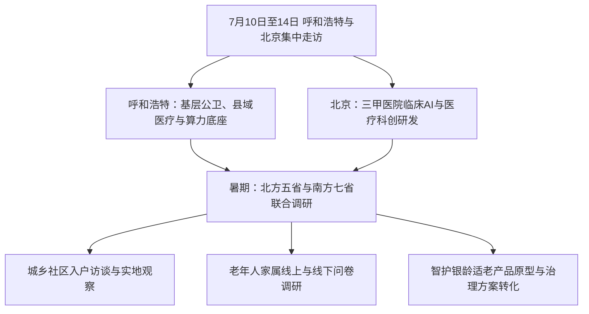

# 慧老智治 医心为民：AI 智慧医养与基层养老治理

> **2026 年暑期社会实践调研报告** — 围绕“慧老智治 医心为民——AI智慧医养赋能基层养老治理现代化”主题，联合实践团队跨越呼和浩特、北京及南北十二省份，通过文献梳理、深度访谈、实地观察与问卷调研，系统剖析智慧医养在基层落地中的真实痛点、产品适老化设计逻辑与治理现代化路径。

## 一、调研背景、目的及意义

人口老龄化是当今中国最显著的社会变迁之一。截至 2024 年末，全国 60 岁及以上老年人口已超过 3 亿，占总人口的 22.0%，65 岁及以上人口占比达 15.6%[1]，我国已全面步入中度老龄化社会。与发达国家“边富边老”的历程不同，我国老龄化呈现出鲜明的“未富先老”“边老边病”特征：老年人口规模庞大、增速快、高龄化趋势显著，约 1.9 亿老年人患有慢性病，多病共存、失能与半失能老人的专业照护需求持续攀升，“长寿但不健康”的结构性矛盾日益突出，给家庭照护体系和基层公共服务带来了沉重压力。

面对严峻的老龄化形势，国家层面作出了一系列前瞻性战略部署。党的二十大报告明确提出“实施积极应对人口老龄化国家战略，发展养老事业和养老产业”；《“健康中国 2030”规划纲要》将健康老龄化纳入健康中国建设全局[2]，“十五五”规划进一步对智慧健康养老作出系统安排，2025 年印发的《关于深化养老服务改革发展的意见》提出构建覆盖城乡、普惠可及的养老服务网络[3]。在此背景下，以人工智能为代表的新一代信息技术被寄予厚望，被视为破解基层医养资源紧张、提升养老服务效能的重要引擎[4]。

然而，宏观政策蓝图与基层落地现实之间仍横亘着明显落差。前期文献梳理与实地走访均表明，基层养老治理当前面临四重结构性难题：

1. **服务供给碎片化**：卫生健康、民政、医保社保等部门往往“各管一段”，医养资源条块分割，健康档案与业务信息难以跨部门互通共享。
2. **技术应用“水土不服”**：市面上不少 AI 医养产品以城市中青年或高数字素养人群为默认画像，严重脱离农村留守老人与低收入高龄群体的真实生活场景。
3. **数字帮扶机制缺失**：基层普遍缺乏常态化的助老指导力量，老年群体陷入“没人教、不会用、不敢用”的现实困境。
4. **跨部门协同与激励不足**：基层数字化考核激励机制与数据治理能力滞后，导致智慧医养在最后一公里的推广动力不足。

<aside-note id="key-or-barrier-thesis" kind="callout" title="核心命题：技术究竟是钥匙还是壁垒？" tone="thesis">
AI 智慧医养在基层呈现出鲜明的双重属性：它既可能成为破解基层养老治理难题的<text-mark tone="good" effect="fluorescent">“钥匙”</text-mark>——通过智能监测、辅助筛查、远程医疗与慢病管理提升服务可及性与精准度；也可能演变为加剧数字鸿沟的<text-mark tone="warn" effect="fluorescent">“壁垒”</text-mark>——因界面繁琐、操作门槛高、信任缺失，反而将最需要医疗照护的老年人拒之门外。技术究竟走向何方，取决于我们能否真正走进基层、听懂老人。
</aside-note>

基于上述背景，团队以“AI智慧医养赋能基层养老治理现代化”为主题，于 2026 年暑期开展系统性社会实践，重点回应三个核心问题：

- **需求端视角**：老年人对 AI 智慧医养究竟“怎么看、怎么用、面临哪些真实障碍”？
- **治理端视角**：基层治理体系在智慧医养推广与落地中究竟“卡在哪里”？
- **医工转化视角**：青年医学生与技术开发者能够为填平这一鸿沟“做什么”？

从**理论意义**看，既有研究多停留在宏观政策解读或单一算法技术层面，从基层治理能力现代化视角贯通“技术—制度—人群”的系统性实证研究仍显不足。本次实践以第一手田野数据为基础，构建“认知—使用—障碍—治理”的分析链条，为探索 AI 赋能基层养老治理提供来自一线的经验证据。

从**实践意义**看，团队在北方五省（甘肃、黑龙江、河南、山东、山西）与南方七省（福建、广东、湖北、湖南、江苏、江西、浙江）共 12 个省份开展问卷与访谈调研；同时深入呼和浩特市疾控中心、内蒙古自治区科技厅、伊利健康谷、内蒙古自治区人民医院、武川县医院、首都医科大学附属北京友谊医院、呼和浩特智慧城市指挥中心、小台社区卫生所，以及北京安和加利尔、奥林巴斯等 20 余个调研点位，深度访谈疾控专家、医院管理者、基层医务工作者、社区网格员与老年居民，旨在摸清真实需求，推动“智护银龄”App 等适老化研发成果真正可用、管用。

---

## 二、调研内容与方法

本研究遵循 **“调查研究 → 认知升华 → 实践创造”** 的知行合一逻辑，立足我国南北方与城乡基层医养的现实差异，综合运用文献研究、实地观察、深度访谈、问卷调查与横向比较等方法，全面采集基层养老治理、AI 医疗技术下沉、老年慢病与癌症早筛、智慧医养产业发展的多维资料。

### （一）研究框架与推进节奏

<timeline-block id="research-three-stages" title="知行合一的三阶段调研与转化路径" tone="thesis">
- **第一阶段：田野调查与集中走访（7 月中旬）** — 梳理国内外智慧医养与基层治理政策文献，赴呼和浩特与北京开展联合集中走访，深入疾控机构、三甲与县域医院、社区卫生服务站、大数据算力中心与医疗科创企业，采集癌症高危筛查、基层义诊与设备运维等一手实景素材。
- **第二阶段：多省调研与编码归因（7 月下旬—8 月中旬）** — 联动北方五省与南方七省开展问卷与半结构化访谈，对访谈录音转录文本、观察笔记与统计数据进行清洗编码，开展南北、城乡及省会与县域的多维交叉对比，提炼“技术—制度—人群”三大维度的核心症结。
- **第三阶段：系统设计与实践转化（8 月中下旬）** — 结合呼和浩特基层早筛实践与北京前沿医疗科创经验，针对老年群体操作痛点与孤独感难题，完成“智护银龄”极简语音交互原型研发与基层医养治理对策报告撰写。
</timeline-block>

### （二）调研区域与点位矩阵

1. **宏观对比区域**：选取北方五省（甘肃、黑龙江、河南、山东、山西）与南方七省（福建、广东、湖北、湖南、江苏、江西、浙江）作为跨区域研究样本，全面把握不同经济水平、气候条件与人口结构下 AI 智慧医养的发展格局。
2. **核心实地调研点位**：聚焦 **内蒙古呼和浩特**（兼具边疆基层公卫实践、和林格尔大数据算力底座与本土健康产业特征）与 **北京**（汇聚顶尖临床医疗资源与前沿医疗科创企业），形成 **“基层落地场景 + 技术研发源头”** 的双核对照样本：
   - **公共卫生与医疗机构**：呼和浩特市疾病预防控制中心、内蒙古自治区人民医院、武川县医院、和林格尔县医院、首都医科大学附属北京友谊医院、小台社区卫生所等。
   - **政府职能与算力平台**：内蒙古自治区科技厅、呼和浩特智慧城市指挥中心、和林格尔大数据算力中心。
   - **产业园区与医疗科技企业**：伊利健康谷、北京安和加利尔科技有限公司、奥林巴斯培训及维修中心。

### （三）核心研究方法与调查工具设计

<html-embed id="field-evidence-lens" src="./embeds/field-evidence-lens/index.html" title="查看资料来源：文献、访谈与辅助问卷" height="620">
报告把深度访谈作为核心调研手段，简易问卷作为辅助工具。交互只展示对应原文，不增加样本数、比例或调查结果。
</html-embed>

在调研实施过程中，团队前期虽设计了标准化的老年群体调查问卷，但在基层实地入户时发现，高龄与农村受访者普遍存在视力衰退、文化程度有限等客观情况，自主填写长问卷较为困难。因此，团队及时调整方法策略：将简化版问卷与家属代填问卷作为辅助量化工具，<text-mark tone="thesis" effect="fluorescent">主要研究资料依靠访谈与实地观察获取</text-mark>，并对访谈录音转录文本进行主题编码分析。

为确保跨区域调研的一致性，团队围绕老年居民、患者家属、基层医护及治理骨干设计了结构化调研问卷与半结构化访谈提纲，核心涵盖五大调查维度：

<inset-card id="survey-five-dimensions" title="调研问卷与半结构化访谈五大核心维度" eyebrow="RESEARCH INSTRUMENT" kicker="FIVE CORE DIMENSIONS" tone="note">
- **维度一：受访者与基层机构基本画像** — 涵盖老年受访者年龄、城乡、文化程度、月收入、居住方式，以及基层医务与治理人员的岗位年限与老年接诊占比。
- **维度二：老年慢病谱系与日常管理误区** — 排查高血压、糖尿病、脑卒中、骨关节病等高发慢病分布，定位随意停药、漏服漏检、轻信偏方及缺乏照护监督等痛点。
- **维度三：智慧医养产品认知、接触渠道与信任度** — 评估智能穿戴、在线问诊、AI 辅助筛查等工具的知晓率、信息获取渠道（代际推荐 vs 机构科普）及隐私与可靠性顾虑。
- **维度四：实际使用行为、弃用原因与适老化诉求** — 追踪设备使用频率、核心应用场景，剖析界面复杂、方言障碍、网络受限等弃用主因，提炼一键式语音交互等适老需求。
- **维度五：基层推广堵点与跨部门协同治理机制** — 考察基层人员数字素养、培训缺口、卫健/民政/医保数据互通壁垒、考核激励机制及科创技术下沉的制度阻碍。
</inset-card>

| 调查对象类别 | 核心采集方式 | 关键观测指标 | 样本覆盖规模 |
| --- | --- | --- | --- |
| 城乡老年居民及家属 | 入户协助问卷 + 线上家属调研 | 知晓率、信任度、使用率、四维障碍（操作/认知/信任/环境） | 12 省份有效问卷 1,276 份 |
| 多元主体深度访谈 | 半结构化深度访谈 + 录音编码 | 临床落地实效、老人心理排斥原因、代际反哺与照护痛点 | 累计深度访谈 214 例 |
| 基层医护与治理骨干 | 专项问卷 + 机构座谈会 | 数字素养自评、跨部门数据孤岛、考核激励缺位、培训诉求 | 基层骨干问卷 186 份、深度座谈 18 人 |

---

## 三、调查结果与多维数据分析

### （一）样本人口学特征

本次回收的 1,276 份有效老年群体样本年龄跨度为 60—92 岁，平均年龄 71.4 岁，呈现出以下典型人口学结构特征：

- **年龄与性别构成**：60—69 岁低龄老人占 42.3%，70—79 岁中龄老人占 38.7%，80 岁及以上高龄老人占 19.0%（北方五省高龄占比 20.5%，略高于南方的 17.6%）。女性占比 53.2%，男性占 46.8%；农村女性受访者比例（55.7%）高于城市（50.8%），折射出农村女性留守养老的普遍性。
- **城乡与教育结构**：城市样本占 51.2%，乡镇及农村样本占 48.8%。文化程度方面，小学及以下占 38.5%，初中占 34.2%，高中/中专占 18.6%，大专及以上仅占 8.7%。其中北方农村地区小学及以下比例高达 47.3%，显著高于南方农村（34.1%）。
- **收入与居住状况**：月收入 2,000 元以下占 41.3%（农村地区高达 58.4%），2,000—4,000 元占 35.8%，4,000 元以上占 22.9%。居住方式上，与子女同住占 43.6%，夫妻同住占 30.2%，独居占 17.8%，入住养老机构占 8.4%；农村独居率（23.5%）几乎是城市（12.3%）的两倍，北方独居比例（20.1%）亦高于南方（15.6%）。

### （二）老年人对 AI 智慧医养的认知与态度

1. **产品知晓率存在显著梯度落差**：受访老年人对 AI 医疗相关产品与服务的总体知晓率为 **34.7%**，即约三分之二的老年人缺乏基本了解。知晓率随年龄增长急剧递减（60—69 岁为 45.6%，70—79 岁为 31.2%，80 岁及以上仅为 16.8%），且城市知晓率（44.3%）接近农村（24.8%）的两倍，南方七省（39.2%）高于北方五省（29.8%）。
2. **产品信任度偏低，隐私与责任归属成首要因**：在知晓相关产品的受访者中，表示“比较信任”和“非常信任”的合计仅占 **28.5%**，“一般”占 34.2%，“不太信任”和“完全不信任”合计达 **37.3%**。高达 **62.4%** 的受访者担忧健康数据泄露或被商业滥用，38.7% 认为“机器不如面对面的医生可靠”，27.1% 担心“机器出错后无人负责”。
3. **信息接触高度依赖家庭代际反哺**：老年人接触 AI 医疗产品的渠道依次为子女/孙辈推荐（41.2%）、社区/村委会宣传（23.6%）、电视/广播广告（18.4%）、医疗机构推荐（10.5%）与网络信息（6.3%）。在农村地区，依赖子女推荐获取信息的比例高达 **52.7%**（城市为 34.1%），表明家庭代际支持是新技术下沉乡村的核心纽带。

### （三）老年人 AI 医疗产品使用现状

- **分品类使用率头重脚轻**：全部受访者中至少使用过一类 AI 医养产品或服务的比例为 **22.8%**。其中智能手环、智能血压计等基础健康监测设备使用率为 15.6%，在线问诊 App 为 7.2%，而真正涉及核心算法能力的 AI 辅助诊断终端使用率仅为 **3.8%**。农村总体使用率（12.4%）不足城市（32.1%）的四成。
- **使用持续性弱，农村弃用率高**：在有过使用经历的老人中，每周至少使用一次的“经常使用者”占 31.4%，“偶尔使用”占 44.7%，而 **“尝试后弃用”的比例达 23.9%**（农村地区弃用率更是高达 **32.6%**，显著高于城市的 18.4%）。弃用首要原因为“操作太复杂”（58.3%），其次为“觉得没实际用处”（22.6%）与“担心隐形收费”（12.1%）。
- **功能停留在浅层监测**：使用场景以家庭自测（62.7%）与社区卫生中心指导使用（21.3%）为主；最常使用的功能集中于血压/心率监测（68.4%）和用药提醒（45.2%），仅 6.8% 的使用者真正体验过 AI 辅助诊断分析功能。

### （四）老年群体的四维痛点与障碍剖析

调研数据显示，老年人在拥抱智慧医养时面临着操作、认知、信任与环境四重相互交织的现实壁垒：

1. **操作障碍（82.6% 受访者至少面临一项）**：具体表现为字体过小与界面层级复杂（67.4%）、操作步骤繁琐记不住（54.6%）、触屏交互不灵敏（38.2%）以及语音识别不支持地方方言（21.7%）。其中，北方老人受困于“步骤太多记不住”的比例更高（61.3% vs 南方 48.2%），而南方老人受困于“方言不通”的比例显著突出（28.4% vs 北方 14.8%）。
2. **认知障碍（与受教育程度强相关）**：46.3% 的老人表示“不理解这些智能化功能有什么实际用处”，35.8%“拿到设备不知从何下手”，28.4%“害怕点错按钮造成扣费或故障”。小学及以下学历老人中存在认知障碍的比例高达 61.7%（大专及以上仅为 18.4%）。
3. **信任障碍（防诈戒备与机器排斥）**：除 62.4% 的数据隐私顾虑外，38.7% 的老人坚持“看病必须找真人医生”，25.3% 表示“年纪大了不想折腾新事物”（80 岁以上高龄群体中该比例升至 47.2%）。农村老人尤其担心“机器误诊或出故障后投诉无门”（42.6% vs 城市 33.1%）。
4. **环境与支持障碍（基础设施与陪伴缺位）**：54.3% 的老人反映“身边没人教、没人指导”，42.7% 表示“子女不在身边无人协助”，37.6% 因“设备出了问题缺乏售后维护”而放弃使用，31.8% 遭遇“网络信号差、设备频繁掉线”（北方农村地区网络受限比例高达 42.3%）。

### （五）基层治理骨干视角与区域横向对比

在对 186 名基层医护及治理骨干的问卷与 18 人深度访谈中，治理端的瓶颈同样清晰浮现：

- **基层数字素养与培训缺口**：基层工作人员数字素养自评均分为 3.2 分（5 分制），乡镇人员（2.8 分）明显低于城市社区（3.6 分）；仅 28.5% 能熟练操作智慧养老平台，高达 **87.6%** 的基层骨干迫切需要平台操作、适老沟通与 AI 工具指导培训。
- **推广难点与跨部门协作堵点**：基层反馈的首要难点是“老人接受度低”（72.6%）与“缺乏专业人员培训”（58.1%）。仅 31.2% 的受访骨干认为跨部门协作顺畅，**67.7% 指出卫健、民政、医保数据互不联通**，58.6% 反映缺乏统一服务平台；同时，高达 **76.3%** 的受访者表示所在单位“无智慧养老相关考核或考核流于形式”。
- **多维区域对比特征**：

| 对比维度 | 领先区域 / 群体特征 | 滞后区域 / 群体特征 | 核心成因剖析 |
| --- | --- | --- | --- |
| 南北差异 | 南方七省（知晓率 39.2%、使用率 27.8%，浙江达 34.2%） | 北方五省（知晓率 29.8%、使用率 17.5%，甘肃仅 12.3%） | 数字经济基础、财政投入力度、基层网络基建及冬季严寒气候制约 |
| 城乡差异 | 城市老年群体（知晓率 44.3%、使用率 32.1%、信任度 34.6%） | 农村老年群体（知晓率 24.8%、使用率 12.4%、独居率 23.5%） | 城乡教育与收入差距、留守空巢化、农村“无人指导”（67.4%）突出 |
| 省会与县域 | 省会城市（知晓率 48.6%、使用率 35.4%，三甲医院辐射强） | 地级市及县域（知晓率 28.7%、使用率 17.2%，高度依赖代际推荐） | 优质医疗资源集聚效应明显，县域面临医疗虹吸与专业人才流失 |

---

## 四、基层智慧医养落地的深层症结分析

结合呼和浩特、武川县及北京等地的实地访谈材料，我们可以穿透统计数据，看到制约 AI 智慧医养在基层落地的四重深层制度与工程症结。

### （一）条块分割与“信息孤岛”消解技术实效

基层 AI 智慧医养的落地绝非单一部门可以独立推进，必须依靠医院、疾控、基层卫生机构、民政与医保体系的紧密咬合。然而在县域实际运行中，“各自为政”仍是常态：医疗归卫健系统管理，养老服务归民政系统统筹，医保结算则运行在另一套独立系统中。

在呼和浩特市疾控中心座谈时，相关负责人坦言，公卫部门非常希望与各级医院打通数据壁垒，将“医防融合”真正落到老年慢病早筛、早干预上。但在现实中，三套体系的数据采集标准与业务流程互不兼容：老人在医院刚测完血压、做完体检，回到社区随访时要重新登记一遍，申请民政养老补贴时还得再填一遍纸质表格。大量重叠的居民健康信息被锁在各自的垂直系统内，乡镇卫生院与村医的随访记录无法顺畅上传至县级医院；更有甚者，老人在家中佩戴的智能监测设备即便捕捉到心率异常或血糖剧烈波动，预警信号也无法实时推送至家庭医生或社区网格员手中，导致智能硬件沦为应付参观演示的“展示品”。

### （二）脱离县域与乡土实际的“水土不服”

在武川县及周边牧区、农村走访时，我们深切感受到许多商业化 AI 医疗产品在设计之初便偏离了基层老人的真实生活图景：

- **交互设计背离高龄生理特征**：农村留守老人普遍视力退化、记忆力减退，面对需要多级菜单跳转、字号微小、术语生硬的在线问诊或健康管理 App，往往手足无措。
- **基础设施与就医习惯错位**：部分偏远牧区和乡村网络信号不稳定，重度依赖云端长连接的智能设备频繁掉线；同时，小台社区卫生服务站的彭大夫在访谈中指出，基层老人看病讲究的是“面对面把脉问诊”的信任感，生硬地用 AI 问答替代医生面诊极易引发排斥，甚至有老人轻信非正规 AI 推送的保健品建议而买错药，最终仍需线下医生重新调方纠正。
- **“一刀切”行政配发造成资源闲置**：部分县域医院虽然按上级标准采购了成套智能化设备，但由于大城市三甲医院的虹吸效应，加上缺乏贴合本地老人习惯的运营引导，昂贵的设备采购入库后便长期闲置，反而给基层留下了“智慧医养华而不实”的刻板印象。

### （三）基层数字帮扶人力与专职机制双重缺位

智能设备进村入户后，决定其生死的往往是“有没有人持续教、持续管”。调研发现，高校大学生暑期“三下乡”等科普活动虽能带来短期热度，但志愿者离开后老人很快便会遗忘操作步骤；而在基层常态化体系内，数字助老力量捉襟见肘：

- **基层医护负荷已近饱和**：武川县医院张院长在访谈中提到，市局批复的 3 个事业编岗位长期无人报考，偶有高学历人才考入也难以长期留任。大豆铺分院的医护人员直言，日常门诊、慢病台账与上门量血压已处于满负荷运转状态，根本无暇挨家挨户开展智能设备教学。
- **乡村村医自身面临老龄化**：武川县 93 个自然村虽实现了村医覆盖，但相当一部分村医自身已年逾七旬，日常仍在使用传统按键老年机，要求高龄村医充当“AI 数字辅导员”显然脱离实际。
- **统筹权责边界模糊**：在与内蒙古自治区科技厅刘处长座谈时，她指出蒙医药数字化、牧区远程医疗与老年慢病数据库建设确属当前短板，但科技部门侧重宏观科研规划，基层医疗机构的落地运营又涉及卫健与民政职责，跨部门专职统筹岗位的缺失直接拖慢了落地进度。

### （四）考核激励错位与基层数据治理能力短板

在基层治理的指挥棒中，常规公卫随访与慢病台账是硬性考核指标，而智慧养老覆盖率与老人数字服务留存率往往属于“干好不加分、干坏不扣分”的软性任务。这种激励缺位直接催生了 **“重采购、轻运营，重硬件、轻服务”** 的现象——硬件发放完毕即视为任务交差，后续的用户体验与故障维护无人跟进。与此同时，面对网络上层出不穷的 AI 语音合成诈骗案例，许多缺乏防诈辨别力的老人将智能化技术视为“洪水猛兽”，进一步加深了“不会用、不敢用、不想用”的防御心理；而在服务端，社区卫生站仍普遍停留在纸质手写档案阶段，既缺懂医疗又懂信息技术的复合型人才，也缺乏将采集数据转化为健康干预决策的分析能力。

<compare-block id="grassroots-governance-compare" title="传统基层养老困局与 AI 智慧医养协同模式对照">
<compare-side role="bad" title="传统基层养老与碎片化困局">
卫健、民政、医保数据割裂，基层医护困于重复填表；商业 AI 产品界面繁琐、脱离乡土场景，“重硬件采购、轻长效运营”，导致设备高闲置率与老年数字鸿沟加剧。
</compare-side>
<compare-side role="good" title="AI 智慧医养与多方协同治理模式">
打通跨部门健康档案与预警闭环，采用“一键语音 + 方言交互 + 家属后台联动”的极简适老化设计，构建“基层网格员 + 医学生志愿基地 + 代际反哺”的常态化帮扶机制。
</compare-side>
</compare-block>

归根结底，**AI 赋能基层养老的核心症结不在算法与硬件本身，而在于治理体系与适老服务的滞后**。唯有同步破除部门孤岛、重构适老交互、补齐帮扶人力与考核制度短板，技术才能真正化为守护银发的温暖力量。

---

## 五、AI 智慧医养系统设计与治理现代化建议

### （一）医工交叉实践转化：“智护银龄”极简适老产品原型设计

作为本次实践团队负责调研成果转化的核心技术人员，我在汇总十二省调研数据并与团队深入复盘后，真切体会到：近半数受访老人反映“没人教、子女不在身边没人帮”，他们在访谈中表面上云淡风轻地说“不需要新玩意儿”，字里行间却流露出深层的孤独感与对远方亲人的挂念。与此同时，超过八成老人被困在繁琐的视觉界面与多步操作中。

基于这一田野洞察，我们在设计“智护银龄”AI 智慧医养应用原型时，彻底摒弃了传统医疗 App 堆砌菜单与图表的做法，确立了 **“向老人做极致减法，在后台做智能加法”** 的工程架构逻辑：

1. **极简“单按钮”全语音交互界面**：针对高龄老人视力退化与记不住步骤的痛点，主屏幕仅保留一个醒目的超大号 **“点击说话”** 按钮。老人无需打字或翻找菜单，一键即可用日常口语或方言与 AI 健康助手全天候自然对话，完成症状倾诉、用药咨询与日常陪伴。
2. **亲情温度中继与隐式心理抚慰**：当独居老人向 AI 念叨日常起居、身体不适或对晚辈的思念时，系统不仅在前端给予温和的语音回应与健康叮嘱，还会在获得隐私授权的前提下，在后台通过结构化摘要将老人的情绪状态与关键话语静默同步给远方子女，用技术搭建起消除代际孤独感的隐形桥梁。
3. **慢病体征双向同步与分级预警闭环**：软件与家用适老监测硬件无感联动，持续记录血压、心率与用药打卡状态，在老人端与家属端提供清晰的安心反馈；一旦触发异常阈值，立即向绑定的家属与基层家庭医生同步推送分级预警，真正打通“居家监测—亲属知晓—基层干预”的最后一公里。

<aside-note id="zhihuyinling-prototype-note" kind="addon" title="成果转化感悟：从单点产品设计到系统工程思维" tone="good">
在完成“智护银龄”原型研发后，我更加深刻地认识到：真正落地基层的智慧医养绝不仅是一个单点的软件 UI 问题，而是一项涵盖适老交互、方言语音模型、跨部门数据接口与基层推广运营的系统工程。只有把代码写进泥土里、把老人藏在沉默背后的情感需求纳入架构考量，医工交叉的创新才能真正服务于最需要的人。
</aside-note>

### （二）赋能基层养老治理现代化的系统对策

面向未来，要推动 AI 智慧医养在城乡基层落地生根，需要从制度协同、产品规范、帮扶网络与长效转化四个维度协同发力：

<inset-card id="governance-action-framework" title="推进基层智慧医养落地的四维治理路径" eyebrow="GOVERNANCE ROADMAP" kicker="SYSTEMIC SOLUTION" tone="thesis">
- **打通数据孤岛，建立跨部门医养协同底座**：统筹卫健、民政、医保三方数据标准，依托和林格尔等区域算力中心共建县域统一的老年电子健康与养老档案库，实现居家监测预警向社区卫生站和家庭医生的一键流转。
- **推行强制性适老化准入，拒绝“数字炫技”**：制定基层智慧医养采购的适老化技术标准，优先引入支持大字体、实体按键、全语音及南北方言交互、弱网离线缓存的轻量化终端，杜绝脱离农村实际的“一刀切”硬件摊派。
- **构建“网格员 + 家庭代际 + 高校医学生”三级帮扶网**：在社区与乡镇设立数字助老专责联络机制，结合农村高达 52.7% 的子女推荐渠道强化代际数字反哺，并依托医学院校志愿服务基地建立常态化驻点指导机制。
- **优化基层考核激励，推动“重硬件”向“重运营”转型**：将老年数字化健康管理实际留存率、慢病干预改善率与老人满意度纳入基层治理正向激励体系，并为基层医护与网格员配备系统化的智慧医养实操培训。
</inset-card>

“慧老智治，医心为民”。人口老龄化是摆在时代面前的必答题，而走出实验室、走进呼和浩特与广袤城乡基层的田野调研告诉我们：让科技保有温度、让服务明晰边界、让治理实现协同，才是基层养老治理现代化的必由之路。我们将继续推动“智护银龄”原型在真实社区场景中的试用迭代，并推进《基层老年医养治理工作指引》与咨政建议落地，努力让每一位老人都能在数字时代被看见、被听懂、被温柔守护。

---

## 参考文献

[1] 国家统计局. 中华人民共和国2024年国民经济和社会发展统计公报[EB/OL]. (2025-02-28)[2026-08-30]. https://www.stats.gov.cn/xxgk/sjfb/tjgb2020/202502/t20250228_1958817.html.

[2] 中共中央, 国务院. “健康中国2030”规划纲要[EB/OL]. (2016-10-25)[2026-08-30]. https://www.ndcpa.gov.cn/jbkzzx/c100030/common/content/content_1658760801129664512.html.

[3] 中共中央, 国务院. 关于深化养老服务改革发展的意见[EB/OL]. (2025-01-07)[2026-08-30]. https://www.beijing.gov.cn/zhengce/gwywj/202501/t20250108_3983528.html.

[4] 国家卫生健康委员会等. 关于促进和规范“人工智能+医疗卫生”应用发展的实施意见[EB/OL]. (2025-11-04)[2026-08-30]. https://www.nhc.gov.cn/guihuaxxs/c100133/202511/d1a42ae835c743b9b3e83ac0253c3e9f.shtml.
