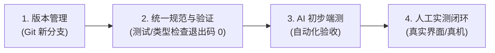
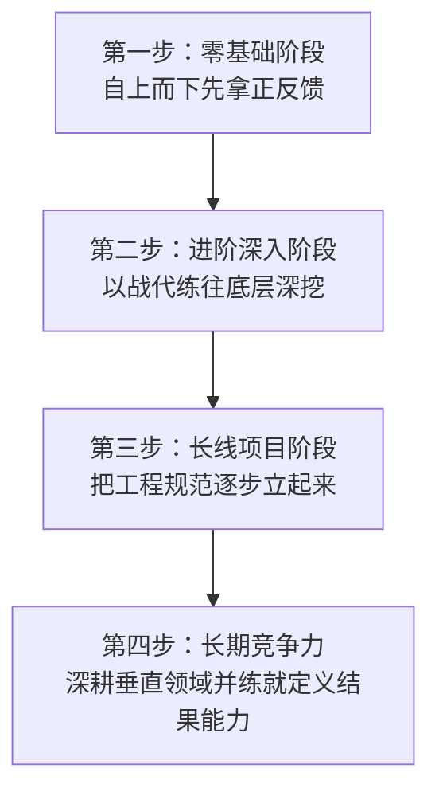

# 和 AI 相处的这一年

> **副标题**：一个医学生的全栈与智能体实践复盘
>
> **阅读前说明**：这篇博客是 Gemini 基于腾讯元宝会议纪要与我当时的讲课 PPT 源码辅助整理而成的。由于缺乏完整的会议逐字稿，也没有当时会议录屏画面的完整上下文，原始素材本身存在一定的信息失真，转写和最终整理出来的部分细节可能存在偏差。加上最近时间有限，我没有逐字逐句完整审查全文，不过整体的核心思路是符合我本意的。另外需要特别提醒的是，AI 在整理文字时很容易把我的很多个人判断改写成偏向绝对化的表述，这在 AI 时代其实并不可取。文中的许多结论只是我基于目前认知和阶段性成果做的简单总结，甚至有些地方我自己也觉得理解得还比较浅，当时面向的主要是刚接触 AI 的朋友，所以给出了一些简化的判断，并不代表这些判断就是普适或可以直接照搬的经验。希望大家在阅读时保持批判性思考，觉得有启发的地方可以拿来参考，觉得有问题的地方也请多加甄别。

2026 年 11 月 8 号，我从凌晨一点聊到夜里十一点半，断断续续连着开了五场线上会。事后复盘发现，这 5 场对话在某种程度上有着一些统一化的内在逻辑。因此，我想结合当初做的 PPT 和 5 场对话内容，把相关散落的知识点整合起来，整理为这篇博客，也当做回顾与 Agent 协作这一年中的整体时间复盘，同时也希望可以在一定程度上帮助刚刚接触 AI 的朋友们。

<web-embed id="ppt-ai-life" src="https://ppt.husteread.icu/ai-life" title="AI 如何赋能生活 · 讲课 PPT" height="520">
若无法直接预览幻灯片，可点击卡片右上角「打开」或直接访问 https://ppt.husteread.icu/ai-life 全屏浏览。
</web-embed>

在这里，我先把这一年最核心的体会总结在前：

<aside-note id="core-thesis" kind="callout" title="核心体会">
AI 能帮一个人走多远，取决于这个人自己本来站在什么位置。它可以很快把一个零基础的普通人拉到各个领域的专业及格线上，但很难直接跨过从及格到顶尖的那段距离。而往上的那一段路，拼的依然是人本身。同时你的知识广度决定了你能想到多少种组合方案，你的专业深度决定了你能不能看穿那些细微的错误，而你在动手之前把问题定义清楚、把验收标准立住的能力，决定了最终做出来的东西到底靠不靠谱。
</aside-note>

回头看，过去这一年我折腾的许多事情，包括摸索模型边界、管理上下文、建立工程规范、搭建个人知识库与自动化流程，再到后来算清每一笔成本账，其实都是在摸索怎么在具体的学习和生活里，和 AI 更好地打配合。

---

## 一、我的来路：一个医学生是怎么开始用 AI 做东西的

我是华中科技大学同济医学院基础医学强基计划的大二学生，同时在修读数智医学微专业。在进大学之前，我从来没有系统学过编程，完全是靠自己边做边摸索出来的。最早在 2025 年夏天高考刚结束那会儿，GPT-4 正火遍全网，我刚接触它的时候，也只是把它当成一个深夜能聊心事、能温和接住情绪的倾听者；后来发现它的知识面实在太广，就慢慢用它替代了满是广告的传统搜索引擎。

<html-embed id="how-i-started-with-ai" src="./embeds/how-i-started-with-ai/index.html" title="我怎么入坑 AI · 代码动画" height="560">
若代码动画未能自动呈现，可点击卡片右上角「打开」全屏播放。
</html-embed>

真正让我从“用 AI 查东西”变成“让 AI 做东西”，源于两个非常具体的契机。

第一个契机是在 2025 年 10 月。当时我是华科读书会的活动部部长，想把读书会这一年的各种活动与照片整理成一个大家能随时翻看的回忆相册网站。我试着把“想要照片墙加时间线、再配一段轻柔的背景音乐”的想法发给 AI，结果它直接帮我写出了完整的网页代码，随后我结合 AI，最终把它嵌入到 WordPress 站点里上线。

<html-embed id="reading-club-album" src="./embeds/reading-club-album/index.html" title="我们的小相册 · 华科读书会回忆相册" height="600">
若相册未能直接加载，可点击卡片右上角「打开」全屏浏览完整相册与时间线。
</html-embed>

第二个契机来自医学专业课的学习。学医的时候经常会遇到跨章节、跨教材的问题，比如“糖尿病人酮症酸中毒时呼气为什么会有烂苹果味”，完整的生化代谢与临床机制散落在好几本教材的不同章节里。为了把这些散落的知识点真正串起来，我愿意花时间去折腾，于是动手做了 StudySolo 这个项目。那时候真正吸引我的不是跟 AI 聊天本身，而是看着脑子里零散的念头，真的能通过代码变成一个可以运行、身边的同学也用得上的工具。

把这两个小项目做出来之后，后面的尝试就顺理成章地铺开了：用纯代码生成教学视频、从零写全栈网站、用 LaTeX 把排版混乱的 Word 文档一键转成标准学术格式，再一路摸索到通用 Agent 的开发与编排。

这一年多下来，我发起了面向学术生产力的 1037Solo（RootSolo）系列项目，参与共建了青禾·原野（Protocom），也在学院的“医路求索”团队里担任技术组组长；带着 StudySolo、Flash Idea 和 PurpleInk 这几个项目，陆续在华科首届创新 AI 智能体校园开发大赛、中国高校计算机大赛 AIGC 创新赛以及 AdventureX 2026 黑客松（阶跃星辰赛道）里拿了奖。目前在做的便是集成了智能拍照识别饮食、热量统计和 Agent 表单查询推荐的健康打卡项目，几个 3D 交互网页，以及用代码配合 Three.js 建模和豆包语音制作的医学科普视频系列《细胞之城》。

坦白讲，从零基础起步到能比较顺手地带着 AI 交付完整项目，我整整磨了一年。计算机科班出身的同学在课堂上几节课就能建立起来的系统框架，我靠自己试错、看报错、查资料摸索了一整年，单看学习基础知识的效率确实不算高，没什么好遮掩的。

但这一年的实战也给了我一份意外的收获，就是攒下了一套怎么跟 AI 打配合的实际经验。正因为我一开始不懂底层代码怎么一行行手写，每当项目跑不通或者改出问题时，只能逼着自己把需求边界、目录规范、模块接口和验收标准一条条想明白，再用清晰的规则去约束 AI。后面几节要聊的方法，大多都是从上面这些项目的排错现场里一点点总结出来的。

---

## 二、AI 的边界：能干什么的边界，与不同工具之间的边界

在《AI 如何赋能生活》那份分享 PPT 的最后一页，我写了一句自己感触很深的话：**边界，是最重要的一件事。** AI 到底能做什么、做不到什么，光听别人宣传没太大意义，往往还是得自己亲自下场试过才清楚。结合这一年的体会，我当时把“AI 的边界”总结成了两个大的方向：**第一个方向是 AI 能干什么的边界，第二个方向是不同 AI 之间区别的边界。**

### 2.1 第一个方向：AI 能干什么的边界

所谓“AI 能干什么的边界”，核心是指 AI 到底能和哪些学科结合、能深入到哪些细分领域，以及在这些领域里它能做到什么程度。

#### （1）通用能力与垂直细分领域的结合

在摸索 AI 能跟什么领域结合时，我当时举的例子并不是停留在宽泛的大类学科上，而是拆成了两块来看：一块是生图、生视频、写代码、文档处理这些**通用领域的能力**；另一块则是智慧医疗、医学影像分析、蛋白质结构预测等**具体垂直细分领域的应用**。

当你对这两块都有了一定了解之后，再回头看自己的本专业，就会慢慢养成一种**“用 AI 的眼光看自己学科”**的视角，比较容易看出哪些耗时费力的传统环节有机会用 AI 重新梳理。在这个过程中，我经常会借用**知识广度**和**第一性原理**的思路：AI 很擅长帮我们补齐某项具体技术的操作深度，但前提是我们自己得先有一定的知识广度，知道有哪些工具和路径存在，才能把不同领域的做法组合起来。就像高中解复杂的数学题时，死算往往很难走通，通常要先观察条件结构，通过降维和换元把陌生问题转化成熟悉的基础题型；做开发或解决专业问题也是一样，先把复杂需求拆解成基础的输入、处理和输出逻辑，往往更容易找到简化的实现路径。

#### （2）“行业平均线”与顶尖专业水平的差距

在尝试把 AI 用到不同领域之后，关于它能做到什么程度，我有一个阶段性的认识：**AI 可以比较快地把一个零基础的普通人，拉升到某个领域的平均专业水准。**

这确实带来了很大的便利；但换个角度看，**AI 的及格线，也在慢慢变成初学者的淘汰线。** 无论是写基础代码、剪辑常规视频，还是做一张普通的活动海报，现在的 AI 往往比刚入门的新手做得更规范、速度更快、成本也更低。

不过往上的顶尖水平，AI 目前还是很难直接拉平的。比如它很难直接做出细节和构图都极具张力的顶尖海报；放到医学领域里，这种差距也同样明显。像临床诊断学里常讲的“牵涉痛”，或者查体时那些细微的体征差别，书本上的文字规律 AI 都能列出来，但真正面对具体病人时，怎么从复杂的症状和查体手感里敏锐地抓住关键线索，依然高度依赖医生长期临床攒下来的经验和专业直觉。越往深处走，越考验一个人在自己专业领域里的积累够不够深。

### 2.2 第二个方向：不同 AI 之间区别的边界

第二个方向的边界，是指我们使用不同 AI 模型之间的表现差距，以及使用不同 Agent 软件时的实际体验差异。把这个层次分清楚，平时选工具和排查问题时会少走很多弯路。

#### （1）底层大模型与外层 Agent 软件（Harness）的层次区分

在日常使用里，不同 AI 工具表现出来的效果，其实是由两个不同层次共同决定的：**能力上限更多取决于底层大模型本身的水平，而实际做出来的下限，则很大程度上受外层智能体软件（Harness）以及我们如何提供上下文的影响。**

所以我平时选工具，不会只看官方发布的跑分榜单，而是把评测数据和自己的实际使用体感结合起来看。每当想用 AI 解决一类新问题时，我一般会顺着三个问题去试：**目前市面上有哪些底层模型可选？放在哪个 Agent 软件环境里表现更顺手？再往深一步想，它能做好这件事的底层逻辑是什么？** 过去这一年我陆续试过不少工具，最后留在电脑里常用的其实就那么几款，核心标准就是看它在具体任务里能不能稳定地把活接住。

#### （2）不同模型之间的分工与单平台依赖风险

具体到不同大模型的选型上，它们各自的强项和短板还是挺明显的，我平时习惯按手头的任务特点来分工：

- **写文案与深度中文表达**：Claude 目前在中文语感和逻辑细腻度上通常表现更好一些；
- **前端界面设计与样式调整**：用 Gemini 或 Kimi 的性价比往往更高，Claude 的调用价格相对较贵，拿来反复调前端样式在成本上不太划算；
- **纯代码生成视频与复杂镜头控制**：像用代码直接驱动教学动画、控制运镜这类任务，目前我试下来主要是 Claude Opus 或 Sonnet 5.5 这一系模型能比较稳定地跑通，其他模型暂时还不太容易接住。

同时这里也需要注意一个现实问题：**尽量不要把一整条业务流程完全绑死在某一个特定模型上。** 如果手头的工作完全依赖某一家海外模型，一旦遇到服务波动、账号风控或者大幅涨价，整个流程就很容易被动停摆。

---

## 三、上下文管理：关于 Context Engineering 的几点实践经验

当我们大概了解了 AI 的边界、知道它大致能干什么之后，接下来更重要的问题，就是怎么结合自己的实践，学会更好地去使用 AI。在和 AI 协作这件事上，一方面需要我们不断去尝试和摸索它的能力边界；而在另一个方向上，如果结合我自己的经历来看，我目前觉得最重要的一条协作经验，就是对 AI 上下文的管理。

以前遇到 AI 写出来的东西不对、需要来回返工，我第一反应也容易觉得是模型不够聪明；但现在只要出现返工，我通常会先自查：是不是刚才给的提示词本身就有逻辑漏洞？这次跑偏到底是模型生成时的概率偏差，还是外层智能体软件的编排机制（Harness）存在局限？而且上下文怎么组织，不仅影响输出质量，也关系到调用成本和缓存命中率（Cache Hit）。在多轮对话或长任务里，如果前序上下文能保持相对稳定，命中的缓存部分往往只需要很少的费用；反过来，背景材料摆放的顺序和时机不同，最后算下来的账单可能会差出不少。

我认为模型的上下文管理是一件很复杂的事情，而且我个人觉得它值得被称作一门 Engineering（上下文工程）。正因为它本身比较复杂，我更倾向于先从模型上下文背后的逻辑、日常使用中的注意事项，以及一些实际编排方式出发，分享一点经验类的内容。下面整理的这 7 点，彼此之间可能没有特别严格的先后逻辑关系，但我觉得每一点在实际使用中都有一定的参考价值，大家可以结合自己的场景简单看一看；未来如果有机会，我也希望能把这些零散的体会进一步梳理成更本质的框架：

1. **用一份 300 行以内的 `AGENTS.md` 交代项目全局概况与关键文件路径**
   把项目怎么启动、占用什么端口、核心架构脉络是什么写进根目录的 `AGENTS.md` 里，给 AI 一份清晰的全局说明，篇幅一般建议控制在 300 行以内。这里还有一点很实用：`AGENTS.md` 里非常适合写清楚各个关键文档和模块的文件路径索引，这本身也是结合了“渐进式批注”的思想，正好呼应下面要讲的第二条思路。
2. **渐进式批注，按需读取上下文**
   尽量不要一上来就把项目里所有的规范文档一股脑全塞进对话里。无关内容塞得越多，模型的注意力往往越容易分散，写出来的代码反而更容易出错。更好的方式是在总说明里留好路径索引，推进到哪一块功能，再引导 AI 去读取对应的那个文件。
3. **把踩过的坑反向写回规范文档**
   项目里如果遇到反复出现的 Bug，在排查修复之后，可以把出错原因和修复准则顺手补进规范文件里。自己踩过一次的坑，写进文档后就能成为后续协作时的参考记录，减少在同一个问题上反复消耗时间。
4. **单独维护一份前端设计规范（Playbook / 设计锁）**
   如果不加约束让 AI 直接生成前端，写出来的页面容易风格不一，有时新建一个对话就会换一套配色和字号。我在做《UI/UX 启迪课程》分享时提到过“给 AI 上设计锁”的做法：围绕“清晰而非困惑、少即是多、一致性”三条原则，单独建一份前端 Playbook（或 `design.lock`），比如把全站的主色控制在三种以内、字体控制在两种以内，让 AI 每次改界面时有个统一的参照。
5. **动手前先把目录路径清单讲清楚**
   `src` 目录放哪些核心业务代码、`app` 层怎么管路由、后端 API 接口放在哪里，先在文档里交代清楚，AI 才更容易找准该去哪个文件夹里查代码、改代码。
6. **主动补齐空间上下文**
   纯文本模型对页面的实际视觉排布缺乏直观感知，光靠文字描述“页面哪里歪了”往往很难一次改准。直接截图并在图上画框批注，或者把页面组件结构导出成 JSON 发给它，修改的准确率通常会提升不少。
7. **把操作系统的环境差异写进提示词**
   不少模型默认习惯按 Linux 的命令格式输出，到了 Windows 环境里，有时会因为少写 `.exe` 后缀，或者搞混了 PowerShell 和 bash 的语法差异、不清楚 `curl` 在 PowerShell 里的别名机制而报错。把当前系统的环境说明提前写进提示词或项目规范里，能省掉不少环境命令上的折腾。

除了单项目内的整理，**上下文隔离**也是我平时比较在意的一点。

我习惯按项目、按话题建立独立的本地文件夹，在做 AI 编程时，一般不会接入个人生活经历相关的数据；在使用通用聊天软件时，那些默认的“跨会话全局记忆”我通常也会手动关掉，因为不同话题之间有时会互相干扰，相比之下按需连接自建知识库或独立文件夹会更干净一些。另外，考虑到单个对话的上下文窗口本身有限，遇到涉及多职能的复杂事务时，我们也可以考虑采用多个子智能体（Sub-agents）协同的方式，让不同子智能体各自负责一块，往往比让同一个会话从头包办到尾更容易把控。

---

## 四、软件工程规范：怎么让 AI 写出来的项目长期维护下去

如果说管好上下文主要是为了让 AI 在单次协作里更好地对齐需求，那么软件工程规范要解决的，则是怎么让 AI 写出来的代码在几周、几个月之后还能继续维护，尽量避免改一处崩一片的情况。

### 4.1 明确模块出入口，引导 AI 做组件复用

用 AI 写代码时常遇到的一个困扰，倒不一定是语法报错，而是它很容易写出一堆单独看都能跑、拼在一起却对不上的零散组件。

我平时常拿自己做的那个智能饮食打卡项目举例。那个应用当时设计了三个入口：智能拍照识别、直接手动打卡、以及跟 AI 对话打卡。按理说，这三个入口底层完全可以复用同一批数据处理和展示组件。但当时我没有提前把模块规则约定好，AI 在写这三个入口时各写各的，每个模块单拎出来看都没什么问题，可整条业务链路一串起来就容易断，三套逻辑各自独立、互不相通。后来页面上出现热量显示不出来的 Bug，我也是顺着“拍照识别 → 写入数据库 → 读取数据 → 填充页面状态”这条完整链路一步步排查，才最终定位到问题所在。

那次经历让我体会很深：**模块拆分得清不清楚，很大程度上决定了排查一个问题是花十几分钟，还是要耗掉大半天。** 很难指望 AI 自己主动产生全局架构意识，最好在动手前先把各个模块的入口和出口约定清楚，通过项目规范引导它复用现有组件。

### 4.2 把需求颗粒度拆细，在写代码前留好边界兜底

模块边界划好之后，再往下就是**需求的颗粒度**。

跟 AI 提需求时，如果不提前交代清楚“调起相册时能不能多选”“要不要调用手机原生接口”“查出来是空值时怎么处理”“网页端没有手机计步传感器时怎么降级显示”，做出来的功能有时就会缩水，或者在遇到边界情况时报错。我现在写需求说明时，像“每日步数在网页端默认显示为 0 步”“新增数据优先复用现有数据表的列”这类细节，一般都会尽量提前写进去。

这些看着有点琐碎的边界条件，其实是减少前端页面意外报错的重要保障。如果缺少这层细颗粒度的说明，随着功能越加越多，整个项目就容易从最初的清晰可控慢慢变得难以维护，到最后连自己都不太敢随便改动代码。

反过来，如果项目做到中途确实觉得模块变多、脑子有点理不清了，我平时也会用一个简单好用的办法：**让 AI 扫描代码库生成一张可视化的“模块关系画布”，然后直接在这张画布上做批注。** 相比很多概念复杂的工具，这种一眼能看清模块连接关系的结构图挺实用的，标清楚哪条线需要调整再交给 AI，对项目的掌控感和做事的节奏感很快就能找回来。

<html-embed id="system-architecture-canvas" src="./embeds/system-architecture-canvas/index.html" title="DayDayOn 五层软件工程架构与数据血缘画布" height="720">
若架构画布未能直接加载，可点击卡片右上角「打开」全屏浏览完整的五层架构透视与数据血缘关系。
</html-embed>

### 4.3 小步快跑、冷热更新与底层常识

落到日常开发流程上，我平时比较推崇**“小步快跑”**的做法。

我理解的“小步快跑”，核心思想是**不要把一个庞大笼统的需求直接一股脑丢给 AI**。相反，我们需要先结合需求本身以及自己对整个项目的把握（比如项目现有的规范和模块划分），人为地把大需求拆解成若干个小任务；再结合前面摸索出的模型边界，去判断哪些子任务适合交给哪一个模型、开启哪一档思考等级来处理。

每次推进时，我们单向地把其中一个小任务的边界条件明确好，再配合一套固定的工程工具流去落地：

1. **版本管理**：每一次任务修订对应一个独立的 Git 版本，先切出一条新的分支再动手；
2. **统一规范与基础验证**：Agent 完成编码任务后，先自动跑一遍基础验证（比如自动化测试或类型检查，确保退出码为 `0`）；
3. **AI 初步端测**：如果当前使用的 AI 工具具备端到端测试能力、且调用成本比较低，我也会考虑让它先跑一轮初步的自动端测；
4. **人工实测闭环**：最后一步，一定是我自己打开真实界面或真机，把功能从头到尾点一遍完成人工端测，这样才算形成一个完整的闭环。

因为每一次拆出来的任务量都比较小，这种“小步快跑”的方式在实际做项目时有两个很实在的好处：第一，它并不会因为步子小反而耽误整体进度，相反在一步步推进的过程中，会不断加深我对整个项目结构和细节的理解与掌握；第二，在粒度和边界都很清晰的前提下，我能和 AI Agent 配合得更顺畅，更容易对齐上下文，我心里也会更清楚每一块代码应该引导它怎么写。

这里我再举一个移动端项目里的例子：比如在做移动端相关开发时，版本维护还可以留意区分一下冷热更新。如果只是单纯的前端界面微调，通常走云端热更新重载就能看到效果；但如果改动涉及到底层原生接口，一般就需要重新打包安装 APK 了。提前留意这类界限，能减少不少因为“改了代码却没生效”带来的返工。

之前也有同学问过我，如果遇到体量比较大的复杂项目该怎么管？我结合自己的实践给出的回答是：可能还是要多借助软件工程的思路。比如前期尽量把项目规范、模块依赖关系、数据库写入规则梳理清楚，后期配合端到端测试和冒烟测试等验收环节，而不是单纯指望换一个更贵的模型去解决所有的工程管理问题。（这里也补充说明一下：受限于目前的学业和时间安排，我自己其实还没有系统性地学过软件工程这门课，不过我很打算找时间去系统补一补。只是根据这一年做项目的很多实际体感，我觉得要想把一个项目长期治理好，往后走大概率都会和软件工程的方法挂上钩，所以在我的潜意识里觉得它很重要。这只是我基于目前实践下的一点个人判断，不一定完全准确，仅供大家参考。）

另外，**了解一些计算机底层基础知识也挺有帮助的**。像 Linux 常用指令、Docker、端口、包管理器、开源组件库、容器原理，对这些概念有了基本认识之后，更容易看懂 Agent 在后台编排的每一步大致在干什么，也更容易读懂终端里的报错日志。举个具体的例子：有一次我怎么都连不上远程服务器的 SSH，把情况发给 AI 后，它判断可能是因为本地虚拟网卡开着（代理工具的 TUN 模式），并给出了“在命令里加指定 IP 参数”或者“改走直连规则”两个解决思路。如果我完全不了解命令行和网络基础概念，可能就不太容易判断这条建议的价值，也不好决定当时先试哪个方案。

至于 Windows 系统的开发环境，我遇到过的兼容性问题确实也不少：比如内存占用偏高、跨平台脚本容易水土不服。在 Windows 上做开发，我通常会考虑两条路：要么配置好 WSL，给 AI 提供一个相对标准的 Linux 环境；要么就像前面提到的，把 PowerShell 的语法规则提前写进提示词里，减少命令格式报错。如果条件允许，换用 Mac 往往能省掉不少环境配置上的折腾，我自己最近也在考虑。

---

## 五、日常赋能与记忆复利：把平时的积累变成随时能用的资产

在《AI 如何赋能生活》那份讲课 PPT 的第四部分里，我用五个切换标签展示了自己现在每天都在用 AI 干什么：**日常学习、查专业资料、深度交流、做项目、做科普 IP**。把这五个场景串起来看，背后其实都在做同一件事，就是把平时踩过的坑和学到的知识慢慢积累成长期可复用的资产。

### 5.1 前期基建与 Skills 的复利效应

刚开始做开发的时候，最花时间的往往还不是写提示词，而是打通生产环境、云数据库、本地工具链（Git、Docker、WSL），外加管理一堆账号的订阅、风控和额度。

这些前期投入看着比较繁琐，有时候配通一个环境要折腾好几天。但只要跑通一次，并且用 Skills 把排错经验和常用工作流封装下来，后面再遇到同类任务时，直接调用现成的提示词和模板就能快很多，边际成本会明显往下降。第二次、第三次做同类项目时，推进速度通常会比第一次顺畅不少。

### 5.2 专业课学习与科研文献：用课堂立体系，让 Agent 跑检索

在医学专业课的日常学习上，我一直把 AI 答疑和课堂学习配合起来用：

平时遇到不懂的概念先随手问 AI，通常比自己翻十几个网页快得多；同时我会把医学教材放进个人知识库里当上下文，让 AI 回答时有明确的教材参考范围，再把没搞懂的难点挑出来让它换着角度讲，逐个攻克。但我心里也很清楚，**AI 给出的知识往往是零散的、不太成体系的**。它能帮我做单点突破、开阔眼界，却很难替代系统的学科训练。所以我还是会回到学校的真实课堂上，认真听老师讲课，靠学校课程把整个学科的框架立起来，再用 AI 把里面的细节填满，这两者更多是互相补充的关系。

到了查专业文献和科研场景里，AI 能帮上的忙就更多一些。我会用 Agent 软件接入知网、PubMed 等论文平台的 MCP 工具（学医平时用得更多的还是 PubMed）。查资料时，可以让多个智能体并行去检索和阅读文献，各自带回材料后，再让它们做交叉对比与挑错，综合整理成一份文献报告。拿到报告后，我会在工作站里点开真实的 PDF 原文核对阅读，遇到难懂的长难句让 AI 在旁边做辅助翻译，同时顺手把专业生词收进生词本。这样配合下来，它就从一个简单的问答框，变成了比较实用的科研辅助工具。

### 5.3 深度交流、长期记忆与保持批判性思考

除了专业学习，在生活、学业和情感上遇到困惑时，我有时也会跟 AI 做深度交流。

我长期维护着一套自己的个人知识库，把过去的一些重要经历、想法、情绪状态和健康情况记录进去。因为有了这份长期积累的上下文，AI 对我的背景比较了解，每次聊新问题时不用从头解释来龙去脉，它也能结合我过往的经历给出更有针对性的总结，而不是只说一些笼统的套话；每次聊出有启发的新结论，我再把它更新回知识库里，下一次对话就能在此基础上继续推进。

不过在长期对话里，我对模型的“迎合倾向”也一直保持着留意。在情绪不好或者纠结的时候，我确实希望 AI 先温和地接住情绪，然后再进入客观的分析与建议；但我们自己还是要尽量保持批判性思考，不要因为 AI 顺着自己的话说就急着下定论，避免让它变成只挑好听的话说的恭维工具。

（顺便提一句前面说过的那个知识图谱项目：当时做它，本意是想用 AI 帮人标出日常对话里容易忽略的认知盲区；后来看到大厂的通用 Agent 能力迭代得很快，已经能较好地覆盖这类需求了，我就主动把它搁置了。看清趋势后及时停掉没必要硬撑的项目，本身也算是一次挺有价值的尝试。）

### 5.4 面向结果的逆向学习与输出倒逼内化

在平时的学习习惯上，我还有两个觉得挺受用的做法。

第一个做法我叫它**“面向结果的学习”**。比如我在用 Codex 这类成熟的商业编程工具时，会留意去拆解它的功能设计，琢磨它的工程师为什么要这么设计交互和流程，借成熟产品的业务逻辑来补我自己的系统知识缺口（就像我在《UI/UX 启迪课程》里提到的，看到任何界面都不妨先在心里问一句“它为什么这么设计”）。有时候遇到讲得不算吸引人的课程，我坐在底下也会看看老师 PPT 的制作和排版，琢磨哪些地方可以改进；大一钻研摄影构图养成的观察习惯，后来也自然地用到了前端 UI/UX 设计上，平时闲下来也会下意识去找不同事物之间的关联。其实身边接触到的很多东西都能拿来学习，难点往往在于怎么把“知道一个道理”变成平时的习惯。

第二个做法则是**用输出倒逼内化。** 去听一场讲座或者参加一次分享，结束后如果能坐下来整理出一篇总结并分享出来，吸收到的东西往往比只听不写要扎实得多。在现在这个时代，获取信息的门槛已经低了很多，很多时候拉开差距的地方可能不再只是输入端，更在于输出端。

---

## 六、自动化与时间分配：让程序在后台跑，把时间留给课堂与真实的人

如果问我 AI 有哪项能力比较容易被大家忽略，我觉得不一定是它当面打字有多快，而是**当我们不在电脑前的时候，它依然可以在后台接着跑**。

### 6.1 异步派活与卸载认知负荷

我平时的习惯是提前把任务拆好、布置下去，等我去上课、课间换教室或者晚上休息的时候，让电脑自己在后台往下执行；到了课间的碎片时间，掏出手机在飞书上看一眼进度，顺手补一句指令就行。很多耗时的任务都能这样异步跑完，我只需要在关键节点上远程看一眼、把把关。

在这套模式里，自动化日报（小日报）是我自己挺满意的一条流水线：几个 Agent 每天定时分头搜集资讯、整理内容、自动部署到我的个人博客上，再联动邮箱和待办软件发通知，整套流程跑下来平时基本不用怎么手动干预。像填表、做常规材料模板这类日常杂活，我也会尽量交给 AI 去处理。有时候碰到好几个截止时间（DDL）不确定、约束条件又比较复杂的任务堆在一起，我也会先把所有事情发给 AI，让它先帮我梳理出一份先后顺序。当杂乱的信息被理顺之后，脑子里的负担会轻不少，更能把精力留给需要深度思考的部分。

经常有人问我，一边折腾这些开发项目和自动化，一边读医学，时间怎么平衡？其实我的想法一直挺简单的：**医学专业课的学习始终是重心，我只是把自动化的任务塞进了平时不忙于专业课的空隙里。** 只要自己对本专业有热情、上课的时候认真听讲，一般不太会出现严重分心的问题。

### 6.2 留住“对话”，再走到线下去见具体的人

换个角度说，对我们普通在校学生而言，AI 很有价值的地方其实还不只是写代码，而是它提供了一个随时在线、跨领域、成本很低的答疑渠道。如果有一天所有的扩展功能都被砍掉、只允许保留一个，我个人大概率会选**“对话”**。因为不管是多复杂的 Agent，底层跑的核心依然是对话，工程上的许多工作，本质上也是把底层的概率预测能力编排成了更丰富的形态。

而当我们把线上那些重复机械的杂活交给自动化之后，省下来的时间和精力去干什么？去认识真实的人，去做具体的事。

这一年我花了不少心思在办技术社群、打比赛、做 1037Solo 生态、更新个人博客“羽升”（取“羽化成蝶，升生不息”的意思），还有用代码和 Three.js 做《细胞之城》科普视频系列（把细胞里的分工协作讲成一座城市的运转，试着往系列化更新推进）。回头看，做社群和打比赛带给我很大的收获，其实是路上认识的朋友和积累下来的连接。我自己能够接触到一些真实的企业合作项目，很大程度上就得益于网安学院学长的内推。

平时多参与、多表达，把自己做的东西和真实的思考分享出来，往往更容易遇到志同道合的人。很多时候，在一场线下沙龙里跟人面对面聊上几个小时，收获的启发可能比单纯在电脑前折腾技术还要多。

---

## 七、算清现实账本：订阅成本、账号风控、数据主权与团队落地

聊完了方法与体会，这一节也想把账本摊开，算一笔现实的经济账。高强度使用 AI 是有实际成本的，如果前期不太留意，很容易在开销和流程稳定性上踩坑。

### 7.1 先把真实的开销与风控风险摆出来

先把几个我自己的真实开销和经历摆出来供大家参考：

- 之前我用 Claude 走纯代码路线做学科可视化视频，前前后后做了三四十个视频，光调用成本就花了一两千块钱；
- 在过去几个月里，我每个月花在各类 AI 工具上的订阅费一度达到两三千元，主要靠平时做兼职的收入支撑。直到最近认真算了一遍账，觉得长期这么花确实负担太重，才决定把非核心的订阅陆续停掉；
- 除了费用之外，还要面对潜在的**账号风控与封号风险**，如果主力账号突然被封，手头正在推进的活就很容易被迫中断。

从今年的行业动向也能看出来，不少 AI 厂商正在从早期的“靠补贴换增长”转向更注重商业化回本，部分产品的免费或低价额度在收紧，实际使用成本大概率会慢慢往上涨。所以我个人的建议是：**不妨趁着现在还有一定的补贴红利，早点把适合自己的工作流程跑通、把方法练熟，比等以后普遍涨价了再从头摸索要划算一些。**

另外，出海使用海外模型的门槛也确实不低：办理境外信用卡、海外手机号接码、SIM 卡归属地检测，乃至换设备、换时区时的环境校验，往往都要花精力去处理。最近某款头部海外产品大幅缩减了使用额度，单次复杂调用的成本变得很高，背后很大程度上也是厂商在控制算力亏损。就算通过分散订阅多个平台来平摊风险，各个账号的风控状态和剩余额度也需要自己花精力去盯着，这笔隐形的维护成本其实并不小。

### 7.2 给新手的省钱起步路线

正因为自己走过不少花钱的弯路，如果刚入门的朋友问我怎么选工具，我一般会建议一条相对省钱稳妥的路线：**可以先从国内生态成熟的工具起步。**

比如腾讯的 **WorkBuddy** 注册就有免费积分，里面内置的 Skills 可以理解为官方预先整理好的提示词工作流，把不少复杂的工程概念做了简化，不用先啃完底层原理就能上手试着做东西；而且在腾讯自己的生态里，顺手就能总结腾讯会议纪要、连上飞书发通知、部署静态网站，有时还会配套提供入门级的云服务器，帮新手省掉了不少环境配置的工作。相比之下，如果一上来就碰到界面不够友好、收费偏高、额度消耗又快的工作台产品，新手可能用一两天就容易失去兴趣。等先用顺手的工具把任务拆解的感觉练熟了，后面再按实际需要去尝试 Claude Opus 或 GPT Codex 这类模型也不迟。

### 7.3 数据主权与团队低成本落地方案

用得越久，**数据主权**这件事我也越发重视。我现在更倾向于在本地电脑或自己的服务器上部署开源框架当“中控台”，尽量不把长期积累的核心数据和工作流完全绑在某一家商业平台上；同时不管是自己写工具还是用别人的客户端，我个人一直尽量守住一条安全习惯：**只在本地客户端输入 API Key，尽量避免在第三方服务器上存储密钥。**

如果是小团队或者课题组想尝试自动化，我们也实际测算过一套成本较低的方案：租一台基础配置的 VPS 服务器，部署开源 Agent 框架，接入性价比较高的 DeepSeek API，再配合人工做初期数据清洗，连进飞书里做会议记录自动化。每次开完会定时把录音转写成文字、清洗后存入知识库，再用飞书卡片把结果推送给大家收集反馈，逐步调优效果。顺带提个小细节，飞书团队版按人数收费相对较贵，小团队规模下用单人版配合机器人往往划算不少。

而在尝试搭建这套团队知识库的过程中，我们发现很花精力的地方往往不在技术本身，而在于**导师或前辈脑子里的许多经验并没有现成的文字稿**。要把这些隐性的背景知识从零开始通过录音、访谈整理进知识库，这块的工作量其实非常大，前期评估时最好留足预期。

这件事跟用 AI 做 PPT 也是类似的道理：我见过有人半小时就能出初稿的，因为他是直接调用自己平时整理好的个人知识库去生成大纲；也见过有人先用 Grok 生成前端页面、再交给 Claude 一点点调整样式，前前后后花了两个多小时。这中间的效率差别，很大程度上不在于当天用了哪款工具，而在于平时有没有把自己的资料和经验一点点整理成随时能调用的数据积累。

---

## 八、如果从头走一遍：给零基础同学的四步参考路线

聊了这么多具体的做法和踩坑经历，如果现在让我站在一年后的节点上回头看，给同样零基础的非科班朋友梳理一条循序渐进的学习参考路线，我大概会分成下面四步，一步步往上走，不用一上来就去碰最难的底层细节：

### 第一步：零基础阶段，自上而下先拿正反馈

最开始一般不用抱着厚厚的编程语法书死磕。可以先试试**自上而下**的路子：花一点时间了解软件工程、服务器运维这些基本概念，对组件库、容器原理、端口、包管理器有个大概印象；然后找个自己感兴趣的小点子，让 AI 带着跑通一个能看、能点的简单项目。先拿到第一波实实在在的正反馈，把继续往下学的动力攒起来，这在起步阶段往往很有帮助。

### 第二步：进阶深入阶段，以战代练往底层深挖

等能做出简单作品之后，可以花两三个月时间把 Git 版本控制这类工程基础补一补。这个阶段我个人觉得比较有效的方式是**以战代练**：拿具体的项目去驱动 AI 写代码、排错，遇到看不懂的报错或陌生的技术名词，就顺着好奇心往底层原理去追问，把 AI 当成随时能请教的老师。这里比较关键的是保持主动思考，学到的概念尽量挂靠到具体的业务场景上去理解，这样比单纯背诵孤立的知识点更容易记住。

### 第三步：长线项目阶段，把工程规范逐步立起来

当你开始尝试周期更长、功能更多的项目时，前面第四节聊到的那些软件工程做法，比如目录划分、模块解耦、细颗粒度需求说明、验收条件以及基于 Git 分支的小步快跑，就都可以逐步用起来了。

### 第四步：长期竞争力，深耕垂直领域并练就“定义结果”的能力

到了后期，我目前比较认同的一个方向是：**去深耕一个具体的垂直领域。** 当你在自己的专业方向上足够深入、对业务的理解更透彻时，往往可以用更普通的模型，引导 AI 写出比外行用昂贵模型更贴合需求的代码。AI 始终只是辅助工具，人自己的专业深度很大程度上决定了最后能做到什么水平。

至于不少人担心的“习惯了用 AI，以后脱离 AI 不会干活怎么办”，我个人觉得不用过度焦虑。工具本身大概率会越来越普及、越来越好用，与其纠结会不会依赖工具，不如多花心思摸索人机协作的边界在哪、自己专业里的核心判断力怎么持续提升。

如果要说有什么能力是 AI 在短期内比较难替代的，我目前觉得是：**在一个东西还没做出来之前，你能把想要的结果清晰地定义出来，并且给出能够验证它的明确标准。**

---

## 九、站在一年节点上，我还在琢磨的四件事

文章最后，我也把几个目前自己还没彻底想明白的问题记在这里：

1. **上下文管理，到底更像一门工程还是一门手艺？**
   虽然前面列了几条具体的操作经验，但我有时觉得它也很像一门需要手感的实践手艺。常规的注意事项可以拿出来分享，但面对复杂长任务时具体怎么取舍上下文，似乎很难总结成一套固定死板的标准公式，很多时候还是得结合具体案例慢慢摸索。
2. **当大厂的通用 Agent 越来越强，个人自建知识库、自建本地中控台还值不值得投入太多精力？**
   就像前面提到的，那个抓对话盲区的知识图谱项目我已经主动停掉了，但我自己的长期个人记忆库还在日常维护。哪些东西迟早会被通用大模型原生覆盖、哪些个人数据积累依然值得花时间打理，这个平衡点我还在继续观察。
3. **把成本压到什么程度，才不算把自己的探索欲也一起砍掉？**
   今年决定削减订阅开支的时候，这个问题比账单上的数字更让我犹豫。毕竟回头看，这一年不少有意思的新想法，恰恰是在那些前期看似不计成本的自由试错里摸索出来的。
4. **当 AI 把各行各业的平均线抬得越来越高，属于自己的“专业深度”具体该往哪个方向扎？**
   深耕垂直领域的道理很容易理解，但落到一个医工交叉背景的学生身上，未来几年具体该往哪个细分方向扎下去，还得靠接下来几年的专业学习与实践去慢慢寻找答案。

---

## 附：关于这篇复盘的整理说明与阅读建议

目前这篇博客是 Gemini 基于腾讯元宝的会议纪要以及我当时的讲课 PPT 源码整理而成的。

由于缺乏完整的会议逐字稿，当时的原始上下文本身就存在不少信息失真；再加上整理时也没有我会议录屏画面的上下文，所以转写记录以及最终呈现出来的部分分析板块，可能会存在一些不够准确的地方。因为我最近学业和时间安排比较紧，还没有完完整整地逐字审查这篇博客，但文章里梳理的核心思路大体是没有问题的。

不过，如果大家读到这里，也想特别提醒一点：

在看 AI 整理出来的初稿时，我发现 AI 有一个很大的问题，就是它很容易把我口头分享时的许多个人判断，改写成偏向绝对化的表述（我在修订时已经尽量调柔了一部分，但可能仍有遗漏），我认为这种绝对化的表达在 AI 时代是不可取的。

文中的许多结论，只是基于我目前的认知和阶段性成果所做的简单总结，仅代表我现阶段对这些事情的理解。有些内容我自己也很清楚，目前理解得还比较浅层；而且当时分享面向的主要是刚刚接触 AI 的朋友，为了方便大家理解，我有时会给出一些简化的判断。但这并不代表这些判断就是放之四海皆准、可以直接照搬执行的标准经验。

所以希望大家在浏览这篇博客时，能够带着批判性的眼光去看：觉得有启发、用得上的地方，欢迎拿去做个参考；觉得有疑问或者不合理的地方，也请大家批判性地看待。
