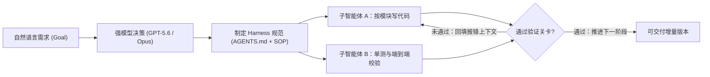

# AI编程范式笔记·羽升手记01-v0.3

<aside-note id="original-cover-title" kind="quote" title="核心命题">
当我们在聊 AI 编程的时候，我们到底在聊什么？从 Vibe Coding 到 Loop Engineering，从一句自然语言到一个能跑一整天的智能体系统——顺便，把这半年攒的省钱心得也算一笔账。
</aside-note>

本篇内容整理自作者本人的口述录音，讨论对象包括 GPT-5.6 / Codex、Claude Code、Cursor、Devin 等编程工具的实测体感，以及 harness engineering、loop engineering 等工程范式。文中标注的价格、速度、榜单信息经过检索核实，时效以 2026 年 7 月 13 日为准。

### 这篇笔记打算说清楚四件事

<timeline-block id="original-contents" title="全篇脉络">
- **01 范式篇** — 从一句话到一个系统：Vibe Coding、Harness Engineering 与 Loop Engineering 的演进边界
- **02 协议篇** — IDE、CLI、桌面 Agent，以及把它们连起来的 MCP 协议与模型梯队
- **03 选型篇** — 我这半年实测过的编程工具全记录与订阅倍率横评
- **04 省钱篇** — Token 经济学：缓存命中、上下文窗口管理与多模型分工如何省下 30 倍成本
- **附录** — 一份可以直接抄走复用的项目启动前置提示词（Pre-Dev Prompt）
</timeline-block>

### 写在前面

这篇东西的起因说起来有点绕。本来是跟人聊游戏开发，聊着聊着聊到了 GPT-5.6 在 Codex 里的表现，然后顺着就往下讲了模型分工、讲了架构、讲了 harness engineering、讲了 loop engineering，再往后又扯到了各家编程工具的定价、token 怎么算钱、国产模型怎么捡便宜——讲到最后我自己都愣了一下，心想这都扯到哪儿去了。

但仔细想想，这些东西其实是成体系的，只是我平时太散了，没坐下来好好理一遍。这半年折腾下来，脑子里攒的很多判断都属于信息差级别的东西——不是那种搜一下就有的公开资料，是真金白银烧出来的体感。所以这次干脆彻底捋一遍：范式怎么演进的、工具怎么分类的、钱是怎么花掉又是怎么省下来的。

我讲得通俗，但该专业的地方不会绕着走；例子基本都是我自己踩过的坑，没有的地方我会明确标出来，不瞎编。搜索核实过的信息我会注明，个人体感也会老实交代是体感，不装权威。

> 反正 AI 是个放大器，你把你听过的这些东西告诉它，它就能帮你迭代出一套新的范式，去更好地做事。

## 从一句话，到一个能跑一整天的系统

这一部分讲的是编程范式怎么一路演化过来的——从最早“我说你做”的 vibe coding，到现在动辄能跑几个小时甚至一整天的智能体系统。中间这几道坎，harness engineering、loop engineering，都不是编出来唬人的名词，是这半年真金白银试出来的分野。

## 1.1 先说结论：模型越强，跑起来反而越慢

最近在用 GPT-5.6 在 Codex 里做东西，一个很明显的体感是：这模型和别的比起来，会自动把一个任务拆解成好几个子任务，派出去几个子智能体分头干，同时在测试和回归验证上花的功夫特别多。好处很直接——你甚至只需要给一个比较模糊、简单的需求，它自己就能把任务拆得很清楚。但问题也很直接：这么干会把开发速度拖得很慢，大部分时间都花在测试、验证、还有它自己“想”上面了。

再加上一个很实际的数字：GPT-5.6 的 token 输出速度大概在每秒 50 个左右。上面这几条原因叠在一起，就导致像游戏开发、网站开发这种要疯狂堆代码量的活，用它做起来会明显偏慢。

<aside-note id="gpt-56-release-note" kind="addon" title="背景核实：GPT-5.6 的三档梯队与客户端合并">
GPT-5.6 是 OpenAI 在 2026 年 7 月 9 日正式全量发布的一代模型，对外分成三档能力/成本梯队：**Sol**（旗舰档）、**Terra**（均衡档）、**Luna**（最省成本档），另外还有面向长任务的 `max` 和面向复杂任务、多智能体拆分的 `ultra` 两个加强模式。这套“数字标世代、代号标能力档”的命名方式，是从 GPT-5.6 这一代才开始启用的，此前的 GPT-5.3-Codex、GPT-5.4 都还是单一模型。

同时，这次发布还顺手把 Codex 合并进了 ChatGPT 桌面端——原来的 Codex 桌面应用直接变成新版 ChatGPT 桌面端，国内讨论里常说的“GPT-5.6 在 Codex 里”，现在其实等价于在这个合并后的客户端里选 Codex 模式。（来源：OpenAI 官方发布页 `openai.com/index/gpt-5-6` 及 9to5Mac 等报道，核实于 2026-07-13）
</aside-note>

## 1.2 更现实的分工：谁决策，谁执行

其实大部分游戏开发真正的做法，是把前面的基建做扎实，等到后面要写大量代码的时候，想办法把活交接给别的模型去跑。但这个交接有个前提——任务必须尽可能拆得少、拆得细，因为其他模型拆解任务的能力确实不行，但这不代表它们执行一个边界明确的任务时也不行。

说白了：强模型负责想清楚“要干什么”，弱一点、便宜一点的模型负责把想清楚的事情“做出来”。这条分工线，后面会反复出现——它几乎是所有省钱思路的起点。

<html-embed id="decision-execution-balance" src="./embeds/decision-execution-balance/index.html" title="决策与执行：原稿中的分工线" height="580">
原文区分想清楚要干什么与把明确的事情做出来；这是分工示意，不更新模型排名、价格或能力判断。
</html-embed>

## 1.3 Codex 真正在拼的东西：长任务能力

GPT-5.6 在 Codex 里最强的一点，其实是长任务能力。除了 Claude Code 能勉强长时间干活以外，市面上 AI 辅助编程的工具少说也有几十个，但基本没有一个能连续工作哪怕几天、而且最终效果还不错的。

这事儿我琢磨了一下，大概是三个原因叠加：

1. **底座能力强**：5.6 这个模型本身的推理与规划上限确实高；
2. **子智能体分治**：Codex 里 5.6 会自动把长任务拆分交给子智能体，防止长任务下上下文一点点丢失；
3. **重度端侧验证**：它每一步的思考和决策都拉得很长，并且大部分时间和 token 都花在测试和验证上——写完代码要审查一遍有没有问题，然后自动把这个东西跑起来，还会一步一步截图，自己看看效果对不对。

## 1.4 拿游戏开发举例：完整链条长什么样

以游戏开发为例，主要要干的事情无非这五步：

- **想清楚** — 游戏内容、机制这些先用自然语言想好；
- **转架构** — 把自然语言的需求，转化成代码层面的整体架构；
- **写代码** — 把架构再转成真正能跑的代码；
- **审代码** — 代码审查加测试；
- **端到端测试** — 页面有没有问题，真人上去试玩、找 bug、改 bug，然后继续往里加内容、加关卡、加机制。

这五步说起来简单，但真正决定项目能不能撑到后期的，其实是第二步——架构。下一节细说。

## 1.5 为什么架构这么重要：单文件别超过 300 行

这里有个我一直很强调、但很少有人跟我讲清楚原因的点：为什么用 AI 开发一定要讲究架构？

道理其实很朴素——当一个项目越来越复杂，到了后期，不可能是几千行代码就能搞定的体量。而所有 AI 单次能输出、单次能输入的代码量都是有限的。所以更适合 AI 开发的方式，是把项目里不同的模块拆开：拿游戏举例，登录系统、商城系统、关卡系统、判断系统……每一个体系放一个文件夹，每个文件夹里，这个体系下的每个小板块只对应一个文件，单文件最好不要超过 300 行，文件名就直接写清楚这段代码是干什么用的。

这样做的好处很实际：等游戏开发到后期，我要新增某个关卡，肯定要同步加相关的道具、boss、商城里对应的东西——这时候 AI 只需要检索文件夹名字，就能准确定位到这几个板块在哪儿，不用把整个项目塞进上下文里现翻。

更好的开发流程，业内管它叫 **harness engineering**：提前把游戏的所有机制想清楚，同时文件夹怎么布局、文件怎么排布，也提前规划好。像“新增关卡”“新增角色”这类会反复出现的操作，在代码层面无非是各个模块都要同步新增一些东西——这时候就可以专门写一份 SOP（在 harness engineering 里，这类东西也被称为一种 harness）：这份 SOP 说清楚要跨越哪些文件夹、在哪些文件里新增什么样的东西。

为什么从长期视角看，这套规范特别重要？一个游戏刚开始做的时候，架构乱一点没关系，靠模型能力硬塞上下文也能顶住。但游戏做到后期，可能有 100 多个关卡，代码行数十几万甚至更多，这时候 AI 的上下文根本吞不下所有东西，尤其容易把不同板块的东西混到一起——越到后期修 bug 越难，连新增关卡都容易出岔子。反过来，如果前期架构打得好，这些问题能避开一大半，而且越到后期开发反而越快。关键就在于：一旦你把 harness、SOP 这套东西制定出来了——跟 skills 其实是一个逻辑——普通模型也能把活干得不错。

<inset-card id="harness-concept-card" eyebrow="CONCEPT" title="Harness Engineering：模型之外的运行时护栏" kicker="Agent = Model + Harness" tone="thesis">
**核心定义** — 这是 Martin Fowler 文章里给出的经典公式：模型（Model）是原始智力，而 Harness 是模型之外的所有运行时基础设施——告诉 Agent 在代码库里该怎么表现的规则文件、拦住劣质输出的校验循环、防止已知失败模式重演的质量关卡。说白了，**模型决定这个 Agent 有多聪明，Harness 决定它靠不靠谱**。

**实证案例** — LangChain 有个非常直观的测试：同一个模型完全不动，只是把外层的 Harness 换掉，在 Terminal-Bench 2.0 上的得分就从 52.8% 直接冲到 66.5%，排名从前 30 冲进前 5。模型没变，变的是模型外面那层系统——这也是为什么“架构比模型更重要”从来不是一句空话。（来源：`martinfowler.com/articles/harness-engineering.html`，核实于 2026-07-13）
</inset-card>



## 1.6 别的模型，长上下文之后基本守不住规矩

说回前面——其他几个模型放在不同的编程工具里，基本都做不到“长上下文之后仍然遵守规范”这件事。有时候 harness 定得很细，但只要任务一拉长，很多模型就开始出错。可我这半年用 5.6 开发的很多东西，哪怕连续跑了几个小时甚至一整天，遵守规范这件事做得都挺好。

结合前面说的游戏开发全流程，5.6 在 Codex 里基本都能扛住——也就是说，只要最前面的游戏设计做得足够好、token 也管够，完全可以直接基于自然语言把游戏做出来。但从长期视角看，想把游戏做大，前期定好项目规范依然很重要——也就是要去做 harness engineering，而这件事，现在完全可以交给 Codex 自己来做。

## 1.7 四个名词，一条演化线

但实际上，真要开发很多游戏的时候，大部分开发者不会把全部工作都交给 Codex。原因很现实：第一，速度太慢；第二，token 消耗太贵。所以一般的做法是：用最强的模型去做决策分析、制定 harness，把大任务拆解成一个个小任务——可以通过撰写 `docs/plans` 的方式，把一个大需求尽量拆成几个不相互耦合、便于执行的小 task——然后逐步交给便宜一些的模型去跑，每完成一个阶段，自己手动做端到端检查，看看有没有 bug。

现在大部分编程工具都支持子智能体调用，传统“写方案”的方式，就可以变成“每个 plan 交给一个子智能体执行，执行完再分配另一个子智能体做验证测试”。主智能体用最强的模型，子智能体用差一点的模型——这样不仅速度更快，质量也更高，还更省 token。业内把“一个任务对应几个子智能体”这套范式，简单地叫做 loop，对应的就是一个新概念：**loop engineering**——把一个需求拆分成多个 loop 逐一执行。

再往前倒，最古老的名词是 **vibe coding**——相对而言最老的一个说法，就是单纯描述自然语言，然后不管别的，让 AI 去做。在 GPT-5.6 出来之前，大家基本一致认为这种方式很难做出正经项目，顶多是个 demo。但现在有了 5.6，单纯的 vibe coding 已经完全可以撑起一个几万行的小型项目——一个小型项目基本能实现一个垂直领域的功能，或者一个小型游戏。

还有一个我记得当时听过、但自己没试过的说法，当时叫 agent engineering，前段时间挺火，现在也不怎么提了——指的是类似 Claude Code 里那种“agent team”，也是主智能体带一堆子智能体，不过它又升级了一点：多个“组”智能体，通过提示词优化，把它们变成各个领域的专家，一起讨论，一起分配工作。这套范式大概是六个月前提出的，那时候模型都还太差，长任务执行能力也很弱，所以这套范式大概率是搁置了——不过 5.6 出来之后，也许可以再试试。（注：英文语境里更接近的通用词是 Karpathy 提出的 **Agentic Engineering**，而多专家子智能体协作形态现在多被归入 Claude Code / OpenClaw 的 subagent 机制与 Loop Engineering 之下。）

<compare-block id="paradigm-comparison">
<compare-side role="bad" title="早期 Vibe Coding（单轮硬塞）">
只靠一句自然语言直接让模型生成代码，完全不设模块边界与文件上限；前期出 Demo 极快，但代码过万行后上下文迅速腐化，后期改一处崩一片。
</compare-side>
<compare-side role="good" title="Harness + Loop Engineering（分治闭环）">
先由强模型确立目录架构、`AGENTS.md` 与可复用 SOP，再将需求拆成独立小任务交给平价子智能体循环执行与自动验证，越到项目后期迭代越稳。
</compare-side>
</compare-block>

<timeline-block id="paradigm-timeline" title="四个核心范式词的演进时间线">
- **Vibe Coding（2025 年 2 月）** — Andrej Karpathy 在 X 上造的词，形容“完全放弃阅读 diff、报错直接复制粘贴进去”的写代码状态，后被韦氏词典收入俚语词条。
- **Agentic Engineering（2026 年初）** — Karpathy 本人对 Vibe Coding 的正名与升级，剥离“不读代码、图一乐”的刻板印象，强调速度与工程严谨性可以兼得。
- **Harness Engineering（2026 年上半年）** — 由 Martin Fowler、Thoughtworks 等工程博客系统化，围绕 `Agent = Model + Harness` 探讨模型外部的上下文、规则与验证护栏。
- **Loop Engineering（2026 年年中）** — 由 Claude Code 作者 Boris Cherny、OpenClaw 作者 Peter Steinberger 带火，Andrew Ng 在《The Batch》中专门撰文讨论：把单次响应升级为“动作→观察→决策→重复”的闭环，并用子智能体隔离主循环上下文。
</timeline-block>

## 1.8 再往深一层：5.6 强，但真正厉害的是 Codex 这套壳

单纯的 5.6，其实并没有传得那么离谱。真正厉害的是——5.6 这个模型放在 Codex 里，而 Codex 本身，是经过很多工程师不断调优出来的东西。说白了，一个 Codex，本质上对应的就是一整套非常完善的 harness engineering：上下文管理、功能设计、提示词优化……这些 Codex 其实都替你做得清清楚楚了。

简单讲，就是通过不断优化提示词、以及 Codex 后端这些智能体的多步调用和编排，指挥 Codex 把你最开始那句原始需求，拆分成多个任务，再多步调用子智能体去干规划、执行、测试验证这些活。如果你用账号管理工具去看后台，会发现你的一个任务，实际上可能在后台调用了几百次模型——包括 Claude Code 也是这样。

为什么非要多步调用？第一点很直接：如果把所有事情——思考决策、改写代码、截图、验证——都塞进一次模型调用里，上下文直接就爆了。1M token 的上下文，撑不过几轮对话，更别说撑几个小时甚至几天的长任务。

所以实际的流程更像是这样：分析你输入语言的意图，这是一次调用；分析完之后，把结果传给下一次调用，这次调用可能还要回头看看你的代码文件，再分析一遍；分析完再交给下一次调用——这次主要是调用 Codex 里的工具去增删代码；更新完之后，可能还要进行下一次调用，比如启动服务器、截个图，看看实际效果怎么样，发现有问题，再把参数传给下一次调用，继续分析，就这么不断循环下去。这整套机制，背后可能是 Codex 的工程师们花了上百次、甚至好几个月的调参调优，才做出一个真正好用的产品。

<aside-note id="codex-quote" kind="callout" title="核心判断" tone="thesis">
一个任务，后台可能调用了几百次模型——这套多步调用的编排能力，才是 Codex 真正的护城河，不是 5.6 这一个模型。
</aside-note>

这套“多步调用 + 子智能体编排”的机制，靠的就是模型能稳定地跟外部系统对话——数据库、终端、浏览器……这一层协议是什么、怎么工作的，是下一部分要讲的东西。

## 1.9 补一句：为什么最开始跑得慢，值得单独强调

回到最开始那个“5.6 跑起来慢”的点，这里要集中强调一下：慢的核心原因，是它把大量精力放在了端侧验证和测试上——但实际算下来，它做游戏开发的效率其实很低。至少到目前为止，我没见过哪个有经验的人，把编程工具系统性地组合起来，把开发速度真正提上去。所以对有能力的人，我的建议是：值得专门花时间研究一下编程工具本身，提升编程速度和开发速度这件事真的很重要，不是可有可无的细节。

一个游戏从零开始，做出 demo 是最简单的一步；但前期的架构规划，其实是最复杂、最容易被忽略的一步。规划做得好，后面确实会更快——但即使更快，也还是需要好几天的时间去持续迭代，因为你要不断往里加东西。而随着往里加的东西越来越多，你会逐渐发现，你要做的很多模块其实是成体系、相互依赖的：前面架构搭得不好，你对整个项目的了解程度就会越来越低；了解程度越低，你就越理不清楚自己到底要做什么，各个模块之间到底怎么勾连。

到这一步，你就只能把项目丢给更强的模型去帮你分析——但如果连模型都分析不清楚，那基本就废了，这个项目大概率会在某个时间点卡死，进也进不去、退也退不出。所以从长期视角看，前期那些看起来“耽误时间”的准备工作，其实才是真正省时间的地方。

## IDE、CLI、桌面 Agent 以及把它们连起来的协议

写到这儿我得先自首一下——上一部分明显扯远了，从游戏架构一路扯到范式演化。拉回来接着讲：编程工具现在长什么样、AI 怎么连到数据库和别的服务上、还有这几周刚冒出来的两个速度怪物模型该摆在梯队的哪一层。

## 2.1 广度比精通更重要——AI 是个放大器

我个人的判断是，至少到目前为止，还是要提升自己在技术方面的知识广度。不用说你真的会这些东西，至少得知道一下——知道之后，反正 AI 是个放大器，你把听过的这些东西跟它一说，它就能帮你迭代出一套新的范式，去更好地做事。而 AI 编程里最重要的两个东西，一个是 skills，另一个其实是 MCP 或者 CLI——这两个功能上感觉是很像的。

## 2.2 三种形态，各管一段

目前的编程工具，主要分三种：一种是 IDE（VS Code 是代表），一种是 CLI（Claude Code 是代表），另一种我称之为桌面端 Agent（Codex 是代表）。

桌面端 Agent 除了编程工作之外，还能操控你的电脑，干别的任何事，它有两个最关键的属性：第一，界面上只有一个对话框，看不到任何劝退新手的专业页面，一切都极简化，但能力照样很强；第二，可以同时运行很多个任务，在左侧任务栏统一管理。这种形态非常适合日常办公、一次性任务，以及任务方向明确之后，让 AI 自己一路推进下去。

但桌面端 Agent 的坏处也很明显：真涉及到比较复杂的游戏开发或者网站开发，到了后期，肯定要实时盯着文件夹结构，更新日志也得随时留存在项目 `docs` 里——每一次任务交接、每一次任务拆分，一般都放在项目 `docs` 文件夹里，这时候就得经常回去看整个项目的文件夹树结构。

这就是 IDE 派上用场的时候。对需要看代码的人来说，也必须在 IDE 里实时观测；而且在 IDE 里可以直接打开内置浏览器查看项目情况（现在桌面端 Agent 也开始支持这个了，这个功能挺重要的，能让你实时看到效果，然后定点指出哪里不对、该怎么改）。

再说 CLI——在桌面端 Agent 出现之前，CLI 和 IDE 其实搭配得挺好：IDE 里有各种插件，可以在里面调用 Codex 或 Claude Code，属于“一个页面、不同模型和工具”的集成环境；甚至在 IDE 里点开终端（一般在页面下方），就能直接敲 Claude Code 召唤 CLI——相当于在一个集成开发环境里，既能用最好的模型去决策，又能把活分给不同的模型去干。

所以一般情况下，正经开发一个项目，配置是 **IDE + 桌面端 Agent**：后者能同时派遣多个任务、跨文件夹工作很方便；前者主要负责看文件夹树结构、看文档这些。

<html-embed id="tool-shape-viewfinder" src="./embeds/tool-shape-viewfinder/index.html" title="切换看看：IDE、CLI、桌面 Agent" height="580">
三种抽象界面展示工作入口的差异，不是实际产品截图，也不声称一种工具只能有一种形态。
</html-embed>

## 2.3 从一个登录系统说起：MCP 到底解决什么问题

举个具体例子：一个游戏想从单机变成多人、从只是本地使用变成一个真正面向更多人的产品，一定需要至少一个登录系统；而只要涉及登录，就一定涉及数据库，用来存用户信息。传统配置数据库非常麻烦，配完之后要挂到生产环境，更麻烦。

这时候就会用到一类云端服务——最经典、也最适合 AI 开发的，是 Supabase 这种云端数据库。它完全挂在云端，更重要的是它有 MCP，可以接入 AI：就像你本地电脑上的 AI，可以通过 MCP 这个协议，直接打通到你云端账号的 Supabase 数据库上。这样一来，要加一个用户登录系统，AI 除了写本地代码，还能直接通过接口在云端建好数据库表格，项目部署也就顺理成章了。

不只是数据库——PS、3D 建模，以及更多别的服务，都可以很好地接入 MCP 或 CLI。把 AI 连到飞书，或者连到 OpenClaw 这类工具再接入各种 App，本质上走的都是 MCP 或者 CLI 这条路。理论上 Codex 甚至可以连到 Vercel（一个能把项目一键部署的代码托管平台）——再加上能连数据库，这么组合下来，基本就能让 Codex 写完代码之后自己部署、自己搭用户系统。

CLI 的覆盖面更广一些，翻译过来是“终端命令行工具”，可以简单理解成：AI 能在终端里敲指令，连到一堆服务上。Claude Code 就是一个 CLI。

<inset-card id="mcp-concept-card" eyebrow="PROTOCOL" title="MCP（Model Context Protocol）：AI 世界的 USB-C 接口" kicker="M × N → M + N" tone="good">
**协议初衷** — MCP 是 Anthropic 在 2024 年 11 月开源的一套标准，目的是打通 AI 应用和外部工具、数据源之间的连接。没有它之前，M 个 AI 应用要接 N 个外部系统（数据库、GitHub、Slack……），得写 M×N 份定制集成；有了 MCP，工具方只需要做一次 MCP Server，AI 应用只需要做一次 MCP Client，复杂度直接从 `M × N` 降成了 `M + N`。

**实战价值** — 落到具体开发场景里，只要 Supabase、Figma、Slack、飞书提供了 MCP Server，Claude Code、Codex 这些工具就能直接“看懂”并操作它们，不需要再单独写一套接口胶水代码。（来源：`anthropic.com/news/model-context-protocol`，核实于 2026-07-13）
</inset-card>

## 2.4 速度怪物：Grok 4.5 fast 和 SWE-1.7

继续说编程工具这一块——很多国产模型的速度其实比 GPT 快很多，甚至有些模型是专门为速度准备的，比如 Grok 4.5 fast；还有些高速模型，比如 SWE-1.7 fast，能达到每秒输出上千 token，编程起来那速度简直逆天。最关键的是，这两个模型是最近这两周才更新的，能力已经追到了顶级模型的档位——放在几个月前，高速模型基本都是“快是快，但笨”，没人真拿它当主力用；现在不一样了。

在任务拆分得比较好的前提下，能力强，意味着返工率低——你的需求能真正转化成可运行的代码；速度快，意味着一个需求刚提出来，可能几分钟这个功能就做出来了，接下来几分钟你自己测试，看看有没有问题，同时还能继续指挥模型去更新另一个功能——这样开发速度是真的快。

<aside-note id="fast-models-note" kind="addon" title="背景核实：Grok 4.5 与 SWE-1.7 的来龙去脉">
- **Grok 4.5**：Cursor 和 xAI 在 2026 年 7 月 8 日联合发布的模型，定位就是“Opus 级、但更快更便宜”——基础档 \$2/百万输入、\$6/百万输出，快速档 \$4/\$18；对照 Claude Opus 4.8 的 \$5/\$25，价格低出一截。它是在 Cursor 真实用户的代码交互数据上训练的，这块数据是别家模型厂拿不到的。
- **SWE-1.7**：Devin 背后 Cognition 公司的模型，基于 Moonshot 的 Kimi K2.7 Code 打底，配合 Cerebras 芯片做推理，实测能跑到每秒 1000 token，在多个 agent 编程基准上追近 GPT-5.5 和 Claude Opus 4.8 的水平。（来源：`cursor.com/blog/grok-4-5`、Cognition 报道，核实于 2026-07-13）
</aside-note>

## 2.5 模型天梯图——截至 2026 年 7 月 13 日

这张梯队表是我 7 月 4 日发的一版客观总结，现在按最新体感补进了 Grok 4.5 和 SWE-1.7 的位置，同时把几个随时间变化的事实更新到了 2026 年 7 月 13 日。

| 梯队 | 定位与特征 | 代表模型（按综合体感排列，同档不严格分先后） |
| --- | --- | --- |
| **第一梯队** | 全球最强决策与长程规划底座 | Claude Fable 5 / Mythos 5、ChatGPT 5.6（Sol） |
| **第二梯队** | 顶级主力与新一代高速高能模型 | Claude Opus 4.8、Claude Opus 4.7、ChatGPT 5.5、Grok 4.5（Cursor · 新）、SWE-1.7（Devin · 新） |
| **第 2.5 梯队** | 春节档最强与次旗舰守门员 | GLM 5.2、Claude Opus 4.6、ChatGPT 5.4、Claude Sonnet 5 |
| **第三梯队** | 高性价比主力与国产/开源中坚 | Claude Sonnet 4.6、Kimi K2.7 Code、GLM 5.1、Qwen 3.7 Max、DouBao Code 2.1、DeepSeek V4 Pro、Xiaomi MiMo V2.5 Pro、Gemini 3.1 Pro |
| **第四梯队** | 常规辅助与长尾模型 | 未列出的其余模型，大部分归入此档 |

<aside-note id="model-tier-takeaway" kind="callout" title="关于天梯图的说明">
排序按实际编码与 Agent 编排性能大致降序，同梯队内不严格分先后。梯队判断是结合真金白银的实际使用体感给出的综合排名，不是单一跑分榜单的排序——跑分和真实好用程度经常对不上，这点心里要有数。
</aside-note>

<aside-note id="fable-gpt-update" kind="addon" title="时效更新：Fable 5 额度延期与 GPT-5.6 全量铺开">
- **Claude Fable 5**：\$10/百万输入、\$50/百万输出（折合人民币输出侧约 350 元/百万 token）。至于“数日后订阅将无法使用”的传闻，Anthropic 已经把切断订阅额度的日期连续往后延了两次（从原定 7 月 7 日延至 7 月 12 日，7 月 13 日又延至 7 月 19 日），目前尚未真正掉出订阅池，但“随时可能断供”的状态没变。
- **ChatGPT 5.6**：7 月 4 日尚处于部分企业内测，7 月 9 日已正式全量上线，Sol / Terra / Luna 三档面向所有付费等级铺开。（核实于 2026-07-13）
</aside-note>

## 我这半年用过的编程工具全记录

下面是我实测过的各家编程工具汇总，以及它们价格上的对比。每家计费方式都不一样，所以我统一换算成“倍率”——相对于直接调 API、完全按量计费，这家工具的订阅制度大概能给到官方价的几倍额度。数字都是这半年自己充值、自己烧出来的体感，不是官方公示的精确数据，仅供参考，波动会比较大。

## 3.1 IDE 合集

### ① 字节跳动 TRAE

TRAE 分国内版和国际版。国内版，国产模型可以无限免费排队使用，但排队人数动辄上千；基础会员大概 90 元左右，能拿到 100 次免排队调用，比较适合结合 loop engineering 用——提前让顶级模型做好十几份 plan 文档，每份 plan 文档当一个 loop、调用一个子 Agent，一个任务大概能稳定跑几个小时，换算成 token 的话至少得消耗 100M 以上，这一次消耗如果换算成 GLM 5.2 的价格，大概要五十多块钱。

国际版是纯按量计费，里面最好的模型是 Opus 4.7——受出口管制影响，字节跳动走的是亚马逊那边的 Claude 模型，没有最新的 Opus 4.8、Fable 5 和 GPT-5.6，不过国外几个经典模型都还在。TRAE 里的 Solo 模型做 harness engineering，我个人感觉还不错，编排执行短任务和基础的长任务（几个小时左右）应该是可以的。订阅分 3 美元、10 美元、20 美元、200 美元四档，购买后分别给 5 美元、20 美元、80 美元、400 美元的基础 token 成本 + 赠金，赠金的量会随时间和他们自己的成本浮动，但按前段时间的平均水平看，赠金大概等于基础额度——简单粗暴地理解，算上赠金，这四档大概能用出 10 美元、40 美元、160 美元、800 美元的 API 额度，相当于 7 倍补贴。跟 Claude 或 Codex 动辄几十甚至上百倍的补贴比，明显差了不少。

### ② 腾讯 CodeBuddy / 美团 CatPaw / 阿里 Qoder

这几个各自的缺点都挺明显，不是很推荐。腾讯的 CodeBuddy 能力比较一般，他们做得比较好的其实是桌面端 Agent（后面会提到）。美团的 IDE 能力估计不太行——毕竟美团主业是送外卖，这个 IDE 怎么看都不太靠谱——不过它给新人送 500 次免费调用，能调用基本所有国产模型，对成本敏感的可以试试。

Qoder 能力确实不错，甚至他们的 harness 工程能让国产模型通过编排媲美 Opus 4.8 的能力，但把所有东西都开到极致，价格比直接调 Claude API 还高，倍率甚至跌破 1。整体不太推荐，不过他们自己的模型 Qwen 3.7 Max 夜间有 2 折优惠，算上这个，倍率能到 5；再加上他们模型本身也便宜，综合成本倍率能到 5–10，这个模型能力顶多能跟 Sonnet 4.6 打平。

### ③ VS Code Copilot

微软旗下的编程工具，最开始是按次计费，比如开个 10 美元会员大概能调 100 多次，但问题是国外模型太贵了，平均价格差不多是国内的 10 倍。国内模型按次计费勉强还行，国外模型按次计费——估计是把微软的羊毛薅秃了——现在基本变成纯按量计费，而且是所有编程工具里按量计费最贵的一个，倍率很难达到 3 倍以上，相当不推荐。

### ④ 最经典的 IDE：Cursor

首先性价比很高，能力也非常强——前面讲过 harness engineering 这套编排能力，直接决定模型在一个开发工具里能发挥出几成实力，这方面目前最顶尖的就 5 家：**Codex、Claude Code、Devin、Cursor、OpenCode**，具体谁比谁强没细测过，但都足够顶尖。

Cursor 对专业开发者最友好，专业向的功能很多；而且最近这些编程工具基本都支持右上角一键切换成桌面端 Agent 形态，样式跟 Codex 大同小异——互相抄嘛——功能也差不多。Cursor 的生态也不错，能通过 SSH 直接把电脑端 IDE 连到手机上，也支持云端运行，不只是本地跑，综合能力很强。

价格方面，它把额度分成两个池子：一个是 Auto + Composer 2.5 + Cursor Grok 4.5 的模型池，一个是 API 额度池。前者是 10 倍以上的补贴，后者 2–3 倍补贴，且只有月限额。第一个池子看着补贴少（10 倍），但摊到多次任务上消耗并不多，而且速度快，很适合即时开发。主要是自动池子里模型也便宜：Auto 能力大概对标 Sonnet 4.5；Composer 2.5 执行任务能力不错，决策层面不如 Sonnet 4.6；Cursor Grok 4.5 速度非常快，真实能力能对标 Opus 4.7，价格却只要几分之一。

Token 消耗这块确实复杂，得看模型、场景、任务类型三个维度一起算——这里我实在总结不动了。大致规律是：国产模型能力上很多能打，成本大概是国外模型的几分之一，一般在 1/3 到 1/5 左右；大部分编程工具给的补贴在 5–10 倍。简单理解：走官方正规渠道，用国产模型比用国外模型能省下大约 30 倍成本。

### ⑤ Devin

和 Cursor 逻辑差不多，同样是 IDE，计费是 20 美元会员，能用出将近 80 美元的额度。里面国内外模型也基本都有，这一点跟 Cursor 一样——国内外模型都有其实对省钱很重要，比如决策层交给最强的模型、前端设计交给设计强的模型、简单快速的任务交给最便宜的模型，剩下那些边界明确、任务清楚的活，交给代码能力强又便宜的模型。

<aside-note id="cursor-devin-multi-model" kind="quote" title="多模型混编的价值">
能在一个工具里调用所有厂商的模型，这本身就是个很重要的卖点——不用来回切工具，决策、执行、前端这些活直接在一个地方分给不同模型去干。
</aside-note>

Devin 还有一个好处：可以直接把你的项目连到它的云端环境，做端到端测试——不只是跑单元测试，是真的起一个沙盒环境，把你的应用跑起来，用浏览器点一遍，截图记录每一步操作，这个云端沙盒能力比很多工具的“本地跑一下看看”要扎实。

它分日限额和周限额，周限额大概是日限额的 2 倍。日限额对 Pro 账号（20 美元）来说，每天大概能用 5–10 美元的 API 等值额度。Devin 里的 SWE 模型免费用，不确定有没有上限；GLM 5.2 的 200k 上下文 High 思考模式限时免费，前两次免费周期结束后又延长了一周，不知道后面还会不会接着延。Kimi 模型一直免费，Kimi 是国产模型里前端设计最强的，能力大概对标 Sonnet 4.6，代码能力一般般，不算强——但靠这个部分免费的机制，其实也挺划算。

### ⑥ 亚马逊 Kiro

Pro 账号 20 美元一个月，给的是 1000 积分（官网已确认），简单对话大概消耗几个积分，复杂长任务能到几十甚至上百积分。

按我自己的工程量反推过一次汇率：同样去执行一些复杂度差不多的任务，在 TRAE 里大概消耗 10 元人民币左右的成本，换到 Kiro 里大概要吃掉 100–200 积分。一个 Pro 账号 1000 积分，粗暴换算下来大概能支撑将近 50 次这种量级的任务。简单粗暴地把这个补贴估成 2–6 倍——但我觉得这里面有个核心原因：Kiro 的 harness engineering 做得让 token 效率比较高，同时它的模型思考深度感觉偏低，所以比较省 token；说白了，省下来的钱，一部分是拿模型的思考深度换的——整体上模型在这个 IDE 里发挥出来的能力，感觉是有一定下降的。

<aside-note id="kiro-pricing-note" kind="addon" title="背景核实：Kiro 阶梯定价">
Kiro 目前的公开定价为 Free（50 积分）、Pro（20 美元 / 1000 积分）、Pro+（40 美元 / 2000 积分）、Power（200 美元 / 10000 积分），超出部分按 0.04 美元/积分补差。积分按任务复杂度做到小数点后两位的精细计费，简单编辑可能不到 1 积分。（来源：`kiro.dev/pricing`，核实于 2026-07-13）
</aside-note>

## 3.2 CLI 合集

上面提到的每个 IDE 基本现在都配了自己的 CLI，Claude Code 本身就是 CLI，Codex 也有自己的 CLI。最有名的 CLI 是 OpenCode——OpenCode 官方其实有两套订阅体系，叫 **Zen** 和 **Go**，拆开说清楚：

- **OpenCode Zen**：官方的按量计费网关，零加价，直接对接 OpenAI、Anthropic、Google 等厂商挑选过的模型，相当于一个官方中转版的 API 调用——就是正常按 token 计费，没有额外补贴也没有额外加价，胜在省心、不用自己管一堆 API key。
- **OpenCode Go**：官方的订阅制度。新用户第一个月 5 美元，之后 10 美元/月，打包了 GLM-5.2/5.1、Kimi K2.7 Code/K2.6、MiMo-V2.5-Pro、Qwen 3.7 Max、MiniMax M2.7、DeepSeek V4 Pro 等十几个开源模型，限额是按美元价值算的（不是按次数）：每 5 小时 12 美元、每周 30 美元、每月 60 美元，具体能跑多少次要看你用的是哪个模型（模型越贵，同样额度能跑的次数越少）。每个工作区只能有一个人订阅 Go。

闲鱼上那些标“OpenCode Go 会员”、大概 25 元左右的号，卖的就是通过新人注册/邀请等方式拿到折扣价的官方 Go 账号——这条链路本身是真实存在的官方机制。

<aside-note id="opencode-zen-go-note" kind="addon" title="背景核实：OpenCode 官方文档说明">
据 `opencode.ai` 官方文档，Zen 和 Go 均为 `sst/opencode` 团队官方维护的一等公民服务。Go 的限额确认为“每 5 小时 12 美元 / 每周 30 美元 / 每月 60 美元”的美元价值池。（来源：`opencode.ai/docs/go`、`opencode.ai/docs/zen`，核实于 2026-07-13）
</aside-note>

## 3.3 桌面端 Agent：Workbuddy

国产做得比较好的桌面端 Agent 是 Workbuddy，执行常识性任务其实一般，不过里面有专家团，而且技能库很多，一定程度上能让国产模型变得挺强，值得试试。

补一个更具体的成本体感：新人注册加上各种活动，大概能攒到 3000 多积分。实测下来，主要靠专家团去执行一个中等复杂度的任务，大概要消耗 500–1000 积分，而且积分消耗的速度是真的快——因为是积分制，没法精确摸清换算倍率，但可以确定的是：这东西比直接调用 API 肯定要贵，我目前的估计是大概贵 3–5 倍。就是说，Workbuddy 不是一个省钱工具，是一个“用积分换省心”的工具——专家团、技能库这些东西方便是方便，但账要算清楚，别指望它比直接调 API 便宜。

## 3.4 倍率总台账

把上面这些揉成一张表，“倍率”指的都是同一件事：花订阅的钱，相对直接按量调 API，大概能买到官方标价几倍的额度；小于 1 倍说明这工具比直接调 API 还贵。数字是体感估算，不是官方精确公示，仅供横向比较。

| 工具 | 形态 | 计费方式 | 大致倍率 | 备注 |
| --- | --- | --- | --- | --- |
| TRAE 国内版 | IDE | 会员 + 免排队额度 | ~7× | ¥90/100 次；适合配 loop engineering |
| TRAE 国际版 | IDE | 纯按量 | 1× | 走亚马逊 Claude，无 Fable / 5.6 |
| CodeBuddy（腾讯） | IDE | — | — | 能力偏弱，桌面 Agent 更值得看 |
| CatPaw（美团） | IDE | 新人 500 次免费 | — | 能力存疑，适合薅一轮 |
| Qoder（阿里） | IDE | 极致配置下 <1× | 5–10× | 吃自家 Qwen 3.7 Max 夜间 2 折 |
| VS Code Copilot | IDE | 按次 / 纯按量 | <3× | 国外模型贵约 10 倍，最不推荐 |
| Cursor | IDE | 双池：自动池 / API 池 | 10×+ / 2–3× | 可调全部模型；Grok 4.5 对标 Opus 4.7 |
| Devin | IDE | \$20 会员 → ~\$80 额度 | ~4× | 可调全部模型；支持云端端到端测试 |
| Kiro（亚马逊） | IDE | \$20 → 1000 积分（官方确认） | ~2–6× | 省 token 但模型思考深度感觉打折 |
| OpenCode Zen | CLI | 官方按量，零加价 | 1× | 正规 API 中转，胜在省心 |
| OpenCode Go | CLI | \$5–10/月，美元池限额 | ~6–7× | 打包 GLM / Kimi / DeepSeek 等开源模型 |
| Workbuddy | 桌面 Agent | 积分制，消耗快 | ~0.2–0.3× | 比直接调 API 贵 3–5 倍，图省心不图省钱 |

整体上：Claude / Codex 系的官方补贴通常在几十到上百倍，TRAE、Devin 这类大概在 5–10 倍，纯按量或者国外模型为主的工具（VS Code Copilot、Qoder 极致配置）补贴很少甚至倒贴。落地一句话：国产模型 + 官方正规渠道，比国外模型能省下大约 30 倍成本；具体怎么把这 30 倍抠出来，下一部分细讲。

## 怎么把钱省下来

各家工具的倍率说完了，但真正决定账单长什么样的，其实是怎么用 token——怎么管理上下文、怎么吃到缓存折扣、怎么把便宜的活派给便宜的模型。这一部分讲讲这背后的账，怎么算。

## 4.1 缓存命中：同一件事，付十分之一的钱

先说个更重要的事——比起纠结哪个工具的 bug 能省钱，我觉得更重要的是怎么高效利用 token、怎么省成本、怎么编排。举个例子：AI 计费分输入、输出、缓存命中三块。输出一般是输入的好几倍，缓存命中一般是输入的 0.1 倍。

缓存命中可以简单理解成：在同一个页面的多轮对话里，以大部分海外模型为例，只要在 5 分钟之内继续对话，前面所有 AI 输出过的东西、以及所有上下文，都已经缓存过一遍了，这时候计费按输入价格的 0.1 倍算——能极大程度地省成本。

在编程这个场景里，一般常见的缓存命中率在 95%–98%。同样都是用某个顶级模型，平均一次中长的编程任务，大概会消耗 10M token。没有缓存命中、缓存但接近未命中、缓存命中 95%、缓存命中 98% 相比，按常见的输入输出比 3:1 来算，真实消耗的 API 额度大概分别是：**\$200、\$105、\$19.5、\$13.8**。

这组数字是我自己按经验估算的，不同模型、不同工具的具体倍数会有出入，就是个数量级参考——但结论很稳：能不能吃到缓存折扣，成本能差出十倍以上。

<aside-note id="prompt-cache-math" kind="addon" title="背景核实：Prompt Caching 的读取折扣与写入溢价">
Anthropic 的 Prompt Caching 机制确实将命中的缓存内容按标准输入价的 10%（即 0.1 倍）计费。但需要注意：第一次把内容写入缓存时，需要多付一笔“写入费”——5 分钟有效期的缓存写入费是标准输入价的 1.25 倍，1 小时有效期则是 2 倍。简单说：只要同一段上下文在有效期内被命中一次，写入的溢价就已经赚回来了，之后每一次命中都是纯赚；但如果只调用一次而没有后续命中，反而会多付写入费。（来源：`platform.claude.com/docs/en/build-with-claude/prompt-caching`，核实于 2026-07-13）
</aside-note>

## 4.2 国内外模型的缓存窗口，差得不是一星半点

再补一个更关键的省钱点，也是国产模型便宜的另一个原因：缓存的有效窗口，国产模型普遍比国外模型长得多。国外模型的缓存命中窗口一般在 5 分钟左右——Claude 默认就是 5 分钟，要是愿意多付一笔写入成本，可以把这个窗口提到 1 小时。根据网友实测，Codex 这边的缓存命中窗口大概在 5 到 20 分钟，具体多长要看他们内部服务器的压力情况。

所以用国外模型的时候有个坑：如果你的两次调用之间间隔超过了缓存窗口——比如完成一个任务之后，五分钟内没有布置新任务，五分钟后才继续——那本来该按 0.1 倍计费的缓存命中，会直接变回 1 倍计费，你的额度一下子就会激增。

所以缓存命中率真的很重要。一般在 API 调用或者订阅面板里能看到一个综合的缓存命中数据，这个数字推荐保持在 95% 以上，最好能到 98% 左右，这样最省钱——这是编程场景下的平均水平。如果是执行一般任务，或者跟 OpenClaw 这类工具对话，缓存命中率大概只有 50%–80%，明显偏低，所以长期挂着 OpenClaw 这类工具跑，其实是比较费钱的。

反过来，以 DeepSeek 为代表的国产模型，缓存留存时间甚至能长到几个小时到一天之久——这个可以自己搜资料确认，是挺恐怖的一件事，极大程度上压缩了实际成本。不过其他国产模型能缓存多长时间，我没有一个个去研究过，不能一概而论。

<aside-note id="cache-window-comparison" kind="addon" title="背景核实：海外与国产模型的缓存留存窗口对比">
- **Anthropic**：默认缓存有效期为 5 分钟（2026 年初由默认的 1 小时调整为 5 分钟，付费 2 倍标准输入价可选回 1 小时档）。
- **OpenAI**：GPT-5.6 之前的型号通常 5–10 分钟失效（空闲时最长 1 小时），GPT-5.6 及之后型号提升至“至少 30 分钟”。
- **DeepSeek**：官方文档说明缓存“通常在几个小时到几天内自动清除”，比海外模型的分钟级窗口长了一个数量级，这也是其能将缓存命中价格压到每百万 token 0.0028 美元的原因之一。（来源：Anthropic、OpenAI 与 DeepSeek 官方 API 文档，核实于 2026-07-13）
</aside-note>

## 4.3 上下文一长，缓存也救不了你

所以说，怎么高效管理上下文非常重要。还有一点：一旦上下文过长，比如到了 200k 以上，这时候应该经常主动压缩，不然哪怕算上缓存命中，每一次对话依然是把全部上下文一起计费，花的钱照样会直线上升。

另外，有些任务天生很难拿到高缓存命中率——比如一直在输入各种新文件然后做总结，随着输入的东西越来越多，花的钱肯定也越来越多。这种场景就别指望靠缓存兜底了，该拆分任务、该分批处理，还是得老老实实做。

## 4.4 国产模型的价格优势，具体有多大

国产模型能力上很多确实能打，成本大概是国外模型的几分之一，一般在 1/3 到 1/5 左右；而大部分编程工具给的订阅补贴在 5–10 倍。也就是说，走官方正规渠道、用国产模型，大概能比用国外模型省下 30 倍左右的成本。

这个 30 倍不是一次性省出来的，是“模型本身便宜 3–5 倍” × “订阅补贴 5–10 倍”叠加出来的结果——这也是为什么前面反复强调“强模型决策、弱模型执行”这条分工线：把能省的环节，派给便宜又够用的模型去干，账单差距会被迅速拉开。

## 4.5 新人羊毛，和一个不算太稳的中转市场

很多编程工具都会给新用户一个月免费试用，这种机制很容易被拿来批量注册账号薅羊毛，所以现在对这类试用账号，大部分工具都上了限流之类的措施，玩法越来越难。

目前看相对稳定的是 OpenCode 邀请新人的机制——邀请一个新人，双方各得 5 美元资金，新人另外还有折扣，最低大概 1.99 美元就能换到 70 美元额度，而且用的是比较稳定的官方模型。

闲鱼上也有不少号称稳定的中转渠道，价格大概在 25 元左右，卖的是“OpenCode Go 会员”这类东西——因为这类会员是通过 API key 的方式使用，自己编程工具里额度用完了就换一把新 key，或者搞本地中转，中转搞好了就不用担心额度问题。折算下来大概 25 元能买到将近 70 美元成本，倍率在 18 倍左右；再叠加国产模型本身 3–4 倍的价格优势，还有省 token 的空间，理论上能压缩到很低的实际成本。

这块我如实记录，但得说句实话：这类二手中转渠道的稳定性、账号来源是否合规，我没法替你打包票——闲鱼这类市场变化很快，今天稳定不代表下个月还稳定，也存在违反对应平台服务条款的风险。想省钱可以，但账号安全和数据安全自己要有数，别为了省小钱把项目代码交到不知道底细的中转手里。

## 4.6 验证测试这一环，普通模型完全够用

最后一点：Codex 里大量时间花在验证测试上——说白了就是运行几个特定指令、写点测试文件、最后看编译结果对不对，这种活普通模型完全够用。把这一段单独摘出来交给便宜模型跑，也是实打实能省钱的一块。

这条其实呼应了第一部分那条分工线：决策交给强模型，执行、测试、验证这些边界清楚的活，交给便宜的模型——账单和效果，两头都能兼顾。

## 尾声：这些东西，其实一直是成体系的

写到这儿，从范式怎么演化、工具怎么分类、到钱怎么花怎么省，基本捋完了一遍。回头看，这些判断其实一直是成体系的，只是我平时讲的时候太散，想到哪儿说到哪儿。这次借着这篇笔记彻底理一遍，也算是把这半年攒的信息差，正式沉淀成一份能反复翻的东西。

AI 编程这个方向要总结的点还有很多，很多东西都可以继续细化、继续沉淀成方法论——简单的就是 skills，复杂一点的还有更多。这篇先到这儿，后面想到哪块该补，再单独开一篇细讲。

## 附录：一份可以直接抄的启动提示词

很多刚上手的人，习惯打开工具直接开聊，需求一出口 AI 立刻就开始写代码——这其实跳过了最关键的一步。下面这段提示词，作用类似一个 skill：贴给 AI 之后，它不会立刻动手写代码，而是先跟你把项目内容聊清楚，帮你把技术栈和 harness engineering（模块划分、架构规范、模型分工）定下来，最后才进入真正的开发。

这版和上一版最大的区别是：不再把“每个模块一个文件夹、单文件 300 行”当成放之四海皆准的铁律。那套说法是简化讲法，真实生产环境里，架构规范必须先由项目类型和技术栈决定——写网站用 TS 大概率是 Next.js 或 React，写 App 常见的是 Kotlin，写后端如果是 Python 生态大概率落到 FastAPI，如果后端也用 TS，那更可能是 Express.js 或 NestJS。

所以这一版把“定技术栈”单独提成第二步，而且明确要求 AI 自己去搜索确认，而不是凭训练数据里的旧印象拍脑袋。

```text
# 角色设定：开发前置顾问，不是代码生成器
你现在是我这个项目的开发前置顾问，不是代码生成器。在我们写下第一行正式代码之前，请你严格按下面六步来，不要跳步，不要一上来就直接写代码，也不要把下面任何一条当成不假思索套用的模板——每一步的产出都应该是你结合我的具体需求分析出来的，不是背出来的。

第一步 · 摸清需求
用自然语言问我：这个项目核心内容 / 机制是什么，目标用户是谁，大概规模量级（demo / 几万行小项目 / 成体系大项目），预计要迭代多久，有没有已经确定不能改的技术限制。别急着给技术方案，先把我脑子里的东西问清楚、问完整。

第二步 · 定技术栈（先搜索，再推荐）
根据第一步聊出来的项目类型，判断这更接近哪一类，并联网搜索当前（不是你训练数据里旧的）该类项目的主流技术栈组合，再给出推荐，附一句理由：
- 网站 / Web 应用，团队用 TS —— 优先考虑 Next.js（要 SSR / SEO / 全栈一体）或纯 React（只做前端、后端独立）
- 移动 App —— 原生 Android 优先 / 想跨端共享业务逻辑，考虑 Kotlin（或 Kotlin Multiplatform）；追求跨平台开发速度和一套 UI，对比 Flutter 或 React Native 再定
- 后端服务，团队用 Python，尤其涉及 AI / 数据处理 —— 优先 FastAPI
- 后端服务，团队用 TS —— 轻量中间层用 Express.js，需要更强的模块化 / 依赖注入用 NestJS
这份清单是判断起点，不是终点——如果搜到的最新信息和这里不一样，以你搜到的为准，并且要跟我确认这个选择，不要替我拍板。

第三步 · 画模块边界
基于第一步的内容和第二步定下的技术栈，列出这个项目大概有哪些相对独立的模块，并且按这个技术栈的社区惯例来组织（比如 Next.js 项目通常按路由 / 功能区分目录，FastAPI 项目常见按 routers / services / models 分层）——不要套用另一个技术栈的目录习惯。把这份划分列给我看，跟我确认有没有遗漏、有没有可以合并的。

第四步 · 定 harness，写进 AGENTS.md
基于前三步，给出这个项目具体的架构规范：文件 / 目录组织方式、单文件的合理体量参考（这个数字应该来自你对该技术栈惯例的判断，不是固定抄 300 行）、命名约定、哪些文件 / 目录属于“AI 不能碰”的边界。把这些写进项目根目录的 AGENTS.md——这是目前 Codex、Claude Code、Cursor 等主流工具都支持读取的标准格式，纯 Markdown，没有固定字段。只写真正非显而易见、AI 猜不到的东西（构建 / 测试命令、代码风格、架构约束、边界），不要把这个项目本身看一眼代码就知道的信息也塞进去——这类“看似详尽”的自动生成内容，反而会拖慢 AI 的执行、推高 token 成本。如果项目分成多个包 / 服务，可以在每个子目录下也放一份 AGENTS.md，只写这个子模块特有的规则，工具会自动逐级合并。同时把“新增一个功能 / 关卡需要跨越哪些文件”这类可复用 SOP，写进 docs/sop.md。

第五步 · 定 token 预算
告诉我：哪些环节应该用最强的模型做决策（整体架构、复杂 bug 分析、跨模块的判断），哪些环节可以派给便宜 / 开源模型执行（照着 SOP 清单增删代码、跑测试脚本、截图验证）。给我一个具体的分工建议，不要笼统地说“看情况”。

第六步 · 等我确认
把 1–5 步的结果汇总成一份简短方案给我看。在我明确说“可以开始”之前，不要动手写正式代码——可以写一个最小 demo 验证方向，但不要直接开始搭建完整项目。

# 使用方式：把以上内容整段复制，粘贴到对话开头，或存成 AGENTS.md / CLAUDE.md 之类的规则文件
```

这份提示词本身也是“先想清楚再动手”这条原则的实践——它逼着 AI（和你自己）在写代码之前，先把范式篇、协议篇里讲的那些东西过一遍：技术栈怎么选、模块怎么分、harness 怎么定、钱花在哪个模型上。用惯了直接开聊的人，第一次用这个可能会觉得“怎么还不让我写代码”，但这一步磨叽的时间，远比后期返工省下来的时间少得多。

### 技术栈怎么选：一张起点参考表

这张表是第二步提示词里那四条判断的展开版，核实过当前（2026 年）的社区共识——但记住它只是起点，真正落地前，还是应该让 AI 结合你的具体需求联网确认一遍，技术圈的“主流选择”半年就会挪一次位置。

| 项目类型 | 常见语言 | 推荐框架 / 技术栈 | 为什么 |
| --- | --- | --- | --- |
| 网站 / Web 应用 | TypeScript | Next.js（全栈一体、要 SSR/SEO）或 React（纯前端） | 生态最成熟，AI 训练语料最多，出错率低 |
| 移动 App | Kotlin / Dart / JS | Kotlin（Multiplatform）为主，Flutter / React Native 备选 | Android 原生质量优先选 Kotlin；纯跨端求快可以比较 Flutter 或 RN |
| 后端服务（通用 / AI 相关） | Python | FastAPI | 异步、自动生成接口文档、AI / 数据生态最好 |
| 后端服务（团队用 TS） | TypeScript | 轻量用 Express.js，需要强模块化用 NestJS | 和前端同语言，降低上下文切换成本 |

这张表背后有个通用逻辑：选一门 AI 训练语料里覆盖最广、社区约定最统一的语言/框架，不是选“最强”或者“最潮”的那个。AI 辅助开发时代，语言的受欢迎程度本身就是一种生产力——越主流的技术栈，AI 犯错的概率越低，能抄的现成模式也越多。

<inset-card id="agents-md-card" eyebrow="STANDARD" title="AGENTS.md 到底怎么写：重点是“少而准”" kicker="Linux Foundation · Agentic AI Foundation" tone="note">
**标准演进** — `AGENTS.md` 最早是 OpenAI 在 2025 年 8 月发起的约定，2025 年底并入 Linux 基金会旗下的 Agentic AI Foundation（跟 MCP 协议归在同一个基金会下面），到 2026 年年中已经有 28 个以上的工具原生支持、6 万多个开源仓库在用——Codex、Cursor、Devin、Copilot、Claude Code 都会读它。格式上没有任何强制字段，就是一份放在项目根目录的纯 Markdown，社区总结出来比较有效的几块是：项目概览、构建/测试命令、代码风格、测试方式、安全注意事项、提交/PR 规范。

**反直觉结论** — 研究表明，AI 自动生成的 `AGENTS.md`，反而会让任务成功率下降、成本上升两成左右——原因是 AI 会把项目里一看代码就知道的信息也啰嗦地写进去，模型会老老实实照着这些冗余内容去理解、去探索，拖慢速度还不解决问题。真正有效的 `AGENTS.md`，写的是“不看这份文件、AI 猜不到”的东西：非标准的构建命令、团队特有的代码风格约定、哪些文件绝对不能碰。项目大了以后，可以在每个子项目/包目录下各放一份 `AGENTS.md`，工具会自动从当前文件逐级往上合并。（来源：`agents.md` 官方站点、Augment Code 最佳实践研究，核实于 2026-07-13）
</inset-card>

